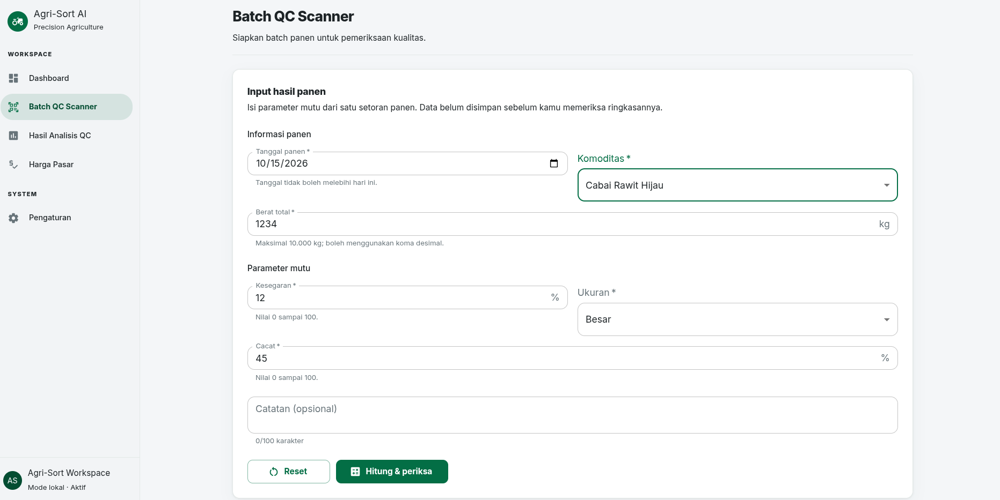
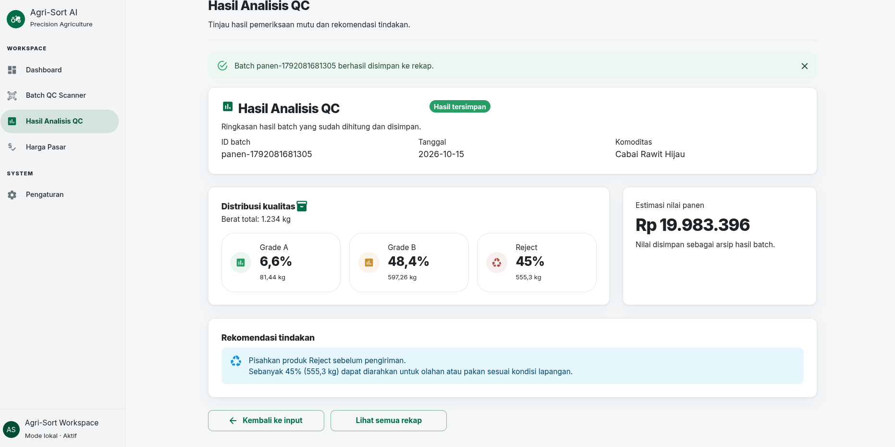
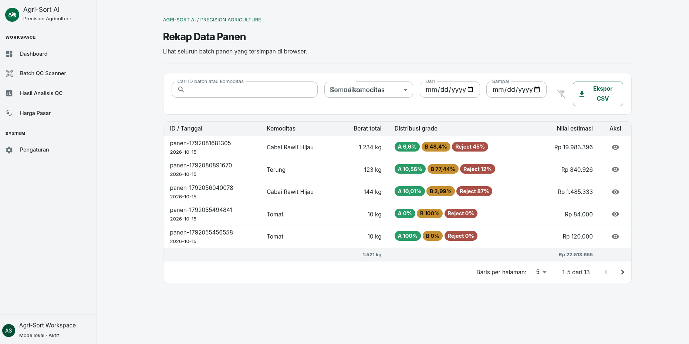

# Agri-Sort AI

Website Quality Control & Smart Pricing Hortikultura untuk petani dan pedagang di Payakumbuh.

Agri-Sort AI membantu mencatat hasil panen cabai rawit hijau, terung, dan tomat, mengkalkulasi distribusi mutu (grade) secara otomatis, dan memantau acuan harga pasar agar keputusan jual lebih tepat.

Target pengguna: petani, pedagang pengumpul, dan penjual di pasar.

Tech stack: React (Vite), Material UI (`@mui/material`, `@mui/icons-material`) sebagai library komponen UI, JavaScript (SPA tanpa backend). Penyimpanan data berbasis `localStorage` browser.

## Alur Inti

1. **Input Hasil Panen** — Pengguna memasukkan komoditas (cabai rawit hijau / terung / tomat), berat total (kg), dan parameter mutu (kesegaran, ukuran, cacat).
2. **Kalkulasi Distribusi Grade & Harga** — Sistem menghitung pembagian grade (A / B / C), estimasi harga per grade berdasarkan acuan harga pasar, dan total nilai panen.
3. **Lihat Rekap Data** — Pengguna melihat riwayat pencatatan, ringkasan distribusi mutu, dan perbandingan nilai antar panen di halaman rekap.

## Cara Menjalankan

### Prasyarat

- Node.js LTS (>= 18) dan npm.
- Git (untuk clone repositori).
- Browser modern (Chrome / Edge / Firefox terbaru).

### Clone Repo

```bash
git clone https://github.com/rizitakanashi-dev/steampreneur-agri-sort-ai.git
cd steampreneur-agri-sort-ai
```

### Install Dependensi

```bash
npm install
```

### Jalankan Server Development

```bash
npm run dev
```

Lalu buka URL yang ditampilkan di terminal (umumnya `http://localhost:5173`).

### Build Produksi (Opsional)

```bash
npm run build
npm run preview
```

## Tangkapan Layar Alur Inti

| Langkah | Deskripsi | Gambar |
|---------|-----------|--------|
| 1 | Input hasil panen |  |
| 2 | Kalkulasi distribusi grade & harga |  |
| 3 | Rekap data panen |  |

> Catatan: simpan tangkapan layar di folder `docs/bukti/` dengan nama `langkah-1.png`, `langkah-2.png`, `langkah-3.png`.

## Cara Menjalankan Pengujian

```bash
npm test
```

Perintah di atas menjalankan seluruh unit test di folder `tes/` menggunakan test runner bawaan Node.js (tanpa framework tambahan).

Hasil yang diharapkan: **57 test lulus, 0 gagal**.

| Berkas test | Jumlah | Cakupan |
|-------------|--------|---------|
| `tes/harvestCalculation.test.js` | 12 | Kalkulasi distribusi grade, harga, pembulatan Rupiah |
| `tes/harvestValidation.test.js` | 5 | Validasi field form input panen (termasuk penolakan berat `0.0`/`0,00`) |
| `tes/gradeValidation.test.js` | 5 | Validasi persentase Grade A/B |
| `tes/harvestStorage.test.js` | 4 | Penyimpanan `localStorage` (data kosong, JSON rusak, ID unik) |
| `tes/harvestProjection.test.js` | 5 | Proyeksi pendapatan pada Pricing Dashboard |
| `tes/harvestRecapChangeRequest.test.js` | 15 | Pencarian, filter kombinasi, ekspor data tersaring, total berat/nilai rekap |
| `tes/csvExporter.test.js` | 10 | Header CSV, angka murni, escape koma/kutip/newline |
| `tes/initialState.test.js` | 1 | State awal aplikasi |
| **Total** | **57** | 32 test alur inti + 25 test Change Request |

## Fitur dan Batasan

### Fitur

- Pencatatan hasil panen (komoditas, berat, parameter mutu)
- Kalkulasi distribusi grade (A / B / C) otomatis
- Estimasi harga per grade dan total nilai panen
- Acuan harga pasar cabai rawit hijau, terung, dan tomat
- Rekap dan riwayat data panen
- **Pencarian real-time** pada halaman Rekap (berdasarkan ID batch atau komoditas, tidak membedakan huruf besar/kecil)
- **Filter komoditas dan rentang tanggal** yang dapat dikombinasikan dengan pencarian
- **Ekspor CSV** data yang sedang tampil (hasil pencarian + filter aktif)
- SPA React tanpa backend, berjalan penuh di browser

### Halaman Rekap Data Panen

Halaman **Hasil Analisis QC → Lihat semua rekap** menampilkan seluruh batch yang tersimpan di browser.

1. **Mencari** — ketik ID batch atau nama komoditas pada kotak pencarian. Tabel tersaring langsung saat mengetik dan tidak membedakan huruf besar/kecil.
2. **Memfilter** — pilih **Komoditas** pada dropdown, dan/atau isi rentang tanggal pada kolom **Dari** dan **Sampai** (batas tanggal ikut dihitung). Pencarian dan filter dapat dipakai bersamaan.
3. **Mereset** — klik ikon **Reset filter** untuk mengembalikan semua filter ke keadaan awal.
4. **Mengekspor CSV** — klik **Ekspor CSV** untuk mengunduh **hanya baris yang sedang tampil**. Berkas dapat dibuka di Excel; baris pertama berisi nama kolom dan angka ditulis murni tanpa simbol `Rp` maupun pemisah ribuan (contoh: `15000`).

Jika tidak ada data yang cocok, tabel menampilkan pesan **"Data tidak ditemukan"**.

### Batasan

- Simulasi client-side: seluruh data tersimpan di `localStorage` browser
- Data tidak tersinkron antar perangkat/browser
- Data hilang jika cache/`localStorage` browser dihapus
- Acuan harga bersifat referensi dan perlu pembaruan manual
- Belum ada autentikasi, backend, maupun database server

## Struktur Folder

```
steampreneur-agri-sort-ai/
├── README.md
├── .gitignore
├── package.json
├── vite.config.js
├── index.html
├── docs/
│   ├── 01-spesifikasi.md … 08-penjelasan-kode.md
│   ├── analisis-change-request.md
│   └── bukti/                    (tangkapan layar hasil uji)
├── src/
│   ├── main.jsx
│   ├── App.jsx
│   ├── theme.js                  (tema MUI)
│   ├── index.css
│   ├── business/                 (logika bisnis, tanpa React)
│   │   ├── harvestCalculation.js
│   │   ├── harvestValidation.js
│   │   ├── harvestStorage.js
│   │   ├── harvestFilter.js      (pencarian & filter rekap)
│   │   ├── harvestProjection.js
│   │   └── priceReference.js
│   ├── components/               (komponen UI MUI)
│   │   ├── AppShell.jsx
│   │   ├── HarvestForm.jsx
│   │   ├── HarvestRecap.jsx
│   │   ├── QCResults.jsx
│   │   ├── PricingDashboard.jsx
│   │   ├── PriceTrendChart.jsx
│   │   └── PageHeader.jsx
│   └── utils/
│       └── csvExporter.js        (pembangun & pengunduh CSV)
├── tes/                          (unit test, dijalankan dengan `npm test`)
```

Catatan: struktur folder mengikuti konvensi Vite, sesuai izin pada lembar challenge. Logika bisnis dipisahkan dari komponen React agar dapat diuji tanpa render.

### Catatan Cakupan: fitur proposal vs implementasi challenge

Beberapa berkas dan kasus uji yang berasal dari proposal awal **tidak berada di repositori utama ini** karena berada di luar cakupan challenge (lihat `docs/01-spesifikasi.md` Bagian 5):

| Item | Status | Alasan |
|------|--------|--------|
| `bughunt-kasir/` (kode Bug Hunt Tugas 2) | Tidak ada di repo ini | Dikerjakan terpisah dari repositori utama aplikasi Agri-Sort AI. Rencana langkah 19 di `docs/02-rencana.md` masih berstatus Belum. |
| Kasus uji U07 (validasi foto blur / Laplacian Variance) | Tidak diuji | Fitur AI vision tidak diimplementasikan dalam versi challenge (frontend-only, tanpa unggah foto atau model YOLO/ONNX). |
| Kasus uji U08 (filter objek non-komoditas / confidence score) | Tidak diuji | Sama seperti U07 — inferensi model tidak tersedia di versi challenge. |
| Kasus uji U12 / kriteria K17 (`agrisort.harga_cache.v1`) | Tidak diimplementasikan | Tidak ada integrasi API harga BAPANAS, sehingga tidak ada cache offline yang perlu dibaca. Harga acuan adalah tabel tetap di `src/business/priceReference.js`. |

Semua nilai BPP (biaya pokok produksi) dan harga acuan di aplikasi ini adalah **data bawaan/simulasi (mock)** yang ditulis di dalam kode, bukan hasil pengambilan data nyata dari API mana pun.

## Sumber dan Lisensi

| Sumber | Lisensi |
|--------|---------|
| React | MIT |
| Vite | MIT |
| Material UI (`@mui/material`, `@mui/icons-material`) | MIT |
| Emotion (`@emotion/react`, `@emotion/styled`) | MIT |
| MUI X Charts (`@mui/x-charts`) — grafik tren harga | MIT |
| Google Fonts (Inter) | SIL Open Font License 1.1 |

Proyek ini dirilis di bawah lisensi MIT. Lihat file `LICENSE` bila tersedia.

## Informasi Tim

Proyek oleh siswa SMKN 4 Payakumbuh:

- **Faris Al Farizi** — Ketua / Navigator
- **Hieray Antovino** — Analis / Dokumentator
- **Ahmad Afif** — Penguji
