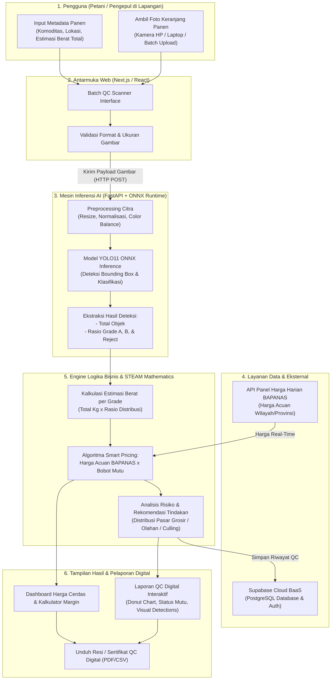
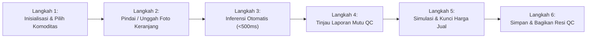
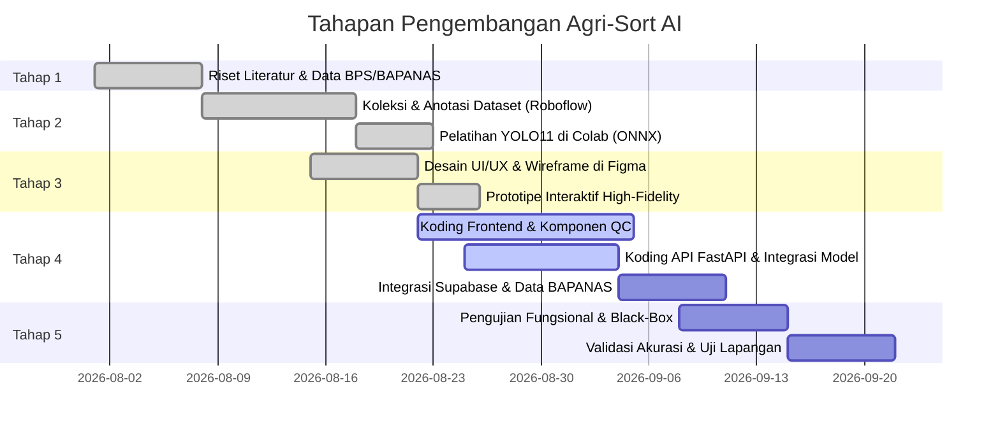
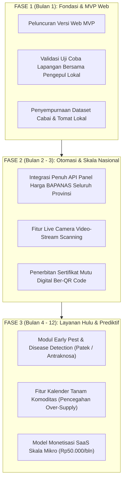

# Alur Kerja Proyek: Agri-Sort AI

> **Proposal STEAMPreneur SMK Tingkat Nasional Tahun 2026 — Solusi Nyata untuk Indonesia**  
> **Judul Karya:** *Agri-Sort AI: Web App Quality Control & Smart Pricing Berbasis Computer Vision untuk Pengepul dan Petani Hortikultura*  
> **Asal Sekolah:** SMK Negeri 4 Payakumbuh, Sumatera Barat  
> **Tim Pengembang:** Faris Al Farizi (Ketua Tim), Hieray Antovino (Anggota), Ahmad Afif (Anggota)  
> **Guru Pendamping:** Rogi Auvi, S.Pd  

---

## 1. Ikhtisar & Latar Belakang Alur

Komoditas hortikultura (khususnya cabai merah keriting, cabai rawit, dan tomat) memiliki tingkat pembusukan cepat dengan risiko kerusakan pasca panen (*food loss*) mencapai **15% – 25%**. Proses pemilahan manual (*sorting*) oleh pengepul/penampung membutuhkan waktu **2 – 4 jam per 100 kg**, bersifat subjektif, dan menimbulkan ketimpangan informasi harga yang merugikan petani.

**Agri-Sort AI** hadir dengan pendekatan holistik 5 pilar STEAM untuk merevolusi rantai pasok hortikultura melalui dua pilar inti:
1. **Automated Batch Quality Control (QC):** Deteksi kualitas berbasis *Computer Vision* (YOLO11 ONNX) dalam waktu **< 500 ms** per batch foto untuk mengklasifikasikan buah ke dalam **Grade A**, **Grade B**, dan **Reject (Tolak)** dengan akurasi $\ge 85\%$.
2. **Smart Pricing Recommendation:** Integrasi data panel harga harian **Badan Pangan Nasional (BAPANAS)** dengan algoritma pembobotan mutu panen untuk memberikan transparansi harga yang adil (*fair pricing*).

---

## 2. Diagram Alur Sistem End-to-End

Berikut adalah arsitektur aliran data dan pemrosesan dari hulu (pengambilan foto panen oleh pengguna) hingga ke hilir (rekomendasi harga cerdas dan pencatatan transaksi):

---

## 3. Alur Pengoperasian Pengguna (*User Journey*)

Alur kerja operasional harian yang dilalui oleh petani atau pengepul saat menggunakan aplikasi:

### Rincian Setiap Langkah Operasional:

1. **Langkah 1: Inisialisasi & Pemilihan Komoditas**
   - Pengguna memilih jenis hasil panen: **Cabai Merah Keriting**, **Cabai Rawit Merah**, atau **Tomat**.
   - Menentukan lokasi daerah panen (misal: Sumatera Barat) untuk mengaitkan acuan harga pasar lokal.
   - Memasukkan total estimasi tonase/berat keranjang panen (misal: 100 kg).

2. **Langkah 2: Pemindaian / Pengambilan Foto (*Batch QC Scanner*)**
   - Pengguna memotret keranjang panen dari tampak atas (*top-down view*) dengan pencahayaan memadai menggunakan kamera gawai atau mengunggah berkas foto (`.jpg`, `.png`).
   - Sistem melakukan pra-validasi format gambar sebelum diteruskan ke server API.

3. **Langkah 3: Pemrosesan Komputer & Deteksi Kualitas**
   - API Backend memproses foto menggunakan model **YOLO11 ONNX** yang dioptimalkan untuk CPU/GPU.
   - Waktu pemrosesan (*latency*) ditargetkan **kurang dari 500 ms** per batch foto.
   - Komoditas terdeteksi dan diklasifikasikan ke dalam 3 kelas:
     - **Grade A:** Segar sempurna, warna matang seragam, tanpa cacat kulit.
     - **Grade B:** Layak konsumsi, sedikit perubahan warna/cacat mekanis kecil.
     - **Reject:** Busuk, luka terbuka, terinfeksi jamur/bakteri (misal antraknosa/patek).

4. **Langkah 4: Tinjauan Hasil Laporan Kontrol Kualitas (*Digital QC Report*)**
   - Menampilkan visualisasi persentase mutu (contoh: 70% Grade A, 20% Grade B, 10% Reject).
   - Menghitung perkiraan konversi bobot fisik nyata (kg) per kategori mutu.
   - Memberikan rekomendasi penanganan pasca panen (misal: pisahkan reject segera untuk mencegah penularan pembusukan).

5. **Langkah 5: Penentuan Harga Cerdas (*Smart Pricing*)**
   - Sistem mengambil harga acuan harian terbaru dari BAPANAS.
   - Sistem menghitung harga wajar beli/jual dengan rumus penyesuaian mutu panen:
     $$\text{Harga Rekomendasi} = \left(\%A \times \text{Harga Acuan}\right) + \left(\%B \times \text{Harga Diskon B}\right) + \left(\%Reject \times \text{Harga Sisa/Rp0}\right)$$
   - Pengguna dapat mensimulasikan margin keuntungan sebelum transaksi disepakati.

6. **Langkah 6: Penyimpanan & Penerbitan Sertifikat Transaksi**
   - Riwayat data panen disimpan ke dalam database Supabase.
   - Pengguna dapat mengekspor dan membagikan bukti digital (*digital QC receipt*) kepada pembeli, supermarket, atau pedagang grosir untuk menjamin objektivitas mutu.

---

## 4. Integrasi 5 Pilar STEAM dalam Alur Sistem

| Pilar STEAM | Implementasi pada Alur Kerja Agri-Sort AI |
|---|---|
| **Science (Sains)** | Menerapkan prinsip fisiologi pasca panen, patologi tanaman, dan biologi buah (kadar air, perubahan pigmen klorofil/likopen, tanda serangan patogen jamur antraknosa & pembusukan bakteri) sebagai dasar pembagian kriteria Grade A, Grade B, dan Reject. |
| **Technology (Teknologi)** | Arsitektur *Computer Vision* terkini (YOLO11 diekspor ke ONNX runtime untuk eksekusi latensi rendah), backend API Python/FastAPI, frontend modern Next.js/Tailwind CSS & React, serta Supabase Cloud BaaS. |
| **Engineering (Rekayasa)** | Rekayasa alur data (*pipeline engineering*) terpadu: akuisisi citra $\rightarrow$ transfer beban komputasi $\rightarrow$ ekstraksi koordinat *bounding box* $\rightarrow$ kalkulasi logika bisnis penentuan mutu dan harga secara otomatis dan berulang tanpa degradasi performa. |
| **Arts (Seni/Desain)** | Perancangan UI/UX menggunakan Figma berprinsip *Human-Centered Design* dengan palet warna natural (*earthy green* / hijau tanah) yang ramah mata bagi petani dan pengepul di lapangan. |
| **Mathematics (Matematika)** | Penerapan statistik pembobotan kelas mutu, perhitungan persentase penyusutan (*food loss reduction*), rasio konversi bobot keranjang panen, deviasi harga pasar harian BAPANAS, serta formula kelayakan usaha (HPP, margin per unit, dan *Break-Even Point* / BEP). |

---

## 5. Alur Tahapan Pengembangan Proyek (*5-Phase Roadmap*)

Berdasarkan Proposal STEAMPreneur Bab 5.1 dan Bab 5.3, siklus hidup pengembangan karya disusun dalam 5 tahapan terstruktur:

### Rincian 5 Tahapan Pengembangan:
1. **Tahap 1 — Tinjauan Literatur & Analisis Data Sekunder:**  
   Pengumpulan data statistik fluktuasi panen cabai/tomat dari BPS dan laporan kehilangan pasca panen untuk merumuskan batasan masalah dan urgensi inovasi.
2. **Tahap 2 — Pengumpulan Dataset & Pelatihan AI:**  
   Pengumpulan ribuan citra cabai dan tomat dengan variasi kondisi (segar, bercak, busuk), pelabelan data menggunakan Roboflow, pelatihan transfer-learning YOLO11 pada GPU Google Colab, serta ekspor bobot ke format ONNX.
3. **Tahap 3 — Desain UI/UX & Alur Sistem di Figma:**  
   Penyusunan kerangka desain 4 layar utama (Landing Page, Batch Scanner, QC Digital Report, Smart Pricing Dashboard) dan penyusunan prototipe klik interaktif.
4. **Tahap 4 — Pengembangan Perangkat Lunak (Coding Sistem):**  
   Pembangunan antarmuka web responsif, pembuatan *microservice* inferensi berbasis FastAPI, serta integrasi layer penyimpanan Cloud Supabase.
5. **Tahap 5 — Pengujian & Evaluasi Validasi:**  
   Pengujian sistem secara menyeluruh melalui *Black-box Testing* fungsional serta uji metrik performa AI ($mAP@50 \ge 85\%$ dan kecepatan inferensi $< 500\text{ ms}$).

---

## 6. Rencana Skalabilitas Jangka Panjang (*Future Roadmap*)

Sesuai arahan pada Bab 7.2 Proposal STEAMPreneur, sistem dirancang untuk berkembang secara modular dalam 3 fase pertumbuhan:

---

## 7. Matriks Tanggung Jawab Tim (RACI)

| Komponen Alur Kerja | Faris Al Farizi *(Ketua Tim)* | Hieray Antovino *(Anggota 1)* | Ahmad Afif *(Anggota 2)* | Rogi Auvi, S.Pd *(Pembimbing)* |
|---|:---:|:---:|:---:|:---:|
| **Arsitektur Sistem & Alur Bisnis** | **A / R** | C | C | I |
| **Model AI & Computer Vision (YOLO11)** | **R** | A | C | I |
| **Desain Antarmuka UI/UX (Figma)** | C | **R** | A | I |
| **Pengembangan Frontend Web App** | C | **R** | **R** | I |
| **Pengembangan Backend REST API** | **R** | C | **R** | I |
| **Integrasi Data BAPANAS & Supabase** | **R** | C | **R** | I |
| **Uji Fungsional & Kasus Uji (Black-box)** | C | **R** | **A / R** | I |
| **Pengujian Lapangan Bersama Petani** | **R** | **R** | **R** | **A** |

*Keterangan:*  
- **R (Responsible):** Pelaksana teknis utama pekerjaan.  
- **A (Accountable):** Penanggung jawab kelengkapan dan kebenaran hasil.  
- **C (Consulted):** Memberikan masukan dan tinjauan teknis.  
- **I (Informed):** Mendapatkan laporan progres dan hasil akhir.
