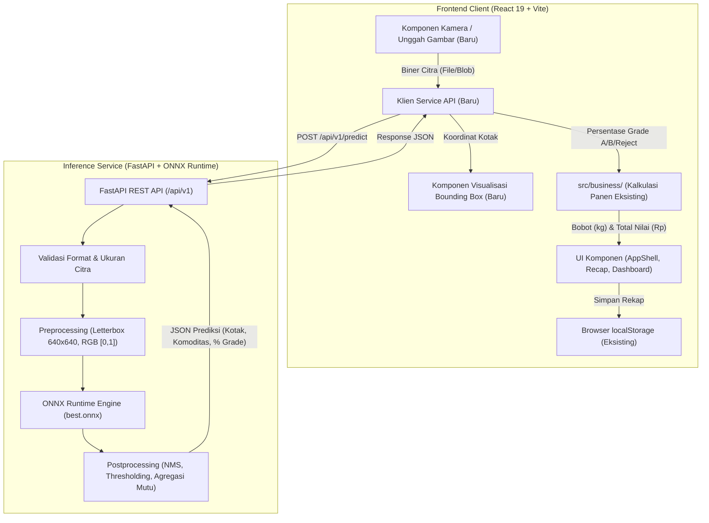

# Laporan Audit Teknis Komprehensif: Agri-Sort AI

**Tanggal Audit:** 3 November 2026  
**Repositori:** `/home/Rizi/agri-sort-ai`  
**Status Git:** Branch `main` (commit `cffd294`), Working Tree Clean  
**Tim Auditor:** Senior Multidisciplinary Engineering Team (Architect, Frontend, Backend, AI/ML, Database, QA, DevOps, Tech Lead)

---

## 1. Ringkasan Eksekutif (Executive Summary)

Audit teknis komprehensif ini dilakukan untuk mengevaluasi kondisi nyata (*as-is*) dari repositori **Agri-Sort AI** sebelum dilanjutkan ke tahap pengembangan berikutnya. Evaluasi mencakup arsitektur sistem, kode sumber frontend, logika bisnis, kesiapan backend, artefak model kecerdasan buatan (AI/ML), dataset, pengujian, keamanan, serta kesiapan operasional.

### Temuan Kunci Audit

1. **Status Arsitektur Aplikasi Saat Ini:**  
   Aplikasi Agri-Sort AI saat ini beroperasi murni sebagai **Client-Side Single-Page Application (SPA)** berbasis **React 19.3**, **Vite 8.3**, dan **Material UI (MUI) 9.5**. Tidak ditemukan server backend (Node.js/Express, Python/FastAPI, dsb.), tidak ada API REST/GraphQL, dan tidak ada database server eksternal (PostgreSQL, Supabase, SQLite). Seluruh persistensi data disimpan secara lokal pada browser melalui `localStorage`.

2. **Ketiadaan Integrasi Computer Vision:**  
   Meskipun dokumen spesifikasi dan proposal awal mencanangkan alur pemilahan mutu otomatis menggunakan Computer Vision (unggah foto, inferensi model deteksi objek, cek blur Laplacian), **fitur vision sama sekali belum terhubung ke dalam aplikasi frontend**. Input data panen pada halaman *Batch QC Scanner* (`HarvestForm.jsx`) saat ini sepenuhnya manual: pengguna mengetik sendiri persentase kesegaran, persentase cacat, ukuran buah, dan berat panen.

3. **Status Artefak Model AI & Ketidaksesuaian Kelas (Mismatch):**  
   Di direktori *root* repositori ditemukan dua arsip zip model: `Agri-Sort-AI-20261102T043857Z-1-001.zip` dan `model-export-20261102T064405Z-1-001.zip`. Berdasarkan inspeksi metadata biner ONNX (`best.onnx`) dan PyTorch (`best.pt`):
   - Model yang tersedia adalah **Ultralytics YOLO11n** (*nano object detection*).
   - Input tensor: `images` `[1, 3, 640, 640]` float32.
   - Output tensor: `output0` `[1, 5, 8400]` float32 (4 koordinat *bounding box* + 1 probabilitas kelas).
   - **Model hanya dilatih untuk 1 kelas tunggal:** `{0: 'fresh-tomato'}`.
   - **Tidak ada kelas untuk Cabai Rawit Hijau maupun Terung**.
   - **Tidak ada kelas penentu mutu/kualitas (Grade A, Grade B, Reject)**. Model ini hanya mampu mendeteksi keberadaan tomat segar, bukan menilai mutu panen hortikultura.

4. **Kualitas Kode Frontend dan Pengujian Unit:**  
   Pemisahan kode (*separation of concerns*) pada frontend sangat baik. Logika bisnis kalkulasi, validasi, filter, dan persistensi dipisahkan secara murni di direktori `src/business/` tanpa ketergantungan pada React. Terdapat **57 unit test** menggunakan *test runner* bawaan Node.js (`node --test`), dan seluruhnya **100% lulus (57 pass, 0 fail)**. Build produksi Vite berhasil tanpa error.

5. **Direktori Non-Proyek (`bughunt-kasir`):**  
   Ditemukan subdirektori `bughunt-kasir/` yang berisi kode tantangan kasir kantin STEAM. Folder ini sepenuhnya independen dan tidak terkait dengan sistem Agri-Sort AI.

---

## 2. Inventaris & Verifikasi Technology Stack

Berdasarkan inspeksi langsung berkas manifes (`package.json`, `package-lock.json`, `vite.config.js`) dan eksekusi perintah inspeksi lingkungan:

| Kategori | Teknologi | Versi Terverifikasi | Bukti Repositori |
|---|---|---|---|
| **Frontend Framework** | React | `19.3.0` | `package.json`, `package-lock.json` |
| **Bundler & Build Tool** | Vite | `8.3.4` | `package.json`, `vite.config.js` |
| **Komponen UI** | Material UI (`@mui/material`, `@mui/icons-material`) | `9.5.0` | `package.json`, `src/components/*.jsx` |
| **Styling Engine** | Emotion (`@emotion/react`, `@emotion/styled`) | `11.14.0` | `package.json` |
| **Visualisasi Data** | MUI X Charts (`@mui/x-charts`) | `9.15.0` | `package.json`, `src/components/PriceTrendChart.jsx` |
| **Bahasa Pemrograman** | JavaScript (ES Modules, ECMAScript 2022+) | Node.js v26 runtime | `package.json` (`"type": "module"`), ekstensi `.jsx`/`.js` |
| **Penyimpanan Data** | Browser `localStorage` | HTML5 Web Storage | `src/business/harvestStorage.js` (`key: agrisort.panen.v1`) |
| **Test Runner** | Node.js Test Runner bawaan (`node --test`) | Built-in Node | `package.json` (`npm test`), berkas `tes/*.test.js` |
| **Font** | Inter (Google Fonts) | SIL OFL 1.1 | `index.html`, `src/theme.js` |
| **Model AI (Arsip)** | Ultralytics YOLO11n | 8.4.198 (PyTorch 2.11.0 export) | `model-export/config/args.yaml`, metadata biner ONNX |
| **Format Model** | ONNX & PyTorch | ONNX Opset 18 / TorchScript | `best.onnx` (10,66 MB), `best.pt` (5,50 MB) di dalam zip |
| **Backend Server** | **Belum Ada** | *Not Implemented* | Tidak ditemukan berkas Express, FastAPI, atau server API |
| **Database Eksternal** | **Belum Ada** | *Not Implemented* | Tidak ditemukan klien Supabase, Firebase, Prisma, atau SQL |

---

## 3. Arsitektur Repositori

### Struktur Berkas & Direktori

```
/home/Rizi/agri-sort-ai/
├── Agri-Sort-AI-20261102T043857Z-1-001.zip   # Untracked: Berisi best.onnx, best.pt
├── model-export-20261102T064405Z-1-001.zip  # Untracked: Berisi weights, args.yaml, data.yaml, results.csv, kurva evaluasi
├── package.json                             # Konfigurasi dependensi dan skrip npm
├── package-lock.json                        # Kunci versi dependensi
├── vite.config.js                           # Konfigurasi Vite (@vitejs/plugin-react)
├── index.html                               # Entry point HTML aplikasi
├── README.md                                # Dokumentasi proyek, panduan instalasi, batasan cakupan
├── dist/                                    # Output build produksi Vite
├── src/                                     # Source code aplikasi frontend
│   ├── main.jsx                             # Mount root React, ThemeProvider, CssBaseline
│   ├── App.jsx                              # State router halaman, state batches, layout container
│   ├── theme.js                             # Konfigurasi kustom tema Material UI
│   ├── index.css                            # CSS global
│   ├── business/                            # Logika bisnis murni (bebas dependensi UI/React)
│   │   ├── harvestCalculation.js            # Kalkulasi distribusi grade, bobot, nilai panen, pembulatan
│   │   ├── harvestFilter.js                 # Logika pencarian real-time, filter komoditas/tanggal, total rekap
│   │   ├── harvestProjection.js             # Kalkulasi proyeksi pendapatan untuk Pricing Dashboard
│   │   ├── harvestStorage.js                # Operasi CRUD localStorage dengan penanganan ID bentrok
│   │   ├── harvestValidation.js             # Validasi input form panen (batas angka, koma desimal, dsb.)
│   │   ├── initialState.js                  # Pembuat state awal aplikasi
│   │   └── priceReference.js                # Simulasi tabel harga acuan & riwayat tren harga tetap
│   ├── components/                          # Komponen UI React (Material UI)
│   │   ├── AppShell.jsx                     # Layout shell navigasi (Sidebar Drawer & AppBar responsif)
│   │   ├── HarvestForm.jsx                  # Form input data panen & modal dialog ringkasan
│   │   ├── HarvestRecap.jsx                 # Tabel rekapitulasi batch terpaginasi, filter, & ekspor CSV
│   │   ├── PageHeader.jsx                   # Komponen judul dan deskripsi halaman
│   │   ├── PriceTrendChart.jsx              # Komponen grafik garis tren harga (MUI X Charts)
│   │   ├── PricingDashboard.jsx             # Dashboard harga pasar, simulasi volume, kalkulator margin/markup
│   │   └── QCResults.jsx                    # Tampilan hasil analisis distribusi mutu & kartu rekomendasi aksi
│   └── utils/                               # Modul utilitas pembantu
│       └── csvExporter.js                   # Serializer CSV sesuai standar RFC 4180 & trigger unduhan browser
├── tes/                                     # Pengujian otomatis (57 unit test)
│   ├── csvExporter.test.js                  # 10 test format CSV, escape karakter, angka murni
│   ├── gradeValidation.test.js              # 5 test validasi persentase Grade A/B
│   ├── harvestCalculation.test.js           # 12 test kalkulasi grade, Rupiah rounding, multiplier harga
│   ├── harvestProjection.test.js            # 5 test kalkulasi proyeksi pendapatan dashboard
│   ├── harvestRecapChangeRequest.test.js    # 15 test pencarian, filter kombinasi, total baris rekap
│   ├── harvestStorage.test.js               # 4 test penanganan localStorage kosong, error JSON, ID unik
│   ├── harvestValidation.test.js            # 5 test validasi field input panen
│   └── initialState.test.js                 # 1 test validasi state awal
├── docs/                                    # Dokumentasi analisis, spesifikasi, dan audit proyek
│   ├── 01-spesifikasi.md                    # Dokumen spesifikasi fungsional, formula, dan batasan
│   ├── 02-rencana.md                        # Rencana kerja dan pembagian tugas tim siswa
│   ├── 03-log-prompt.md                     # Riwayat interaksi prompt AI
│   ├── 04-kasus-uji.md                      # Matriks kasus uji K01-K25
│   ├── 05-kesalahan-ai.md                   # Catatan kesalahan kode yang dihasilkan AI dan perbaikannya
│   ├── 06-catatan-review.md                 # Catatan code review R01-R11
│   ├── 07-refleksi.md                       # Refleksi tim
│   ├── 08-penjelasan-kode.md                # Dokumentasi penjelasan kode per anggota
│   ├── analisis-change-request.md           # Analisis dampak perubahan fitur pencarian & ekspor CSV
│   └── bukti/                               # Bukti tangkapan layar pengujian UI & fungsional
└── bughunt-kasir/                           # Direktori terpisah: Tugas Tantangan Kasir STEAM
    ├── app.js, kasir.js, index.html, package.json, README.md, catatan-bug.md, tes/
```

---

## 4. Audit Fitur yang Ada (Existing Feature Audit)

| Fitur | Status Audit | Lokasi Implementasi | Keterangan & Batasan |
|---|---|---|---|
| **Layout Aplikasi Utama** | **Implemented** | `src/components/AppShell.jsx` | Layout responsif dengan Sidebar Drawer permanen pada layar desktop (`md`+) dan temporary drawer dengan tombol burger pada mobile. Menu aktif ditandai secara visual. |
| **Formulir Input Panen** | **Implemented** | `src/components/HarvestForm.jsx` | Form 7 field: Tanggal, Komoditas, Berat (kg), Kesegaran (%), Ukuran, Cacat (%), Catatan. Dilengkapi validasi interaktif dan dialog konfirmasi sebelum data disimpan. |
| **Kamera & Unggah Gambar** | **Not Implemented** | Belum ada | Tidak ditemukan tag `<input type="file">`, tidak ada komponen drag-and-drop, tidak ada akses `navigator.mediaDevices.getUserMedia()`, dan tidak ada validasi blur Laplacian. |
| **Deteksi AI Komoditas & Mutu** | **Not Implemented** | Belum ada | Tidak ada proses inferensi gambar. Seluruh distribusi mutu dihitung dari angka kesegaran dan cacat yang diketik manual oleh pengguna. |
| **Tampilan Hasil Analisis QC** | **Implemented** | `src/components/QCResults.jsx` | Menampilkan persentase Grade A, B, dan Reject, konversi berat (kg), nilai rupiah estimasi, dan alert rekomendasi pemisahan buah rusak. |
| **Rekapitulasi Data Panen** | **Implemented** | `src/components/HarvestRecap.jsx` | Tabel riwayat batch dengan pagination (5, 10, 25 baris), chip distribusi mutu, dan dialog modal detail per batch. |
| **Pencarian Real-time** | **Implemented** | `src/business/harvestFilter.js` | Pencarian substring *case-insensitive* berdasarkan ID Batch atau nama komoditas. Teruji di `harvestRecapChangeRequest.test.js`. |
| **Filter Multi-Kriteria** | **Implemented** | `src/business/harvestFilter.js` | Filter komoditas (dropdown) dan filter rentang tanggal (`tanggalDari`, `tanggalSampai`) dengan operator logika AND inklusif. |
| **Baris Total Rekapitulasi** | **Implemented** | `src/components/HarvestRecap.jsx` | `<TableFooter>` menghitung total berat kumulatif (kg) dan total nilai (Rp) dari baris yang sedang tampil pada halaman pagination aktif. |
| **Ekspor Berkas CSV** | **Implemented** | `src/utils/csvExporter.js` | Mengunduh berkas CSV dari data yang sedang tersaring. Mematuhi RFC 4180 (angka murni tanpa simbol Rp, escape kutip/koma/newline). |
| **Pricing Dashboard** | **Implemented** | `src/components/PricingDashboard.jsx` | Tabel harga acuan per komoditas, simulasi proyeksi pendapatan berdasarkan volume & proporsi grade, serta kalkulator margin/markup. |
| **Grafik Tren Harga** | **Implemented** | `src/components/PriceTrendChart.jsx` | Visualisasi grafik garis riwayat harga 4 pekan menggunakan `@mui/x-charts`. |
| **Integrasi API BAPANAS** | **Not Implemented** | `src/business/priceReference.js` | Harga acuan bersifat simulasi statis di dalam kode (tertanggal 13 Oktober 2026). Tidak ada koneksi API live ke Badan Pangan Nasional. |
| **Backend & REST API** | **Not Implemented** | Belum ada | Tidak ada server backend untuk menerima request inference atau sinkronisasi data. |
| **Database Persistence** | **Partially Implemented** | `src/business/harvestStorage.js` | Data tersimpan lokal di browser (`localStorage`). Belum ada database server multi-user. |

---

## 5. Audit Arsitektur Frontend

### Struktur Routing dan State Management
- **Routing:** Aplikasi menggunakan *custom conditional rendering router* di dalam [`src/App.jsx`](file:///home/Rizi/agri-sort-ai/src/App.jsx#L160-L225) melalui state `activePage` (`'overview'`, `'scanner'`, `'results'`, `'results-list'`, `'pricing'`). Tidak menggunakan pustaka routing pihak ketiga seperti React Router.
- **State Management:** Terpusat di `App.jsx`. Data batch panen dimuat saat `useEffect` pertama kali dieksekusi melalui `readBatches()` dari `localStorage`. Setiap penambahan batch baru diperbarui ke state React dan ditulis ulang ke `localStorage`.

### Penanganan Form dan Validasi
- Logika validasi form diisolasi di [`src/business/harvestValidation.js`](file:///home/Rizi/agri-sort-ai/src/business/harvestValidation.js).
- Aturan validasi yang ditegakkan:
  - Tanggal panen wajib diisi dan tidak boleh melebihi tanggal hari ini (`todayAsInputValue()`).
  - Komoditas wajib dipilih dari opsi: `'Cabai Rawit Hijau'`, `'Terung'`, `'Tomat'`.
  - Berat total wajib berupa angka > 0 dan $\le 10.000$ kg, mendukung koma desimal (`25,5` $\rightarrow$ `25.5`), serta menolak format nol desimal seperti `'0.0'` atau `'0,00'`.
  - Kesegaran dan cacat wajib berupa angka $0 \le x \le 100$ dengan maksimal 2 desimal.
  - Catatan maksimal 100 karakter.
- Alur form di `HarvestForm.jsx` dilengkapi *touched tracking* dan dialog ringkasan pratinjau sebelum data benar-benar disimpan.

### Logika Bisnis Frontend
Seluruh perhitungan dipisahkan secara murni pada direktori `src/business/`:
1. **Formula Pembagian Grade (`harvestCalculation.js`):**
   $$\text{Reject (\%)} = \text{cacatPersen}$$
   $$\text{Grade A (\%)} = \frac{(100 - \text{cacatPersen}) \times \text{kesegaranPersen}}{100}$$
   $$\text{Grade B (\%)} = (100 - \text{cacatPersen}) - \text{Grade A (\%)} $$
   *Catatan:* Jumlah $\text{Grade A} + \text{Grade B} + \text{Reject}$ selalu tepat 100%.
2. **Formula Pembobotan (Kg):**
   $$\text{Berat}_{\text{grade}} = \text{Berat Total} \times \frac{\text{Persentase}_{\text{grade}}}{100}$$
3. **Formula Nilai Finansial (Rp):**
   $$\text{Nilai}_{\text{grade}} = \text{roundRupiah}(\text{Berat}_{\text{grade}} \times \text{Harga Acuan} \times \text{Pengali Mutu} \times \text{Pengali Ukuran})$$
   - Pengali Mutu: Grade A = 1,00; Grade B = 0,70; Reject = 0,30.
   - Pengali Ukuran: Besar = 1,00; Sedang = 0,90; Kecil = 0,80.
   - Fungsi `roundRupiah()` menggunakan `Number(value.toFixed(9))` sebelum `Math.round()` guna mencegah kesalahan pembulatan angka pecahan IEEE 754.

### Kesiapan Frontend Terhadap Backend API
- **Kondisi Saat Ini:** Frontend sama sekali **belum memiliki lapisan API client**. Tidak ada konfigurasi Axios, tidak ada pemanggilan `fetch()`, tidak ada konfigurasi `VITE_API_BASE_URL`, dan tidak ada mekanisme pengunggahan file multipart.

---

## 6. Audit Backend & Kesiapan API

### Status Backend Saat Ini
- **Status:** **TIDAK ADA (NOT IMPLEMENTED)**.
- Repositori tidak memiliki direktori backend, berkas konfigurasi Python (`requirements.txt`, `pyproject.toml`), Dockerfile, maupun script entry point server.

### Evaluasi Pemilihan Stack: Python + FastAPI + ONNX Runtime
Penggunaan **Python + FastAPI + ONNX Runtime** sangat direkomendasikan sebagai arsitektur backend inferensi untuk tahap integrasi AI:
1. **Performa & Jejak Memori Rendah:** ONNX Runtime berjalan pada CPU menggunakan kernel C++ teroptimasi. Tidak membutuhkan runtime PyTorch utuh (~2 GB download & >800 MB RAM). Paket `onnxruntime` hanya ~20 MB dengan konsumsi memori < 150 MB RSS.
2. **Asinkron & Dokumentasi Otomatis:** FastAPI mendukung endpoint asinkron (`async def`), integrasi Pydantic untuk validasi skema request/response, dan otomatis menyediakan Swagger UI di `/docs`.
3. **Siklus Hidup Model (Lifespan):** Model `best.onnx` dapat dimuat sekali saat startup aplikasi (`@asynccontextmanager lifespan`) dan digunakan kembali untuk setiap request tanpa overhead pemuatan ulang.

### Rekomendasi Kontrak API Minimal

#### 1. `GET /api/v1/health`
- **Tujuan:** Pengecekan kesiapan layanan dan status model di memori.
- **Response `200 OK`:**
  ```json
  {
    "status": "healthy",
    "timestamp": "2026-11-03T12:00:00Z",
    "model_loaded": true,
    "version": "1.0.0"
  }
  ```

#### 2. `GET /api/v1/model/info`
- **Tujuan:** Memberikan informasi metadata teknis model kepada frontend.
- **Response `200 OK`:**
  ```json
  {
    "model_name": "agri-sort-yolo11n",
    "input_shape": [1, 3, 640, 640],
    "classes": ["fresh-tomato"],
    "supported_commodities": ["Tomat"]
  }
  ```

#### 3. `POST /api/v1/predict`
- **Tujuan:** Menerima unggahan foto keranjang panen, menjalankan inferensi deteksi objek, dan mengembalikan koordinat kotak serta estimasi distribusi mutu.
- **Request:** `multipart/form-data` dengan parameter `file` (citra biner JPEG/PNG/WebP, maksimal 5 MB).
- **Response `200 OK`:**
  ```json
  {
    "inference_id": "inf-20261103-001",
    "inference_time_ms": 32.5,
    "detected_commodity": "Tomat",
    "total_objects": 15,
    "distribution": {
      "grade_a_pct": 80.0,
      "grade_b_pct": 13.33,
      "reject_pct": 6.67
    },
    "detections": [
      {
        "box": [120.5, 84.0, 290.2, 260.4],
        "class_id": 0,
        "class_name": "fresh-tomato",
        "confidence": 0.945
      }
    ]
  }
  ```

---

## 7. Audit AI Model & Computer Vision (AI/ML Audit)

### A. Inventaris dan Identifikasi Model

Pemeriksaan mendalam terhadap isi arsip `model-export-20261102T064405Z-1-001.zip` menghasilkan data teknis sebagai berikut:

| Parameter | Nilai Terverifikasi | Sumber Bukti |
|---|---|---|
| **Arsitektur Model** | Ultralytics YOLO11n (Nano Object Detection) | `args.yaml` (`model: yolo11n.pt`) |
| **Framework Pelatihan** | PyTorch 2.11.0 / Ultralytics 8.4.198 | Metadata ONNX biner (`version: 8.4.198`) |
| **Format Berkas** | ONNX (`best.onnx`, 10.663.419 bytes) & PyTorch (`best.pt`, 5.505.562 bytes) | Isi arsip zip |
| **Tugas Model (Task)** | Deteksi Objek (`task: detect`, head: `Detect`) | `args.yaml`, metadata ONNX |
| **Tensor Input** | `images`: `[1, 3, 640, 640]`, Tipe: Float32 | Dekode protobuf biner `best.onnx` |
| **Tensor Output** | `output0`: `[1, 5, 8400]`, Tipe: Float32 | Dekode protobuf biner `best.onnx` |
| **Dekomposisi Saluran Output** | 4 koordinat bounding box ($cx, cy, w, h$) + 1 probabilitas kelas = 5 saluran | Perhitungan matematis dimensi output YOLO11 |
| **Jumlah Kelas Terlatih** | **1 Kelas** (`nc: 1`) | Tensor output saluran 5 & metadata biner |
| **Daftar Label Terlatih** | `{0: 'fresh-tomato'}` | Metadata ONNX & atribut `names` pada `best.pt` |

### B. Audit Dataset & Kontradiksi Versi

Ditemukan **ketidaksesuaian kritis (inconsistency)** antara berkas konfigurasi `data.yaml` dengan bobot model yang tersimpan:
1. Berkas `model-export/config/data.yaml` mencantumkan:
   ```yaml
   nc: 2
   names: ['fresh-tomato', 'rotten-tomato']
   roboflow:
     workspace: rizi-takanashi
     project: agri-sort
     version: 2
   ```
2. Berkas konfigurasi pelatihan aktual `model-export/config/args.yaml` mencatat:
   ```yaml
   data: /content/agri-sort-1/data.yaml
   model: yolo11n.pt
   epochs: 50
   batch: 16
   imgsz: 640
   ```
3. **Analisis Bukti:**
   Model `best.onnx` dan `best.pt` dilatih menggunakan dataset versi 1 (`agri-sort-1`), yang hanya memiliki 1 kelas (`fresh-tomato`). Ketika dataset di Roboflow diperbarui ke versi 2 (`agri-sort/2`) dengan menambahkan kelas `rotten-tomato`, konfigurasi `data.yaml` versi 2 dimasukkan ke dalam zip ekspor, namun model yang diekspor **belum dilatih ulang pada versi 2 tersebut**.
   
   Hal ini dibuktikan secara mutlak oleh bentuk tensor output `[1, 5, 8400]`. Jika model memiliki 2 kelas, saluran tensor output wajib berjumlah $4 + 2 = 6$ (`[1, 6, 8400]`).

### C. Evaluasi Metrik Pelatihan
Berdasarkan berkas riwayat `model-export/config/results.csv` pada epoch ke-50:
- **Presisi ($B$):** 98,14% (0.98139)
- **Recall ($B$):** 92,54% (0.92541)
- **mAP@50 ($B$):** 96,43% (0.96425)
- **mAP@50-95 ($B$):** 89,12% (0.89123)
- **Validation Box Loss:** 0.3683
- **Validation Class Loss:** 0.2860

> [!CAUTION]
> **Kesimpulan Kesiapan Model AI:**  
> Meskipun akurasi deteksi untuk tomat segar sangat tinggi (>96% mAP50), **model saat ini sama sekali TIDAK BISA digunakan untuk penilaian kualitas (grading)**:
> 1. Tidak memiliki kelas untuk Cabai Rawit Hijau dan Terung.
> 2. Tidak mendeteksi cacat, busuk, atau penyakit pada tomat (`rotten-tomato` tidak ada di bobot model).
> 3. Tidak menghasilkan klasifikasi Grade A, Grade B, atau Reject.

---

## 8. Audit Penyimpanan Data & Logika Harga

### Persistensi Data (`src/business/harvestStorage.js`)
- **Penyimpanan:** HTML5 `localStorage` dengan kunci `'agrisort.panen.v1'`.
- **Format Data:** Array JSON yang berisi objek rekaman batch panen (ID batch unik, tanggal, komoditas, berat, parameter mutu, hasil kalkulasi distribusi grade, dan total nilai rupiah).
- **Keandalan:** Dilengkapi fungsi `readBatches()` yang aman terhadap kegagalan parsing JSON rusak (mengembalikan `[]`) dan generator ID `createUniqueId()` yang mencegah benturan ID ganda dengan menambahkan suffix `-2`, `-3`.
- **Evaluasi:** Sangat memadai untuk prototipe satu pengguna pada satu perangkat. Rentan hilang apabila cache browser dihapus.

### Logika & Acuan Harga Pasar (`src/business/priceReference.js`)
- **Sumber Harga:** Tabel simulasi statis di dalam kode, tertanggal 13 Oktober 2026.
  - Cabai Rawit Hijau: Rp 30.000 / kg
  - Terung: Rp 10.000 / kg
  - Tomat: Rp 12.000 / kg
- **Status API BAPANAS:** **TIDAK DIIMPLEMENTASIKAN**. Baik dokumen kode maupun antarmuka pengguna secara jujur menyatakan bahwa data harga adalah simulasi dan bukan data live dari Badan Pangan Nasional.
- **Karakteristik Harga:** Menggunakan pengali mutu (Grade A: 100%, Grade B: 70%, Reject: 30%) dan pengali ukuran (Besar: 100%, Sedang: 90%, Kecil: 80%).

---

## 9. Pengujian & Kualitas Kode (Testing & QA)

### Eksekusi Unit Test Bawaan
Pengujian dijalankan melalui perintah `npm test` (`node --test tes/*.test.js`):
- `tes/csvExporter.test.js`: 10 test lulus
- `tes/gradeValidation.test.js`: 5 test lulus
- `tes/harvestCalculation.test.js`: 12 test lulus
- `tes/harvestProjection.test.js`: 5 test lulus
- `tes/harvestRecapChangeRequest.test.js`: 15 test lulus
- `tes/harvestStorage.test.js`: 4 test lulus
- `tes/harvestValidation.test.js`: 5 test lulus
- `tes/initialState.test.js`: 1 test lulus
- **Total:** **57 test lulus, 0 gagal (durasi ~424 ms)**.

### Eksekusi Build Produksi
Pengujian kompilasi dijalankan melalui `npm run build` (`vite build`):
- Hasil: Berhasil dengan exit code 0 dalam 1,78 detik.
- Catatan: Terdapat peringatan berkas chunk JavaScript `dist/assets/index-ClCxFfZK.js` berukuran 904 kB (>500 kB) karena penggabungan seluruh Material UI dan MUI X Charts tanpa *code-splitting*.

### Kesenjangan Pengujian (*Test Gaps*)
1. Tidak ada unit test untuk komponen React (belum ada `@testing-library/react` atau jsdom).
2. Tidak ada pengujian end-to-end (E2E) antarmuka pengguna (Cypress atau Playwright).
3. Tidak ada pengujian inferensi model AI atau decoding gambar.

---

## 10. Kesiapan Keamanan & Deployment

### Keamanan Aplikasi
- **Sanitasi Masukan:** Validasi tipe data dan batasan angka pada `harvestValidation.js` mencegah manipulasi nilai di luar logika bisnis.
- **XSS & Injeksi:** React meng-escape nilai string secara otomatis. Tidak ditemukan penggunaan `dangerouslySetInnerHTML`.
- **Kerahasiaan Kredensial:** Repositori bersih; tidak ada API Key, secret token, atau password yang bocor dalam kode.

### Kesiapan Deployment
- **Frontend SPA:** Sangat siap dideploy ke layanan hosting statis (Cloudflare Pages, Vercel, Netlify, atau GitHub Pages) cukup dengan mengunggah folder `dist/`.
- **AI & Backend:** **Belum siap dideploy**. Memerlukan pembuatan container Docker yang membungkus FastAPI dan ONNX Runtime.

---

## 11. Matriks Analisis Kesenjangan Fitur (Feature Gap Matrix)

| Fitur | Status Saat Ini | Implementasi Yang Ada | Kebutuhan Yang Kurang | Rekomendasi Tindakan | Prioritas |
|---|---|---|---|---|---|
| **Input Data Panen** | Implemented | `HarvestForm.jsx` (manual) | Tidak ada untuk input manual | Pertahankan sebagai alur fallback/koreksi | Rendah |
| **Pemilihan Komoditas** | Implemented | Dropdown di `HarvestForm.jsx` | Deteksi otomatis dari gambar | Tambahkan deteksi otomatis via AI | Sedang |
| **Integrasi Kamera** | Not Implemented | Belum ada | Akses webcam / kamera smartphone | Bangun komponen kamera HTML5 di React | Tinggi |
| **Unggah Foto Panen** | Not Implemented | Belum ada | File input, drag-and-drop, preview | Bangun komponen upload file di form | Tinggi |
| **Deteksi Komoditas (AI)** | Not Implemented | Model tomat ada di arsip zip | Integrasi web app; kelas Cabai & Terung | Latih ulang model untuk 3 komoditas | Kritis |
| **Klasifikasi Mutu (Grading)** | Not Implemented | Hanya simulasi rumus matematika | Deteksi visual Grade A, B, Reject | Tambahkan anotasi mutu pada dataset | Kritis |
| **Handling Skor Keyakinan** | Not Implemented | Belum ada | Filter deteksi confidence < 50% | Terapkan thresholding NMS di backend | Tinggi |
| **Presentasi Hasil QC** | Implemented | `QCResults.jsx` (tabel % & kg) | Overlay bounding box pada foto | Buat komponen canvas overlay | Tinggi |
| **Koreksi Manual Hasil AI** | Partially Implemented | Modal dialog konfirmasi form | Form penyesuaian persentase AI | Hubungkan hasil prediksi ke form | Tinggi |
| **Kalkulasi Panen & Harga** | Implemented | `harvestCalculation.js` | Tidak ada | Pertahankan modul logika bisnis saat ini | Rendah |
| **Smart Pricing** | Implemented | `PricingDashboard.jsx` | Pembaruan harga dinamis | Pertahankan formula proyeksi | Sedang |
| **Integrasi BAPANAS** | Not Implemented | Simulasi statis di `priceReference.js` | Koneksi API resmi BAPANAS | Buat service background updater | Sedang |
| **Rekapitulasi Panen** | Implemented | `HarvestRecap.jsx` | Tidak ada | Pertahankan modul rekap saat ini | Rendah |
| **Pencarian & Filter** | Implemented | `harvestFilter.js` | Tidak ada | Pertahankan modul filter saat ini | Rendah |
| **Ekspor CSV** | Implemented | `csvExporter.js` | Tidak ada | Pertahankan modul CSV saat ini | Rendah |
| **Penyimpanan Data** | Partially Implemented | Browser `localStorage` | Sinkronisasi multi-device / cloud | Migrasi ke DB setelah auth dibuat | Sedang |
| **Backend API** | Not Implemented | Belum ada | Layanan REST FastAPI | Implementasikan FastAPI + ONNX Runtime | Kritis |
| **Pengujian Otomatis** | Partially Implemented | 57 unit test logika bisnis | Pengujian komponen UI & API | Tambahkan Vitest & Pytest | Sedang |
| **Kesiapan Deployment** | Partially Implemented | Build frontend siap | Wadah Docker inferensi AI | Buat Dockerfile untuk FastAPI backend | Tinggi |

---

## 12. Rekomendasi Target Arsitektur Sistem

Untuk menghubungkan kemampuan AI tanpa merusak fungsi yang sudah berjalan stabil, disarankan arsitektur modular 3-tier:



### Tanggung Jawab Komponen
1. **Frontend (React):**
   - Menangani antarmuka tangkapan kamera / pemilihan berkas gambar.
   - Mengirimkan citra ke backend melalui service API.
   - Menggambar kotak deteksi di atas canvas pratinjau foto.
   - Memasukkan persentase hasil grading AI ke dalam fungsi `calculateHarvest()` dan `calculateHarvestValue()` yang sudah teruji.
2. **Backend (FastAPI Microservice):**
   - Memvalidasi integritas berkas citra (maksimal 5 MB, format JPEG/PNG/WebP).
   - Melakukan letterboxing citra ke dimensi $640 \times 640$.
   - Menjalankan inferensi kecepatan tinggi via `onnxruntime`.
   - Mengembalikan data koordinat dan ringkasan persentase mutu ke frontend.
3. **Persistensi Data:**
   - Mempertahankan `localStorage` untuk mode prototipe lokal saat ini.

---

## 13. Roadmap Implementasi Berbasis Prioritas (Implementation Roadmap)

### Fase 1: Perbaikan Dataset & Pelatihan Ulang Model AI (Prioritas Tertinggi / Blocker)
- **Tujuan:** Menghasilkan model ONNX yang benar-benar mengenali 3 komoditas target dan mengklasifikasikan mutu Grade A, Grade B, serta Reject.
- **Tugas:**
  1. Melengkapi anotasi pada workspace Roboflow `rizi-takanashi/agri-sort` untuk Cabai Rawit Hijau, Terung, dan Tomat.
  2. Memastikan setiap objek memiliki kelas mutu: e.g., `tomat-grade-a`, `tomat-grade-b`, `tomat-reject`, `cabai-grade-a`, dsb.
  3. Melatih model YOLO11 nano pada dataset multi-komoditas multi-grade tersebut.
  4. Mengekspor bobot hasil latih terbaik ke format ONNX (`best.onnx`).
- **Keluaran:** Model `best.onnx` tervalidasi dengan tensor output mencakup seluruh kelas mutu.

### Fase 2: Pembangunan Backend Inferensi (FastAPI + ONNX Runtime)
- **Tujuan:** Menyediakan antarmuka REST API inferensi yang ringan dan dapat diakses frontend.
- **Tugas:**
  1. Membuat struktur folder `backend/` dengan berkas `main.py` dan `requirements.txt`.
  2. Mengimplementasikan endpoint `GET /api/v1/health` dan `POST /api/v1/predict`.
  3. Menyusun modul pemrosesan citra (letterbox $640 \times 640$, normalisasi float32).
  4. Mengonfigurasi CORS middleware agar mengizinkan request dari `http://localhost:5173`.
  5. Menulis unit test backend menggunakan `pytest`.
- **Keluaran:** Layanan inferensi lokal yang merespons dalam $<50$ ms per gambar.

### Fase 3: Integrasi Antarmuka Kamera & Prediksi di Frontend
- **Tujuan:** Menghubungkan aplikasi React dengan backend inferensi.
- **Tugas:**
  1. Membuat komponen input foto `src/components/CameraUpload.jsx` dengan dukungan drag-and-drop dan kamera HP/webcam.
  2. Membuat modul service API `src/services/inferenceApi.js`.
  3. Membuat komponen `src/components/BoundingBoxCanvas.jsx` untuk visualisasi deteksi.
  4. Mengalirkan hasil prediksi persentase grade ke field `HarvestForm.jsx` dengan opsi penyesuaian manual oleh pengguna sebelum disimpan.
- **Keluaran:** Alur pemilahan panen end-to-end berbasis foto yang berfungsi penuh.

### Fase 4: Penyelesaian Catatan Review Kode & Optimasi Build
- **Tujuan:** Membersihkan sisa backlog teknis internal.
- **Tugas:**
  1. Menyelesaikan temuan review R03 (validasi pola nomor HP pada catatan panen).
  2. Menyelesaikan temuan review R04 (menghubungkan atau menghapus tombol "Pengaturan" di AppShell).
  3. Mengonfigurasi *manual chunks splitting* pada `vite.config.js` untuk mengatasi warning ukuran bundle 904 kB.
- **Keluaran:** Kode bersih, tanpa warning build, dan lulus seluruh pengujian.

---

## 14. Risiko Kritis & Blocker

1. **Model Class & Capability Mismatch (BLOCKER):**  
   Bobot model `best.onnx` yang ada saat ini hanya melatih 1 kelas (`fresh-tomato`). Mengintegrasikannya sekarang ke aplikasi web akan menghasilkan kegagalan fungsi karena model tidak mengenali cabai, tidak mengenali terung, dan tidak dapat membedakan buah bagus dari buah busuk/reject.
2. **Ketiadaan Server Eksekusi AI (HIGH):**  
   Aplikasi React di browser tidak dapat menjalankan model YOLO11 ONNX secara efisien tanpa backend server (menggunakan ONNX.js/WebAssembly di browser membutuhkan unduhan model 10 MB ke browser klien dan memakan CPU/GPU pengguna). Diperlukan backend FastAPI lokal.
3. **Data Harga Simulasi Statis (MEDIUM):**  
   Pengguna lapangan berisiko salah persepsi jika harga acuan dianggap sebagai harga resmi BAPANAS hari ini. Tanda peringatan "Simulasi" di antarmuka harus tetap dipertahankan sampai API resmi terhubung.

---

## 15. Rekomendasi Langkah Segera (Recommended Immediate Next Step)

### Tindakan Utama yang Wajib Dilakukan Terlebih Dahulu:
> **JANGAN mulai mengintegrasikan model `best.onnx` yang ada saat ini ke kode frontend.**

### Langkah Kerja Segera:
1. **Fokus pada Dataset dan Retraining Model:**  
   Buka proyek Roboflow `rizi-takanashi/agri-sort`, perbaiki anotasi dataset agar mencakup **3 komoditas target** (Cabai Rawit Hijau, Terung, Tomat) dan memiliki **label kualitas** (Grade A, Grade B, Reject). Jalankan pelatihan ulang YOLO11 hingga menghasilkan bobot baru yang memang memiliki kapabilitas *grading*.
2. **Setelah Model Baru Tersedia:**  
   Baru kemudian buat layanan backend FastAPI untuk menjalankan model tersebut, lalu hubungkan dengan komponen kamera di React sesuai arsitektur pada Bagian 12 laporan ini.

---

## 16. Log Pembaruan Audit & Resolusi Bug Lapangan (9 November 2026)

### Temuan B5: Celah Anti-Kecurangan Berkas Kembar & Kamera Langsung (*Live Camera Stationary Fraud*)

| Kode Temuan | Tingkat Keparahan | Komponen Teridentifikasi | Status Resolusi |
|:---:|:---:|---|:---:|
| **AUDIT-B5-01** | **KRITIS** | `BatchQCScanner.jsx` (Client-side fallback swallow) | **RESOLVED** |
| **AUDIT-B5-02** | **TINGGI** | `LiveCameraViewfinder.jsx` (Sensor noise live camera bypass) | **RESOLVED** |
| **AUDIT-B5-03** | **SEDANG** | `multiAngleHelper.js` (Ketiadaan validasi input kembar) | **RESOLVED** |

#### A. Analisis Akar Masalah (*Root Cause Analysis*)
1. **Mengapa pada Unggah Berkas sempat masih bisa ke-scan?**
   - Backend sebenarnya sudah melempar penolakan HTTP 400 (`DUPLICATE_MULTI_ANGLE_IMAGES`) via SHA-256 hash.
   - Namun di frontend, blok `catch (backendMultiErr)` menelan error penolakan tersebut dan otomatis mengaktifkan *client-side fallback* (2x single-scan terpisah), sehingga pemindaian tetap berhasil dan lolos ke antarmuka.
2. **Mengapa pada Pas Foto (Live Camera) tidak ada peringatan sama sekali?**
   - Kamera langsung merekam video stream aktif. Di setiap milidetik, sensor kamera mengalami fluktuasi foton dan *thermal sensor noise*.
   - Saat diekspor ke JPEG (`toDataURL`), dua jepretan dari adegan yang diam memiliki perbedaan byte biner sekitar 0.1%–0.5%.
   - Akibatnya, perbandingan teks biner `dataUrl1 === dataUrl2` dan SHA-256 hash menghasilkan `FALSE`, sehingga adegan statis tidak terdeteksi oleh perbandingan biner biasa.

#### B. Rekayasa Solusi (*Engineering Fixes*)
1. **Modul Analisis Kemiripan Citra (`src/utils/imageSimilarity.js`):**
   - Mengimplementasikan ekstraksi sidik jari greyscale $16 \times 16$ (256 piksel) dengan formula luma ITU-R BT.601 ($0.299R + 0.587G + 0.114B$).
   - Menghitung disparitas *Mean Absolute Difference (MAD)*. Jika disparitas antar-jepretan kamera $< 4.5\%$, sistem mengklasifikasikannya sebagai **adegan statis tanpa rotasi sampel** dan langsung menolak jepretan kedua dengan peringatan merah.
2. **Eliminasi Fallback pada Error Validasi (`BatchQCScanner.jsx`):**
   - Memastikan bahwa setiap penolakan validasi dari backend (HTTP 400) langsung ditampilkan ke pengguna tanpa pernah jatuh ke pemindaian cadangan.
3. **Pencegahan Berkas Kembar Instan pada File Picker:**
   - Membandingkan DataURL langsung pada saat berkas dipilih di dialog browser, sehingga berkas ditolak dan dikosongkan seketika sebelum tombol ditekan.
4. **Cakupan Pengujian Otomatis:**
   - Menambahkan berkas uji `tes/imageSimilarity.test.js` (5 skenario uji).
   - Seluruh **203 unit test** (115 JS + 88 Python) lulus 100%.

