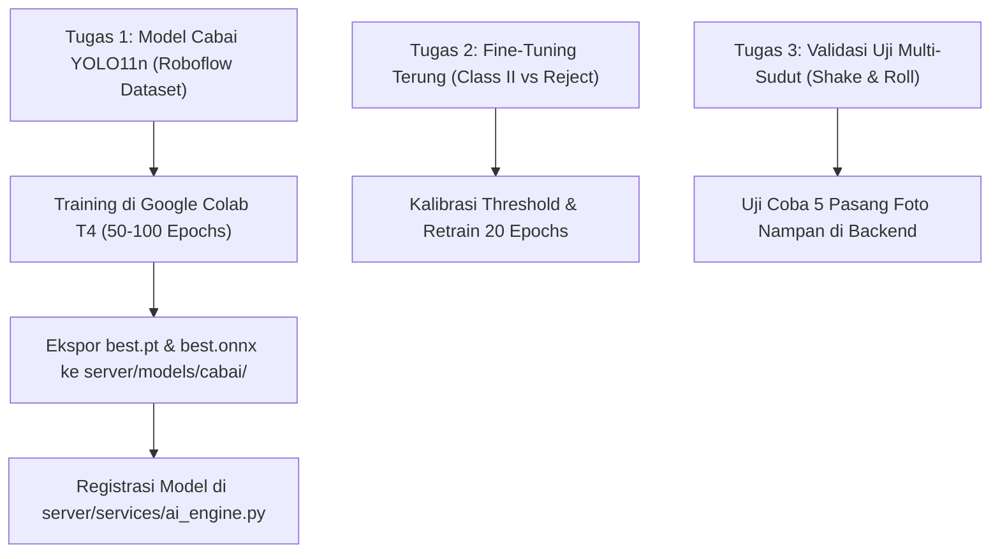

# Panduan Teknis & Instruksi Kerja: Machine Learning (ML) Engineer
## Proyek: Agri-Sort AI — STEAMPreneur SMK Nasional 2026
**Penerima Tugas:** Faris Al Farizi (Lead ML Engineer)  
**Pengirim / Penanggung Jawab Integrasi:** Hieray Antovino (Fullstack Developer)  
**Guru Pembimbing:** Rogi Auvi, S.Pd  
**Status Dokumen:** ACTIONABLE SPECIFICATION & SPRINT TARGET  
**Tanggal Rilis:** 9 November 2026  

---

## 1. Urgensi & Konteks Tugas

Halo Faris! Di sisi Fullstack dan Backend, sistem inti Agri-Sort AI sudah rampung:
1. **Frontend & Dashboard:** Visualisasi Bounding Box Interaktif, Inspeksi 2-Sisi Bersandingan (*Side-by-Side Dual-Angle*), Rekapitulasi Data Panen, dan Ekspor CSV/PDF.
2. **Pricing Triangulasi Nasional:** Integrasi live feed API resmi **BAPANAS** (Badan Pangan Nasional) dan **SP2KP Kemendag RI** untuk harga acuan komparasi pasar.
3. **Sertifikat Uji Mutu Digital:** Sertifikat QC resmi berstandar A4 dengan cap audit anti-kecurangan (*Anti-Fraud Multi-Angle Verified*).
4. **Backend Engine:** Uvicorn FastAPI dan ONNX Runtime fallback engine sudah stabil (196 unit tests 100% passing).

> [!IMPORTANT]
> **Celah Kritis ML Saat Ini:**
> Proposal resmi STEAMPreneur 2026 menjanjikan 3 komoditas hortikultura unggulan Sumatera Barat: **Terung (Eggplant)**, **Tomat (Tomato)**, dan **Cabai (Chili)**.
> - **Terung:** Model YOLO11n 4-kelas sudah ada (`models/terung/best.pt`, `best.onnx`).
> - **Tomat:** Model 2-kelas sudah ada (`model-export/weights/best.pt`).
> - **Cabai:** **BELUM MEMILIKI MODEL AI.** Ini adalah titik paling krusial yang ditunggu oleh tim penguji sayembara!

Berikut adalah panduan langkah demi langkah yang harus Faris kerjakan.

---

## 2. Rincian Tugas Faris (Prioritas & Action Items)



---

### TUGAS 1 (PRIORITAS TERTINGGI / BLOCKER): Training Model AI Cabai

#### A. Sumber Dataset
Gunakan dataset publik dari **Roboflow Universe** yang fokus pada deteksi cabai dan penyakit cabai pascapanen:
- **Rekomendasi Pencarian Roboflow:**
  1. `chili disease detection yolo`
  2. `chilli anthracnose roboflow`
  3. `chili freshness and defects`
- **Spesifikasi Kelas Target (2 atau 3 Kelas):**
  - `0: cabai_segar` (Cabai Sehat / Segar)
  - `1: cabai_busuk` atau `cabai_antraknosa` (Cacat Patek / Busuk Kering Colletotrichum)
  - *(Opsional jika tersedia di dataset)* `2: cabai_cacat_fisik` (Cabai patah / keriput)
- **Ukuran Dataset Minimal:**
  - Minimal 300–600 gambar dengan anotasi bounding box.
  - Split: 70% Train, 20% Valid, 10% Test.

#### B. Skrip Training Google Colab (YOLO11n)
Gunakan Ultralytics YOLO11n pada Google Colab GPU (Tesla T4 gratis):

```python
# 1. Install dependensi
!pip install -q ultralytics roboflow

# 2. Unduh dataset dari Roboflow (Ganti API key & project name Faris)
from roboflow import Roboflow
rf = Roboflow(api_key="API_KEY_FARIS")
project = rf.workspace("workspace-name").project("chili-disease-detection")
version = project.version(1)
dataset = version.download("yolov11")

# 3. Jalankan Pelatihan YOLO11n
from ultralytics import YOLO

# Muat pretrained YOLO11n nano
model = YOLO("yolo11n.pt")

# Training
results = model.train(
    data=f"{dataset.location}/data.yaml",
    epochs=60,
    imgsz=640,
    batch=16,
    patience=15,
    save=True,
    device=0,
    project="agrisort_cabai",
    name="yolo11n_chili_v1",
    plots=True
)

# 4. Validasi pada test split
metrics = model.val(split="test")
print("mAP50:", metrics.box.map50)
print("mAP50-95:", metrics.box.map)
```

#### C. Skrip Ekspor ke Format ONNX (Wajib untuk Server)
Setelah training selesai, ekspor model ke ONNX Opset 18:

```python
# Ekspor ke ONNX
onnx_path = model.export(
    format="onnx",
    imgsz=640,
    opset=18,
    dynamic=False,
    simplify=True
)
print("Model ONNX berhasil diekspor ke:", onnx_path)
```

#### D. Penyerahan Berkas Model ke Repositori
Buat folder baru: `server/models/cabai/` dan commit berkas-berkas berikut:
1. `server/models/cabai/best.pt` (Checkpoint PyTorch ~5 MB)
2. `server/models/cabai/best.onnx` (ONNX Runtime ~10 MB)
3. `server/models/cabai/data.yaml` (Konfigurasi kelas)
4. `server/models/cabai/model-metadata.json` (Berisi metrik mAP, precision, recall)

Contoh format `server/models/cabai/model-metadata.json`:
```json
{
  "model": {
    "name": "Agri-Sort Chili Quality Detection",
    "version": "1.0.0",
    "architecture": "YOLO11n",
    "framework": "Ultralytics",
    "input_size": 640
  },
  "dataset": {
    "name": "Chili Anthracnose & Freshness",
    "classes": {
      "0": "cabai_segar",
      "1": "cabai_antraknosa"
    }
  },
  "evaluation": {
    "split": "test",
    "map50": 0.842,
    "map50_95": 0.761,
    "precision": 0.815,
    "recall": 0.829
  }
}
```

---

### TUGAS 2: Fine-Tuning Model Terung (Class II vs Reject)

#### Masalah Aktual Berdasarkan Audit Matriks Konfusi:
Pada model Terung saat ini (`models-20261107T170211Z-1-001`):
- **19% Class II** salah diprediksi sebagai **Reject**.
- **18% Reject** salah diprediksi sebagai **Class II**.
Penyebab: Bekas gesekan daun / luka gores ringan pada kulit terung memiliki tekstur dan warna keabu-abuan yang sangat mirip dengan lesi busuk basah stadium awal.

#### Solusi yang Harus Dilakukan Faris:
1. **Opsi 1 (Kalibrasi Confidence Threshold):**
   - Tetapkan threshold klasifikasi Reject lebih ketat (misal `conf_reject >= 0.45`), sementara Class II tetap di `0.30`.
2. **Opsi 2 (Fine-Tuning Tambahan 20 Epoch):**
   - Lakukan fine-tuning dari checkpoint `best.pt` terung dengan augmentasi HSV dan MixUp:
   ```python
   model = YOLO("models-20261107T170211Z-1-001/models/terung/best.pt")
   model.train(
       data="models-20261107T170211Z-1-001/models/terung/data.yaml",
       epochs=20,
       lr0=0.001,  # learning rate rendah untuk fine-tuning
       hsv_h=0.015, hsv_s=0.7, hsv_v=0.4,
       mixup=0.1
   )
   ```

---

### TUGAS 3: Pengujian Validasi Anti-Kecurangan 2-Sudut (Shake & Roll Protocol)

Faris bersama Ahmad Afif (QA) perlu menguji endpoint inspeksi multi-sudut:
- Endpoint: `POST /api/v1/qc/scan-multi`
- Kirimkan pasangan foto:
  - Foto 1: Sisi Atas nampan.
  - Foto 2: Sisi Bawah (setelah nampan digoyang / dibalik).
- Pastikan bahwa jika ada cabai/terung busuk yang sengaja ditaruh di bawah dan baru terlihat di Foto 2:
  - Nilai `occlusion_analysis.occlusion_bias_detected` bernilai `true`.
  - Disparitas `defect_delta_percent` terhitung secara akurat.

---

## 3. Checklist Target Faris

| No | Target Deliverable | Deadline Rekomendasi | Status |
|:---:|---|:---:|:---:|
| 1 | Download & kurasi dataset Cabai di Roboflow | Hari ke-1 | ⏳ Pending Faris |
| 2 | Training YOLO11n Cabai di Google Colab (mAP50 $\ge 80\%$) | Hari ke-2 | ⏳ Pending Faris |
| 3 | Ekspor `best.pt` & `best.onnx` ke `server/models/cabai/` | Hari ke-2 | ⏳ Pending Faris |
| 4 | Fine-tuning model Terung (Class II vs Reject) | Hari ke-3 | ⏳ Pending Faris |
| 5 | Uji verifikasi multi-sudut bersama Hieray | Hari ke-3 | ⏳ Pending Faris |

---

*Catatan Tim:* Seluruh arsitektur backend (`ai_engine.py`, `multi_angle_service.py`, `pricing_service.py`) telah dirancang secara modular. Begitu berkas `best.pt` dan `best.onnx` ditaruh di `server/models/cabai/`, Hieray tinggal mengaktifkan routing komoditas cabai secara instan tanpa perlu merombak kode backend. Semangat Faris! 🚀

