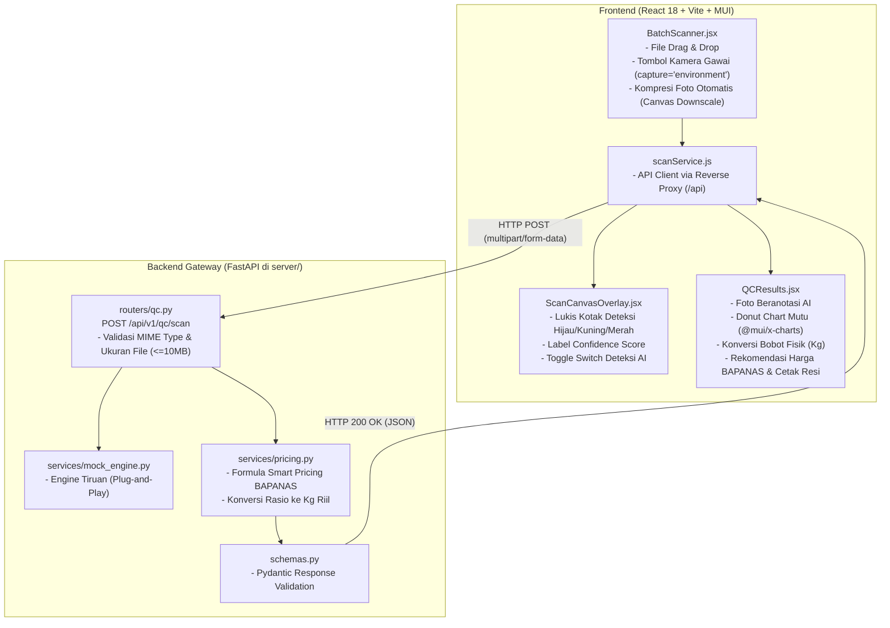

# Rencana Kerja Teknis: Fullstack Developer (Backend & Frontend)

> **Proyek:** Agri-Sort AI — STEAMPreneur SMK Tingkat Nasional 2026  
> **Peran:** Fullstack Developer (Backend & Frontend)  
> **Fokus Utama:** Pembangunan REST API Gateway berbasis Python FastAPI, perancangan antarmuka pemindai panen interaktif (*Batch QC Scanner*), integrasi kamera gawai, visualisasi deteksi *Canvas Bounding Box Overlay*, diagram lingkaran mutu (*Donut Chart*), logika harga pasar BAPANAS, dan alur aplikasi end-to-end.  
> **Strategi Kerja Paralel:** Menggunakan **Engine Mock Terstandarisasi** di sisi backend agar frontend dan backend dapat langsung diuji dan didemonstrasikan tanpa harus menunggu ML Engineer selesai mengintegrasikan model.

---

## 1. Arsitektur Komponen Fullstack



---

## 2. Bagian I: Rencana Kerja Backend (FastAPI di `server/`)

### Langkah BE-1: Inisialisasi Server & Dependensi
- Membuat berkas `server/requirements.txt`:
  ```
  fastapi>=0.115.0
  uvicorn[standard]>=0.30.0
  python-multipart>=0.0.9
  pydantic>=2.9.0
  pillow>=10.4.0
  numpy>=1.26.0
  ```
- Membuat `server/main.py`:
  - Menginisialisasi aplikasi `FastAPI(title="Agri-Sort AI API", version="1.0.0")`.
  - Mendaftarkan `CORSMiddleware` dengan izin akses untuk frontend Vite (`http://localhost:5173` dan `http://127.0.0.1:5173`).
  - Menambahkan endpoint pengecekan kesehatan server: `GET /api/v1/health` $\rightarrow$ `{"status": "ok", "app": "Agri-Sort AI"}`.

### Langkah BE-2: Definisi Skema Kontrak Data Pydantic (`server/schemas.py`)
Mendefinisikan tipe data baku agar respon server konsisten dan tervalidasi:
```python
from pydantic import BaseModel, Field
from typing import List, Dict, Optional

class BoundingBox(BaseModel):
    x1: float
    y1: float
    x2: float
    y2: float

class DetectionItem(BaseModel):
    id: int
    class_id: int
    class_name: str
    grade: str # GRADE_A, GRADE_B, REJECT
    confidence: float
    box: BoundingBox

class QualitySummary(BaseModel):
    total_count: int
    counts: Dict[str, int]
    percentages: Dict[str, float]
    estimated_weights_kg: Dict[str, float]

class SmartPricing(BaseModel):
    reference_price_per_kg: int
    reference_source: str
    recommended_price_per_kg: int
    projected_revenue: int
    action_recommendation: str

class ScanResponse(BaseModel):
    status: str
    data: Dict
```

### Langkah BE-3: Engine Mock Plug-and-Play (`server/services/mock_engine.py`)
Agar frontend dapat langsung berfungsi sebelum ML Engineer menyelesaikan model ONNX:
1. Membaca dimensi gambar yang diunggah menggunakan `PIL.Image.open(io.BytesIO(image_bytes))`.
2. Menghasilkan $15 - 25$ kotak deteksi acak yang proporsional di dalam area gambar:
   - $70\%$ kotak `fresh-tomato` (Grade A/B).
   - $10\% - 20\%$ kotak `rotten-tomato` (Reject).
3. Menghasilkan simulasi jeda waktu eksekusi $300\text{ ms} - 450\text{ ms}$ untuk meniru performa nyata model.
4. Struktur keluaran dibuat **100% identik** dengan fungsi inferensi ML Engineer, sehingga nantinya tinggal mengganti fungsi pemanggil di router.

### Langkah BE-4: Logika Bisnis Finansial & BAPANAS (`server/services/pricing.py`)
Menerapkan formula penetapan harga sesuai proposal STEAMPreneur:
1. **Daftar Harga Acuan Pasar BAPANAS Wilayah (Sumatera Barat):**
   - Cabai Merah Keriting: Rp45.000 / kg
   - Cabai Rawit Merah: Rp42.000 / kg
   - Tomat: Rp14.000 / kg
2. **Kalkulasi Estimasi Bobot Riil (Kg) Tiap Grade:**
   $$\text{Bobot}_A = \text{Total Berat (Kg)} \times \frac{\%A}{100}, \quad \text{Bobot}_B = \text{Total Berat} \times \frac{\%B}{100}, \quad \text{Bobot}_{Reject} = \text{Total Berat} \times \frac{\%Reject}{100}$$
3. **Kalkulasi Rekomendasi Harga Wajar:**
   $$\text{Harga Rekomendasi per Kg} = \left(\frac{\%A}{100} \times P_{\text{acuan}}\right) + \left(\frac{\%B}{100} \times 0.75 \times P_{\text{acuan}}\right) + 0$$
4. **Kalkulasi Proyeksi Pendapatan Kotor:**
   $$\text{Total Pendapatan} = \text{Total Berat (Kg)} \times \text{Harga Rekomendasi per Kg}$$
5. **Rekomendasi Tindakan Pasca Panen:**
   - Jika $\%A \ge 70\%$: *"Kualitas Prima: Dominan Grade A. Siapkan untuk distribusi ke supermarket / pasar grosir utama."*
   - Jika $\%B \ge 30\%$: *"Kualitas Standar: Proporsi Grade B cukup tinggi. Salurkan ke pasar retail harian atau industri olahan (saus/pasta)."*
   - Jika $\%Reject \ge 10\%$: *"Peringatan Mutu: Segera pisahkan buah rusak/busuk untuk mencegah penularan jamur antraknosa ke buah sehat."*

### Langkah BE-5: Endpoint API Gateway (`server/routers/qc.py`)
Membangun router pemindaian `POST /api/v1/qc/scan`:
1. Menerima form data:
   - `image: UploadFile = File(...)`
   - `commodity: str = Form(...)`
   - `total_weight_kg: float = Form(...)`
   - `confidence_threshold: float = Form(0.35)`
2. Validasi berkas:
   - Mengecek ekstensi dan MIME type (`image/jpeg`, `image/png`, `image/webp`).
   - Mengecek ukuran berkas maksimal $10\text{ MB}$.
   - Mengecek validitas nilai `total_weight_kg > 0`.
3. Membaca `image_bytes = await image.read()`.
4. Memanggil engine inferensi (`mock_engine` saat ini, diswitch ke `ml_engine` begitu siap).
5. Menggabungkan hasil deteksi dengan kalkulasi `calculate_smart_pricing(commodity, total_weight_kg, percentages)`.
6. Mengembalikan respon HTTP 200 OK sesuai skema Pydantic.

---

## 3. Bagian II: Rencana Kerja Frontend (React di `src/`)

### Langkah FE-1: Konfigurasi Proxy & Service Pemanggil API
1. Memperbarui `vite.config.js` untuk mengaktifkan reverse proxy:
   ```javascript
   import { defineConfig } from 'vite'
   import react from '@vitejs/plugin-react'

   export default defineConfig({
     plugins: [react()],
     server: {
       proxy: {
         '/api': {
           target: 'http://localhost:8000',
           changeOrigin: true,
         },
       },
     },
   })
   ```
2. Membuat `src/services/scanService.js`:
   - Menyediakan fungsi `scanHarvestBatch({ imageFile, commodity, totalWeightKg, confidenceThreshold })`.
   - Mengirimkan `FormData` via `fetch('/api/v1/qc/scan', { method: 'POST', body: formData })`.
   - Menangani error jaringan secara ramah dengan memberikan fallback pesan yang jelas.

### Langkah FE-2: Kompresi Gambar Sisi Klien (`src/utils/imageCompressor.js`)
Mencegah gagal upload dan menghemat kuota pengguna di lapangan:
- Membuat fungsi `compressImage(file, maxWidth = 1600, quality = 0.85)`:
  - Membaca file gambar ke elemen `HTMLImageElement`.
  - Jika lebar/tinggi melebihi $1600\text{px}$, lakukan *downscaling* menggunakan `HTMLCanvasElement`.
  - Mengonversi kembali ke objek `Blob` / `File` JPEG berukuran ringan ($< 1\text{ MB}$) sebelum diunggah ke backend.

### Langkah FE-3: Komponen Batch QC Scanner UI (`src/components/BatchScanner.jsx`)
Menggantikan formulir teks manual dengan antarmuka pemindai visual interaktif:
1. **Area Pengambilan Gambar:**
   - Kotak Drag-and-Drop dengan ikon kamera/unggah yang jelas.
   - Dua tombol aksi cepat:
     - 📁 **"Pilih dari Berkas"**: Membuka file explorer.
     - 📷 **"Buka Kamera Gawai"**: Mengaktifkan kamera smartphone secara langsung menggunakan input `<input type="file" accept="image/*" capture="environment" />`.
2. **Pratinjau Foto Keranjang:**
   - Menampilkan gambar yang dipilih dengan opsi "Ganti Foto" dan "Hapus".
3. **Form Parameter Panen:**
   - Dropdown pilihan komoditas: *Cabai Merah Keriting*, *Cabai Rawit Merah*, *Tomat*.
   - Input estimasi berat total keranjang (kg).
   - Akordeon/slider opsional: Pengaturan Sensitivitas Deteksi ($30\% - 80\%$).
4. **Indikator Proses (Scanning Progress Animation):**
   - Animasi radar pemindaian di atas foto saat menunggu respon API ($< 500\text{ ms}$).

### Langkah FE-4: Visualisasi Kotak Deteksi (`src/components/ScanCanvasOverlay.jsx`)
Komponen visual yang melukis kotak pembatas AI di atas foto keranjang panen:
1. Menumpuk elemen `<canvas>` tepat di atas foto keranjang dengan posisi absolut.
2. Menghitung skala canvas berdasarkan ukuran render gambar di layar browser.
3. Melukis kotak pembatas (*bounding boxes*):
   - 🟢 **Hijau (`#047857`, tebal garis 3px):** Grade A.
   - 🟡 **Kuning (`#B45309`, tebal garis 3px):** Grade B.
   - 🔴 **Merah (`#B91C1C`, tebal garis 3px):** Reject.
4. Menambahkan label teks berlatar belakang semi-transparan di pojok kiri atas tiap kotak: contoh `Grade A (92%)`.
5. Menyediakan tombol sakelar (*Switch*): *"Tampilkan Kotak AI"* agar pengguna dapat membandingkan dengan foto asli tanpa anotasi.

### Langkah FE-5: Modernisasi Halaman Hasil QC (`src/components/QCResults.jsx`)
Memperbarui halaman hasil analisis QC:
1. **Panel Kiri:** Komponen `ScanCanvasOverlay` yang menampilkan foto keranjang panen beserta kotak deteksi AI.
2. **Panel Kanan:**
   - **Donut Chart Distribusi Mutu:** Menggunakan komponen `<PieChart>` dari pustaka `@mui/x-charts` yang sudah terpasang, menampilkan persentase Grade A, Grade B, dan Reject.
   - **Kartu Metrik Mutu:** Total buah terdeteksi, durasi inferensi, dan konversi bobot fisik nyata (kg) per grade.
   - **Banner Rekomendasi:** Kotak rekomendasi tindakan pasca panen.
   - **Kartu Smart Pricing:** Perbandingan harga pasar BAPANAS vs rekomendasi harga Agri-Sort AI dan estimasi pendapatan kotor.
   - **Aksi Cetak / Ekspor:** Tombol *"Cetak Bukti QC / Unduh PDF"* dan *"Simpan ke Riwayat Panen"*.

### Langkah FE-6: Integrasi Navigasi Global (`src/App.jsx`)
- Menghubungkan komponen `BatchScanner` pada halaman `scanner`.
- Menyimpan hasil scan terbaru ke dalam state `currentScanResult` dan otomatis mengarahkan ke halaman `results`.
- Memperbarui tabel rekap riwayat di halaman `results-list`.

---

## 4. Struktur Direktori Kerja Fullstack Developer

```
agri-sort-ai/
├── server/                               # Wilayah Kerja Backend
│   ├── main.py                           # Inisialisasi FastAPI & CORS
│   ├── schemas.py                        # Pydantic schema kontrak data
│   ├── requirements.txt                  # Dependensi Python
│   ├── routers/
│   │   └── qc.py                         # POST /api/v1/qc/scan
│   └── services/
│       ├── mock_engine.py                # Engine deteksi tiruan (sementara)
│       └── pricing.py                    # Logika smart pricing BAPANAS & kg conversion
│
└── src/                                  # Wilayah Kerja Frontend
    ├── components/
    │   ├── BatchScanner.jsx              # UI pemindai, upload & kamera
    │   ├── ScanCanvasOverlay.jsx         # Canvas bounding box overlay
    │   ├── QCResults.jsx                 # Update tampilan hasil & Donut Chart
    │   └── HarvestForm.jsx               # Form panen (opsi manual)
    ├── services/
    │   └── scanService.js                # API client pemanggil backend
    ├── utils/
    │   └── imageCompressor.js            # Kompresi gambar sisi klien
    ├── App.jsx                           # Integrasi state & alur navigasi global
    └── vite.config.js                    # Konfigurasi reverse proxy /api
```

---

## 5. Kriteria Selesai (Definition of Done — Fullstack Developer)

- [ ] Server FastAPI berhasil dijalankan di port `8000` dan Swagger docs dapat diakses di `http://localhost:8000/docs`.
- [ ] Endpoint `POST /api/v1/qc/scan` berhasil menerima unggahan gambar dan merespon JSON sesuai kontrak data.
- [ ] Komponen `BatchScanner` dapat mengunggah file foto dan memicu kamera gawai secara responsif.
- [ ] Kompresi sisi klien berhasil mengecilkan foto kamera resolusi tinggi sebelum diunggah.
- [ ] `ScanCanvasOverlay` berhasil melukis kotak deteksi hijau, kuning, dan merah tepat pada posisi buah tanpa pergeseran koordinat.
- [ ] Donut Chart `@mui/x-charts` merender proporsi mutu Grade A, B, dan Reject secara akurat berjumlah $100\%$.
- [ ] Perhitungan harga rekomendasi BAPANAS dan estimasi kilogram terhitung otomatis sesuai formula STEAM Mathematics.
- [ ] Seluruh alur (Pilih Foto $\rightarrow$ Scan $\rightarrow$ Tinjau Hasil $\rightarrow$ Simpan) berjalan lancar tanpa *runtime error* di konsol browser.
