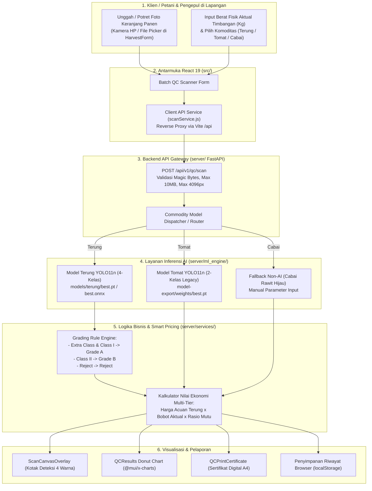
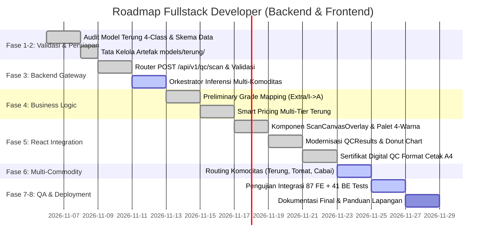

# Rencana Kerja Teknis: Fullstack Developer (Backend & Frontend)
## Proyek: Agri-Sort AI — Quality Control & Smart Pricing Hortikultura

> **Status:** ROADMAP MUTAKHIR (Integrasi Model Terung 4-Kelas & Fitur Pull Terkini)  
> **Komoditas AI Aktif:** Terung / Eggplant (4 Kelas Komersial: Extra Class, Class I, Class II, Reject)  
> **Komoditas Sekunder:** Tomat (Legacy 2-Kelas) & Cabai Rawit Hijau (Pencatatan Manual / Non-AI)  
> **Stack Terverifikasi:** React 19, Vite 8, Material UI 9.5, Python FastAPI, Browser `localStorage`  
> **Hasil Uji Terkini:** 87 Frontend Unit Tests Pass, 41 Backend Unit Tests Pass  
> **Tanggal Pembaruan:** 8 November 2026  

---

## 1. Konteks Integrasi Model Baru & Analisis Pull Terkini

Berdasarkan artefak model baru pada `models-20261107T170211Z-1-001/models/terung/` dan integrasi commit terbaru (`fd29809`, `7119c26`, `b82b874`, `239c9eb`, `79db8ba`):
1. **Model Terung 4-Kelas Aktif:**
   Model YOLO11n Terung menghasilkan 4 kelas asli:
   - `0: Class I`
   - `1: Class II`
   - `2: Extra Class`
   - `3: Reject`
2. **Preliminary Grade Mapping (Aturan Bisnis di Lapisan Backend):**
   Model TIDAK menghasilkan Grade A/B/Reject secara langsung. Pemetaan grade mutu hortikultura dilakukan di domain bisnis backend:
   - `Extra Class` $\rightarrow$ **Grade A** (Mutu Super / Standar Ekspor)
   - `Class I` $\rightarrow$ **Grade A** (Mutu Baik / Pasar Modern)
   - `Class II` $\rightarrow$ **Grade B** (Mutu Standar / Pasar Tradisional & Olahan)
   - `Reject` $\rightarrow$ **Reject / Afkir** (Cacat Berat / Pakan / Kompos)
3. **Penyelarasan Fitur Frontend yang Telah Selesai (*Completed in Recent Pull*):**
   - **Task FS-FE-01:** Reverse proxy Vite (`/api -> http://localhost:8000`) dan service API `scanService.js` dengan timeout 15 detik.
   - **Task FS-FE-02:** Komponen `ScanCanvasOverlay.jsx` dan `canvasOverlayHelper.js` dengan palet warna multi-kelas 4 level Terung (Emerald, Sky Blue, Amber, Red).
   - **Task FS-FE-03:** Modernisasi `QCResults.jsx` dengan visualisasi canvas foto keranjang, diagram donat `@mui/x-charts`, dan kartu metrik kuantitas.
   - **Fitur Tambahan:** Sertifikat Digital QC format cetak A4 siap presentasi (`QCPrintCertificate.jsx` & `qcCertificateHelper.js`).

---

## 2. Arsitektur Teknis & Aliran Data Sistem



---

## 3. Spesifikasi Kontrak Integrasi (Request & Response)

### 3.1 Kontrak REST API: `POST /api/v1/qc/scan`
- **Metode:** `POST`
- **Header:** `Content-Type: multipart/form-data`
- **Parameter Form:**
  - `image`: File binary (`.jpg`, `.png`, `.webp`, $\le 10\text{ MB}$)
  - `commodity`: String (`"Terung"`, `"Tomat"`, `"Cabai Rawit Hijau"`)
  - `weight_kg`: Float (Opsional, berat fisik aktual timbangan, misal: `45.0`)
  - `confidence_threshold`: Float (Opsional, default: `0.25` untuk Terung, `0.35` untuk Tomat)
  - `mode`: String (`"production"` atau `"mock"`)

### 3.2 Response Sukses Terung 4-Kelas (HTTP 200 OK):
```json
{
  "status": "success",
  "data": {
    "scan_id": "scan_20261108_8f1a2c",
    "timestamp": "2026-11-08T00:15:00Z",
    "is_simulated": false,
    "commodity": "Terung",
    "ai_supported": true,
    "actual_weight_kg": 45.0,
    "grading_system": "4-class (Extra Class, Class I, Class II, Reject)",
    "inference_result": {
      "model_version": "1.0.0",
      "inference_time_ms": 284.5,
      "image_dimensions": { "width": 1280, "height": 720 },
      "detections": [
        {
          "id": 1,
          "class_id": 2,
          "class_name": "Extra Class",
          "confidence": 0.912,
          "box": { "x1": 110.0, "y1": 95.0, "x2": 260.5, "y2": 420.0 }
        },
        {
          "id": 2,
          "class_id": 0,
          "class_name": "Class I",
          "confidence": 0.885,
          "box": { "x1": 310.0, "y1": 105.0, "x2": 480.0, "y2": 435.5 }
        },
        {
          "id": 3,
          "class_id": 1,
          "class_name": "Class II",
          "confidence": 0.742,
          "box": { "x1": 530.0, "y1": 130.0, "x2": 690.0, "y2": 450.0 }
        },
        {
          "id": 4,
          "class_id": 3,
          "class_name": "Reject",
          "confidence": 0.814,
          "box": { "x1": 740.0, "y1": 150.0, "x2": 910.0, "y2": 470.0 }
        }
      ],
      "object_counts": {
        "total": 12,
        "extra_class": 5,
        "class_1": 4,
        "class_2": 2,
        "reject": 1
      },
      "condition_ratios": {
        "extra_class_percent": 41.67,
        "class_1_percent": 33.33,
        "class_2_percent": 16.67,
        "reject_percent": 8.33
      }
    },
    "business_grading": {
      "preliminary_mapping_rule": "Extra Class & Class I -> Grade A, Class II -> Grade B, Reject -> Reject",
      "grade_breakdown": {
        "grade_a_percent": 75.0,
        "grade_b_percent": 16.67,
        "reject_percent": 8.33
      },
      "estimated_weights_kg": {
        "grade_a_kg": 33.75,
        "grade_b_kg": 7.5,
        "reject_kg": 3.75
      }
    },
    "smart_pricing": {
      "commodity": "Terung",
      "reference_price_per_kg": 10000,
      "currency": "IDR",
      "region": "Sumatera Barat",
      "price_source": "Tabel Tetap Lokal (Simulasi)",
      "data_status": "simulasi",
      "recommended_price_per_kg": 9500,
      "estimated_economic_value": 427500,
      "action_recommendation": "Mutu Unggul: 75% Grade A (Extra Class + Class I). Pisahkan 1 butir reject sebelum pengiriman untuk mempertahankan kualitas."
    }
  }
}
```

---

## 4. Rencana Kerja Fullstack Developer Berdasarkan 8 Fase



---

### Rincian Pelaksanaan Setiap Fase:

#### Fase 1 — Model Validation & Class ID Alignment
- **Task FS-01: Sinkronisasi ID dan Nama Kelas Asli:**  
  Menyelaraskan skema mock dan model backend agar persis mematuhi `data.yaml`:
  - `0`: `"Class I"`
  - `1`: `"Class II"`
  - `2`: `"Extra Class"`
  - `3`: `"Reject"`
- **Verifikasi:** Unit test `server/tests/test_mock_engine.py` mengonfirmasi pemetaan 4-kelas Terung.

#### Fase 2 — Model Packaging & Local Asset Management
- **Task FS-02: Penyimpanan Bobot Terung di Backend:**  
  Menempatkan bobot resmi di `server/models/terung/` (`best.pt` dan `best.onnx`) tanpa mengubah berkas sumber.

#### Fase 3 — Inference Backend (FastAPI Service)
- **Task FS-03: Endpoint Scanner `POST /api/v1/qc/scan`:**  
  - Validasi *Magic Bytes* (JPEG, PNG, WebP), ukuran maksimal 10MB, dimensi maksimal 4096px.
  - Parameter `commodity` menentukan model yang dieksekusi (Terung vs Tomat vs Cabai).
  - Mode switch: `mode=production` memanggil engine AI nyata, `mode=mock` memanggil generator deterministik bertanda `"is_simulated": true`.

#### Fase 4 — Grading Business Logic & Pricing Engine
- **Task FS-04: Logika Pemetaan Mutu Komersial:**  
  Mengimplementasikan formula pemetaan mutu pada `server/services/pricing_service.py`:
  - Menghitung rasio kelas asli: $\% \text{Extra}$, $\% \text{Class I}$, $\% \text{Class II}$, $\% \text{Reject}$.
  - Mengagregasi ke grade aplikasi:
    $$\% \text{Grade A} = \% \text{Extra Class} + \% \text{Class I}$$
    $$\% \text{Grade B} = \% \text{Class II}$$
    $$\% \text{Reject} = \% \text{Reject}$$
- **Task FS-05: Smart Pricing Multi-Tier Terung:**  
  Harga acuan simulasi Terung di Sumatera Barat: Rp10.000 / kg.
  $$\text{Harga Rekomendasi} = (\% \text{Grade A} \times 10.000) + (\% \text{Grade B} \times 0.75 \times 10.000) + 0$$
  Estimasi nilai ekonomi dihitung berdasarkan bobot riil timbangan dikalikan harga rekomendasi.

#### Fase 5 — React Integration & Visual Polishing
- **Task FS-06: Palet Warna Multi-Kelas Kanvas (`canvasOverlayHelper.js`):**  
  - 🟢 **Extra Class:** Emerald Green (`#059669`)
  - 🔵 **Class I:** Sky Blue (`#0284c7`)
  - 🟡 **Class II:** Amber (`#d97706`)
  - 🔴 **Reject:** Bright Red (`#dc2626`)
- **Task FS-07: Donut Chart Distribusi Mutu (`QCResults.jsx`):**  
  Menggunakan `@mui/x-charts` `<PieChart>` untuk menampilkan proporsi visual 4 kelas Terung.
- **Task FS-08: Sertifikat Digital QC Cetak A4 (`QCPrintCertificate.jsx`):**  
  Modal cetak berskala A4 rapi dengan header resmi, tabel rincian butir terdeteksi, ringkasan grade komersial, tanda tangan digital, dan tanggal bahasa Indonesia.

#### Fase 6 — Multi-Commodity Routing Expansion
- **Task FS-09: Router Komoditas:**  
  - Terung $\rightarrow$ Deteksi AI 4-kelas penuh + Smart Pricing Terung.
  - Tomat $\rightarrow$ Deteksi AI 2-kelas legacy + Smart Pricing Tomat.
  - Cabai Rawit Hijau $\rightarrow$ Form input manual mutu panen + Smart Pricing Cabai.

#### Fase 7 — Quality Assurance & Testing
- **Task FS-10: Eksekusi Rangkaian Pengujian Menyeluruh:**  
  - **Frontend:** 87 automated unit tests via `npm test` (mencakup canvas overlay, certificate helper, scan service, dan harvest validation).
  - **Backend:** 41 automated tests via `python3 -m unittest discover -s server/tests` (mencakup mock engine, pricing service, storage, dan upload security).
  - **Regression:** Memastikan seluruh kasus uji lama tidak terganggu.

#### Fase 8 — Deployment & Monitoring Readiness
- **Task FS-11: Konfigurasi Produksi Ringan:**  
  - Backend berjalan di port 8000 (Uvicorn), Frontend di port 5173/Vercel.
  - Reverse proxy Vite memastikan tidak ada isu CORS pada lingkungan pengujian lokal maupun server demo sekolah.

---

## 5. Definition of Done (DoD) Fullstack Developer

Pekerjaan Fullstack Developer dinyatakan selesai jika:
1. Endpoint `POST /api/v1/qc/scan` menerima foto terung, menjalankan deteksi 4-kelas, dan merespon dalam $< 500\text{ ms}$.
2. Pemetaan `Extra Class` & `Class I` $\rightarrow$ Grade A, `Class II` $\rightarrow$ Grade B, `Reject` $\rightarrow$ Reject berjalan transparan di backend.
3. Canvas overlay melukis kotak deteksi 4 warna secara presisi di layar desktop dan mobile.
4. Donut Chart dan Sertifikat Digital A4 menampilkan rincian mutu panen terung secara akurat.
5. Mode input manual untuk cabai dan tomat legacy tetap berfungsi normal.
6. Seluruh 87 frontend test dan 41 backend test lulus 100%.
