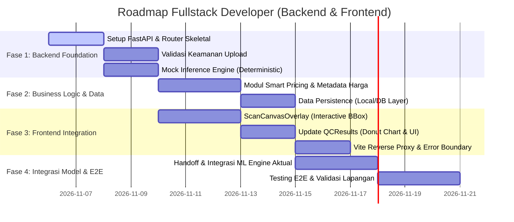

# Rencana Kerja Teknis: Fullstack Developer (Backend & Frontend)

> **Proyek:** Agri-Sort AI — Quality Control & Smart Pricing Hortikultura  
> **Dokumen:** Pedoman Implementasi Teknis Fullstack Developer  
> **Status:** HASIL AUDIT & REVISI TEKNIS (Ground Truth Baseline)  
> **Penanggung Jawab:** Fullstack Developer (Backend API & Frontend Web)  
> **Tanggal Pembaruan:** 5 November 2026  

---

## 1. Informasi Proyek & Konteks

Agri-Sort AI adalah sistem berbasis web yang dirancang untuk membantu transparansi pemeriksaan mutu panen dan perhitungan estimasi nilai ekonomi hortikultura bagi petani dan pengepul.

### Target Komoditas Aplikasi vs Kemampuan Model Saat Ini
- **Target Komoditas Pengembangan Aplikasi:**
  1. Cabai Rawit Hijau
  2. Tomat
  3. Terung
  *(Serta varian Cabai Merah Keriting & Cabai Rawit Merah pada dokumen proposal)*.
- **Batasan Kritis Model AI Saat Ini `[VERIFIED]`:**
  Model Computer Vision yang tersedia saat ini **HANYA** dilatih untuk mendeteksi **Tomat** dengan dua label: `fresh-tomato` dan `rotten-tomato`. Model **BELUM** mendukung komoditas Cabai atau Terung, dan **TIDAK** menghasilkan klasifikasi mutu Grade A, Grade B, atau Reject secara otomatis.

---

## 2. Hasil Audit Kondisi Repository Aktual `[VERIFIED]`

Audit menyeluruh terhadap codebase menghasilkan temuan aktual berikut:

| Komponen | Status Aktual di Repository | Catatan Teknis Audit |
|---|---|---|
| **Frontend Framework** | React `^19.3.0` (React 19) | Bukan React 18 seperti pada draf lama. |
| **Build Tool & Bundler** | Vite `^8.3.4` (Vite 8) | Menggunakan ESM (`"type": "module"`). |
| **UI Component Library** | Material UI (MUI) `^9.5.0` & Emotion `^11.14` | MUI Core versi 9.5 dengan `@mui/icons-material`. |
| **Data Visualization** | `@mui/x-charts` `^9.15.0` | Sudah terpasang untuk visualisasi grafik. |
| **Test Runner** | Node.js built-in test runner (`node --test tes/*.test.js`) | 60 unit test berjalan lulus 100%. |
| **State & Storage** | Browser `localStorage` dengan key `agrisort.panen.v1` | Menggunakan modul `src/business/harvestStorage.js`. |
| **Fitur Input Foto** | Komponen Kamera gawai & Drag-and-Drop sudah ada di `HarvestForm.jsx` | Telah diimplementasikan pada commit `bc4dbf4`. |
| **Sumber Harga Pasar** | Tabel statis lokal di `src/business/priceReference.js` | Diberi label eksplisit: *Simulasi (bukan API BAPANAS live)*. |
| **Backend API** | **BELUM TERSEDIA** di repository | Perlu dibangun dari awal di direktori `server/`. |

---

## 3. Kondisi Model AI dan Batasan Integrasi

Fullstack Developer wajib memahami batas kemampuan model AI agar tidak merancang fitur yang keliru:

1. **Kelas Output Model Hanya Dua:** `fresh-tomato` dan `rotten-tomato`.
2. **Tidak Ada Grade A/B/Reject dari YOLO:** YOLO tidak menghasilkan kelas Grade A/B/Reject.
3. **Confidence Score Bukan Ukuran Kualitas:** Nilai confidence ($0.0 - 1.0$) hanya menunjukkan kepastian model terhadap deteksi objek tomat, bukan tingkat kemanisan, kematangan, atau kesegaran buah. **DILARANG** mengonversi rentang confidence menjadi Grade A/B/Reject (misal: $\text{conf} \ge 0.70 \rightarrow \text{Grade A}$).
4. **Proporsi Objek Bukan Proporsi Berat:** Jumlah buah tomat segar yang terdeteksi tidak mewakili persentase berat riil keranjang panen ($\text{Jumlah Buah} \neq \text{Kilogram}$).
5. **Sumber Data Harga Bukan dari AI:** Model YOLO murni melakukan deteksi citra (*object detection*). Harga referensi dikelola terpisah di backend.
6. **Integrasi BAPANAS Live Belum Tersedia:** Belum ada endpoint API resmi BAPANAS yang terhubung. Sistem menggunakan dataset acuan lokal terstruktur dengan metadata status yang transparan.

---

## 4. Arsitektur Sistem & Pemisahan Tanggung Jawab

Sistem mengadopsi arsitektur terpisah (*Decoupled Architecture*): Frontend React 19 berjalan pada port `5173`, dan Backend FastAPI Python berjalan pada port `8000` dengan reverse proxy di Vite (`/api`).

### Matriks Tanggung Jawab (RACI)

```
[ KLIEN / BROWSER ] ──(Foto Panen + Metadata)──> [ FRONTEND (React 19) ]
                                                          │
                                         HTTP POST /api/v1/qc/scan
                                         (multipart/form-data)
                                                          ▼
                                            [ BACKEND API (FastAPI) ]
                                            ├── 1. Validasi & Keamanan Upload
                                            ├── 2. Internal Call -> [ ML Inference Engine ]
                                            │                       (Raw Detections Output)
                                            ├── 3. Engine Logika Bisnis & Penilaian
                                            ├── 4. Pengelolaan Harga Referensi
                                            └── 5. Penyimpanan Transaksi Panen
```

- **Tanggung Jawab ML Engineer:**
  - Preprocessing citra, inferensi model YOLO11 ONNX, postprocessing NMS, filtering confidence threshold, dan mengembalikan **raw detection result** murni (`box`, `class_name`, `confidence`).
- **Tanggung Jawab Fullstack Developer:**
  - Membangun Backend FastAPI (`server/`), validasi keamanan upload citra, orkestrasi pemanggilan ML Engine, implementasi logika bisnis, perhitungan nilai ekonomi, pengelolaan data harga, antarmuka frontend, visualisasi canvas, dan pengujian integrasi end-to-end.

---

## 5. Kontrak Integrasi Antar-Role (Spesifikasi Baku)

Kedua dokumen (Fullstack dan ML Engineer) menyepakati satu kontrak integrasi tunggal berikut:

### 5.1 Kontrak Internal: Backend Python $\leftrightarrow$ ML Inference Engine
Pemanggilan dilakukan secara langsung melalui modul Python (*in-process function call*):
```python
def predict_harvest_image(
    image_bytes: bytes, 
    confidence_threshold: float = 0.35
) -> dict:
    """
    Fungsi internal inferensi.
    Input:
      - image_bytes: raw byte buffer citra
      - confidence_threshold: batas minimum keyakinan deteksi (default: 0.35)
    Output: Dictionary raw detection sesuai skema di bawah.
    """
```

**Format Kembalian Raw Detection (ML Engine):**
```json
{
  "contract_version": "1.0.0",
  "model_name": "yolo11n-agrisort",
  "model_version": "2026.11.02",
  "inference_time_ms": 312.4,
  "image_dimensions": {
    "width": 1280,
    "height": 720
  },
  "detections": [
    {
      "id": 1,
      "class_id": 0,
      "class_name": "fresh-tomato",
      "confidence": 0.942,
      "box": { "x1": 120.5, "y1": 85.0, "x2": 240.2, "y2": 210.8 }
    },
    {
      "id": 2,
      "class_id": 1,
      "class_name": "rotten-tomato",
      "confidence": 0.887,
      "box": { "x1": 310.0, "y1": 140.2, "x2": 430.5, "y2": 265.0 }
    }
  ],
  "detection_summary": {
    "total_objects": 2,
    "class_counts": {
      "fresh-tomato": 1,
      "rotten-tomato": 1
    }
  }
}
```

---

### 5.2 Kontrak Eksternal REST API: Frontend $\leftrightarrow$ Backend
Endpoint: `POST /api/v1/qc/scan`
- **Request:** `multipart/form-data`
  - `image`: File binary (`image/jpeg`, `image/png`, `image/webp`, max 10MB)
  - `commodity`: String (`"Tomat"` `[VERIFIED_AI]`, atau komoditas lain `[MANUAL_INPUT_ONLY]`)
  - `weight_kg`: Float (Opsional, berat total terukur dari timbangan fisik)
  - `confidence_threshold`: Float (Opsional, default: `0.35`)
  - `mode`: String (`"production"` atau `"mock"`)

- **Response Sukses (HTTP 200 OK):**
```json
{
  "status": "success",
  "data": {
    "scan_id": "scan_20261105_9a7b1c",
    "timestamp": "2026-11-05T10:45:00Z",
    "is_simulated": false,
    "commodity": "Tomat",
    "ai_supported": true,
    "actual_weight_kg": 50.0,
    "inference_result": {
      "model_version": "2026.11.02",
      "inference_time_ms": 312.4,
      "image_dimensions": { "width": 1280, "height": 720 },
      "detections": [
        {
          "id": 1,
          "class_name": "fresh-tomato",
          "confidence": 0.942,
          "box": { "x1": 120.5, "y1": 85.0, "x2": 240.2, "y2": 210.8 }
        }
      ],
      "object_counts": {
        "total": 24,
        "fresh_tomato": 22,
        "rotten_tomato": 2
      },
      "condition_ratios": {
        "fresh_ratio_percent": 91.67,
        "rotten_ratio_percent": 8.33
      }
    },
    "smart_pricing": {
      "commodity": "Tomat",
      "reference_price_per_kg": 12000,
      "currency": "IDR",
      "price_unit": "kg",
      "region": "Sumatera Barat",
      "price_source": "Tabel Tetap Lokal (Simulasi)",
      "data_date": "2026-10-13",
      "data_status": "simulasi",
      "estimated_economic_value": 550000,
      "value_calculation_method": "Berdasarkan berat aktual input pengguna dan rasio sampel segar terdeteksi",
      "recommendation_note": "Mutu Baik: 91.7% tomat segar dari sampel terdeteksi. Pisahkan 2 butir tomat rusak untuk mencegah penularan pembusukan."
    }
  }
}
```

- **Response Error Terstandarisasi (HTTP 4xx / 5xx):**
```json
{
  "status": "error",
  "error": {
    "code": "IMAGE_VALIDATION_FAILED",
    "message": "Format file tidak didukung. Harap unggah berkas JPG, PNG, atau WebP.",
    "details": { "allowed_types": ["image/jpeg", "image/png", "image/webp"], "received_type": "application/pdf" }
  }
}
```

---

## 6. Rencana Kerja Fullstack Developer Berdasarkan Fase



---

### Fase 1: Fondasi Backend & Keamanan Upload

#### Task FS-BE-01: Inisialisasi Proyek FastAPI & Lingkungan Server
- **Tujuan:** Menyiapkan server FastAPI yang siap menerima koneksi dari frontend Vite.
- **Langkah:**
  1. Membuat struktur folder `server/` dan berkas konfigurasi `server/requirements.txt`.
  2. Menginisialisasi `server/main.py` dengan FastAPI dan `CORSMiddleware`.
  3. Menambahkan healthcheck route: `GET /api/v1/health`.
- **Berkas Terlibat:** `[NEW] server/main.py`, `[NEW] server/requirements.txt`
- **Output:** Server berjalan di port `8000` dengan Swagger documentation di `http://localhost:8000/docs`.
- **Acceptance Criteria:** `curl http://localhost:8000/api/v1/health` merespon HTTP 200 `{"status": "ok"}`.

#### Task FS-BE-02: Validasi & Keamanan Upload Berkas Citra
- **Tujuan:** Menjamin hanya gambar yang valid dan aman yang diproses oleh sistem.
- **Langkah:**
  1. Memeriksa *Magic Bytes* (header file), bukan sekadar ekstensi file (menggunakan `Pillow` atau `python-magic`).
  2. Batasi ukuran berkas maksimal $10\text{ MB}$.
  3. Batasi dimensi gambar (maksimal $4096 \times 4096$ piksel) untuk mencegah *Decompression Bomb / Zip Bomb*.
  4. Sanitasi nama berkas guna mencegah *Path Traversal*.
- **Berkas Terlibat:** `[NEW] server/utils/security.py`, `[NEW] server/routers/qc.py`
- **Acceptance Criteria:** Berkas `.exe`, `.pdf`, atau gambar berukuran $>10\text{ MB}$ ditolak dengan HTTP 400 Bad Request.

#### Task FS-BE-03: Implementasi Mock Inference Engine
- **Tujuan:** Menyediakan layanan deteksi deterministik agar frontend dapat diuji secara mandiri sebelum ML Engine selesai.
- **Langkah:**
  1. Membuat `server/services/mock_engine.py` yang menghasilkan deteksi tomat segar dan busuk dengan koordinat terukur.
  2. Menandai respon secara eksplisit: `"is_simulated": true`.
  3. Memberikan simulasi latensi terukur ($250\text{ ms} - 400\text{ ms}$).
- **Berkas Terlibat:** `[NEW] server/services/mock_engine.py`
- **Acceptance Criteria:** Endpoint `POST /api/v1/qc/scan?mode=mock` mengembalikan deteksi berformat kontrak baku.

---

### Fase 2: Logika Bisnis, Smart Pricing, & Penyimpanan Data

#### Task FS-BE-04: Pengelolaan Sumber Data Harga & Metadata Lengkap
- **Tujuan:** Mengelola data harga referensi secara transparan tanpa klaim palsu API BAPANAS.
- **Langkah:**
  1. Membuat modul `server/services/pricing_service.py` berbasis data terstruktur lokal:
     - `commodity`: `"Tomat"`, `"Cabai Rawit Hijau"`, `"Terung"`, dll.
     - `reference_price`: Nilai harga per kg.
     - `region`: Wilayah acuan (misal: `"Sumatera Barat"`).
     - `source`: `"Tabel Tetap Lokal (Simulasi)"` atau `"Input Manual"`.
     - `data_date`: Tanggal data.
     - `data_status`: `"simulasi"` | `"manual"` | `"historis"`.
  2. Menghitung estimasi nilai ekonomi berdasarkan **berat aktual terukur input pengguna** dikalikan rasio kondisi segar dari sampel deteksi.
  3. Menambahkan catatan batasan metode perhitungan secara transparan.
- **Berkas Terlibat:** `[NEW] server/services/pricing_service.py`
- **Acceptance Criteria:** Setiap data harga yang dikirim memuat metadata lengkap status data; tidak ada penyebutan "Live BAPANAS API".

#### Task FS-BE-05: Lapisan Penyimpanan Riwayat (*Persistence Layer*)
- **Tujuan:** Menyimpan riwayat pemeriksaan mutu panen.
- **Langkah:**
  1. Pada fase awal lokal: Mendukung ekspor JSON/riwayat ke client storage (`localStorage` key `agrisort.panen.v1`).
  2. Menyediakan skema database (PostgreSQL/Supabase) modular di backend untuk persistensi jangka panjang:
     - Tabel `scans`: `id`, `commodity`, `actual_weight_kg`, `fresh_count`, `rotten_count`, `created_at`, `status`.
- **Berkas Terlibat:** `[NEW] server/services/storage_service.py`, `src/business/harvestStorage.js`
- **Acceptance Criteria:** Riwayat scan tersimpan rapi dan dapat dibuka kembali pada halaman Rekap Panen.

---

### Fase 3: Integrasi Antarmuka Pengguna (Frontend React 19)

#### Task FS-FE-01: Reverse Proxy & Client API Service
- **Tujuan:** Menghubungkan aplikasi React 19 ke FastAPI server tanpa kendala CORS.
- **Langkah:**
  1. Mengonfigurasi `vite.config.js` dengan reverse proxy:
     ```javascript
     server: {
       proxy: {
         '/api': {
           target: 'http://localhost:8000',
           changeOrigin: true,
         },
       },
     }
     ```
  2. Membuat `src/services/scanService.js` untuk pemanggilan API asinkron dengan penanganan timeout (15 detik).
- **Berkas Terlibat:** `[MODIFY] vite.config.js`, `[NEW] src/services/scanService.js`
- **Acceptance Criteria:** `fetch('/api/v1/health')` dari browser mengembalikan status 200 via proxy Vite.

#### Task FS-FE-02: Komponen Visualisasi Deteksi (*ScanCanvasOverlay.jsx*)
- **Tujuan:** Menampilkan foto panen dengan kotak pembatas (*bounding box*) deteksi AI yang presisi.
- **Langkah:**
  1. Membuat komponen canvas yang responsif di atas elemen gambar.
  2. Menggambar kotak berdasarkan koordinat `box: { x1, y1, x2, y2 }`:
     - 🟢 **Hijau (`#047857`):** `fresh-tomato`.
     - 🔴 **Merah (`#b91c1c`):** `rotten-tomato`.
  3. Menampilkan label teks: Nama kelas & Confidence score (misal: `fresh-tomato 94%`).
  4. Menyediakan tombol switch: *"Tampilkan/Sembunyikan Anotasi AI"*.
  5. Menangani scaling canvas saat ukuran layar berubah (*responsive resize*).
- **Berkas Terlibat:** `[NEW] src/components/ScanCanvasOverlay.jsx`
- **Acceptance Criteria:** Bounding box digambar presisi di atas buah tomat pada resolusi desktop maupun smartphone.

#### Task FS-FE-03: Modernisasi Halaman Hasil QC (*QCResults.jsx*)
- **Tujuan:** Menyajikan hasil deteksi kondisi buah, perbandingan jumlah, dan estimasi ekonomi secara objektif.
- **Langkah:**
  1. Menampilkan foto bertingkat dengan `ScanCanvasOverlay`.
  2. Menampilkan diagram donat proporsi kondisi buah (`@mui/x-charts` `<PieChart>`) dengan label: Tomat Segar vs Tomat Busuk.
  3. Menampilkan kartu informasi:
     - Jumlah butir terdeteksi (Segar vs Busuk).
     - Berat aktual keranjang (input timbangan pengguna).
     - Acuan harga dan estimasi nilai ekonomi.
     - Peringatan segregasi (pisahkan buah busuk).
  4. Menyediakan state penanganan:
     - **Loading State:** Animasi radar scan saat inferensi berjalan.
     - **Empty State:** Pesan informatif jika belum ada pemindaian.
     - **No-Detection State:** Pesan edukatif jika kamera tidak menemukan buah tomat.
     - **Error State:** Notifikasi ramah jika koneksi server terputus.
- **Berkas Terlibat:** `[MODIFY] src/components/QCResults.jsx`
- **Acceptance Criteria:** Hasil scan tampil komprehensif, responsif, dan tidak ada error runtime di konsol browser.

---

### Fase 4: Handoff, Integrasi Model Aktual, & Pengujian E2E

#### Task FS-INT-01: Integrasi Modul ML Engine Aktual
- **Tujuan:** Menyambungkan modul inferensi yang diserahkan oleh ML Engineer ke router backend.
- **Langkah:**
  1. Mengganti pemanggilan `mock_engine` di `server/routers/qc.py` dengan `ml_engine.predict_harvest_image`.
  2. Menjalankan skenario fallback: jika modul ML mengalami kegagalan, kembalikan status error terkendali (HTTP 503 Service Unavailable).
- **Berkas Terlibat:** `server/routers/qc.py`
- **Acceptance Criteria:** Foto tomat nyata yang diunggah diproses oleh model YOLO11 ONNX dan menghasilkan kotak deteksi aktual.

#### Task FS-INT-02: Pengujian Integrasi & End-to-End (E2E)
- **Tujuan:** Memastikan kehandalan seluruh alur kerja dari antarmuka pengguna hingga inferensi model.
- **Langkah:**
  1. Menjalankan pengujian regresi 60 unit test eksisting (`npm test`).
  2. Menulis pengujian integrasi backend menggunakan `pytest` dan `TestClient`:
     - Uji upload format valid dan invalid.
     - Uji respon data pricing dan struktur bounding box.
  3. Pengujian manual di lapangan menggunakan smartphone.
- **Berkas Terlibat:** `[NEW] server/tests/test_api_integration.py`
- **Acceptance Criteria:** Semua pengujian lulus tanpa regresi performa.

---

## 7. Checklist Keamanan & Kinerja (Security & Performance)

- [ ] **Validasi Berkas:** Validasi MIME type berbasis signature bytes, batas ukuran 10MB, dan batas resolusi 4096px.
- [ ] **Anti-Path Traversal:** File sementara disimpan menggunakan nama acak UUID, bukan nama asli dari klien.
- [ ] **CORS Configuration:** Dibatasi hanya pada origin frontend yang terdaftar (`http://localhost:5173`).
- [ ] **Client-Side Compression:** Otomatis mengecilkan gambar $>1600\text{px}$ pada browser untuk menghemat kuota internet pengguna.
- [ ] **Graceful Degradation:** Aplikasi tetap dapat mencatat data panen secara manual jika server backend/AI sedang luring (*offline*).

---

## 8. Definition of Done (DoD) Fullstack Developer

Pekerjaan Fullstack Developer dinyatakan tuntas jika memenuhi seluruh syarat berikut:
1. Server FastAPI berjalan stabil dan terdokumentasi di Swagger `/docs`.
2. Frontend React 19 terhubung mulus ke API via proxy tanpa error CORS.
3. Foto keranjang panen dapat diunggah melalui berkas atau kamera HP secara lancar.
4. Bounding box terlukis akurat di atas kanvas dengan label `fresh-tomato` dan `rotten-tomato`.
5. Tidak ada klaim palsu terkait Grade A/B/Reject dari AI atau live API BAPANAS.
6. Estimasi nilai ekonomi terhitung transparan dengan metadata sumber harga lengkap.
7. Seluruh 60 unit test eksisting tetap lulus 100%.

---

## 9. Ruang Lingkup Masa Depan (FUTURE SCOPE)

Fitur berikut **TIDAK TERMASUK** dalam ruang lingkup implementasi saat ini dan dicatat untuk pengembangan lanjutan:
- Integrasi live feed API resmi BAPANAS (menunggu ketersediaan API publik dan perjanjian akses).
- Model AI untuk deteksi kualitas Cabai Rawit Hijau dan Terung (menunggu akuisisi dataset baru).
- Model AI estimasi bobot fisik langsung dari citra computer vision.
- Otentikasi pengguna berbasis multi-role (Petani, Pengepul, Admin Pasar) dengan Supabase Auth.
