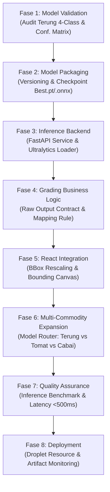

# Rencana Kerja Teknis: Machine Learning (ML) Engineer
## Proyek: Agri-Sort AI — Quality Control & Smart Pricing Hortikultura

> **Status:** ROADMAP MUTAKHIR (Model Baru: YOLO11n Terung 4-Kelas)  
> **Artefak Model Aktif:** `models-20261107T170211Z-1-001/models/terung/` (`best.pt` [5,49 MB], `best.onnx` [10,67 MB])  
> **Dataset Sumber:** Roboflow `eggplant-quality-grades-hgdr1-oooww/1` (CC BY 4.0)  
> **Framework & Versi:** Ultralytics YOLO 8.4.204 (YOLO11n, Google Colab NVIDIA Tesla T4)  
> **Tanggal Pembaruan:** 8 November 2026  

---

## 1. Konteks Proyek & Transisi Model

Agri-Sort AI beralih dari model purwarupa tomat 2-kelas lama ke model **YOLO11n Terung (Eggplant)** dengan 4 kelas mutu komersial. Transisi ini menandai langkah awal aplikasi menuju deteksi mutu komoditas nyata dengan standar klasifikasi berbasis data.

### Spesifikasi Model Terung Aktual `[VERIFIED]`

| Parameter | Nilai Aktual Artefak |
|---|---|
| **Arsitektur** | YOLO11n (Nano Object Detection) |
| **Framework Runtime** | Ultralytics 8.4.204 |
| **Input Image Size** | $640 \times 640$ piksel |
| **Jumlah Kelas (`nc`)** | 4 Kelas |
| **Format Bobot Tersedia** | `best.pt` (5.489.626 bytes) & `best.onnx` (10.666.390 bytes) |
| **Konfigurasi Dataset** | `models-20261107T170211Z-1-001/models/terung/data.yaml` |
| **Metadata Model** | `models-20261107T170211Z-1-001/models/terung/model-metadata.json` |

### Daftar Kelas Asli (*Original Classes*) & Distribusi Anotasi `[VERIFIED]`

| Class ID | Nama Kelas Asli (*Original Class*) | Train Instances | Valid Instances | Test Instances (311 Gambar) |
|:---:|---|:---:|:---:|:---:|
| `0` | `Class I` | 795 | 94 | 87 |
| `1` | `Class II` | 466 | 56 | 68 |
| `2` | `Extra Class` | 490 | 59 | 63 |
| `3` | `Reject` | 741 | 102 | 94 |
| **Total** | **4 Kelas** | **2.492** | **311** | **312** |

> [!IMPORTANT]
> **Integritas ID Kelas:**  
> ID kelas (`0: Class I`, `1: Class II`, `2: Extra Class`, `3: Reject`) wajib dijaga konsisten dengan `data.yaml`. Jangan mengubah nama atau urutan kelas di dalam model. Pemetaan ke grade mutu aplikasi dilakukan di lapisan logika bisnis backend, bukan di dalam model AI.

---

## 2. Audit Evaluasi Model & Batasan Kritis

### A. Hasil Evaluasi Uji (*Test Split Evaluation*) `[VERIFIED]`

| Metrik Evaluasi | Nilai Keseluruhan (*Overall*) | Target Kesiapan Produksi | Status |
|---|:---:|:---:|:---:|
| **Precision** | **69.54%** | $\ge 80.0\%$ | Perlu Peningkatan |
| **Recall** | **79.90%** | $\ge 80.0\%$ | Mendekati Target |
| **mAP@50** | **80.17%** | $\ge 85.0\%$ | Memadai untuk MVP Lapangan |
| **mAP@50-95** | **73.43%** | $\ge 70.0\%$ | Baik |

**Performa Rinci per Kelas:**
- `Extra Class`: Precision 72.5%, Recall 83.7%, mAP50 83.3%, mAP50-95 74.3%
- `Reject`: Precision 77.9%, Recall 86.1%, mAP50 88.3%, mAP50-95 82.8%
- `Class I`: Precision 66.6%, Recall 73.5%, mAP50 72.9%, mAP50-95 63.5%
- `Class II`: Precision 61.1%, Recall 76.3%, mAP50 76.1%, mAP50-95 73.1%

### B. Temuan Kritis Matriks Konfusi (*Confusion Matrix Findings*)
Analisis *normalized confusion matrix* menunjukkan kelemahan diskriminasi utama:
1. **Kebingungan Antara Class II dan Reject:**
   - Sekitar **19%** dari objek aktual `Class II` salah diprediksi sebagai `Reject`.
   - Sekitar **18%** dari objek aktual `Reject` salah diprediksi sebagai `Class II`.
2. **Dampak Finansial di Lapangan:**
   - Salah memprediksi `Class II` menjadi `Reject` menyebabkan petani rugi karena buah layak jual dibuang/diafkirkan (*under-grading*).
   - Salah memprediksi `Reject` menjadi `Class II` menyebabkan pedagang/pembeli menerima buah cacat/busuk (*over-grading*).
3. **Kesimpulan Kesiapan Model:**
   Model **TIDAK BOLEH DIANGGAP SIAP PRODUKSI PENUH** hanya karena mAP50 mencapai 80.17%. Untuk fase MVP, model harus dijalankan dengan batasan *Human-in-the-Loop* (pengguna dapat meninjau dan mengonfirmasi hasil deteksi sebelum transaksi difinalisasi).

---

## 3. Penilaian Arsitektur Integrasi AI (*Architecture Assessment*)

Terdapat dua pendekatan utama untuk mengintegrasikan model YOLO11 ke dalam sistem Agri-Sort AI:

| Kriteria Evaluasi | Opsi A: Python + FastAPI + Ultralytics (`.pt`) | Opsi B1: Backend ONNX Runtime (`.onnx`) | Opsi B2: Browser-side ONNX Runtime Web |
|---|---|---|---|
| **Format Bobot** | `best.pt` (PyTorch Checkpoint) | `best.onnx` (ONNX Opset 18) | `best.onnx` via `onnxruntime-web` |
| **Kompleksitas Dev** | **Rendah**: Native API (`model.predict()`), auto NMS & rescaling. | **Sedang**: Perlu kode manual letterbox & NMS Python. | **Sangat Tinggi**: Perlu pipeline canvas WebGL, tensor parsing JS. |
| **Latensi Eksekusi** | ~250–350 ms (CPU modern / Droplet). | ~180–280 ms (CPU teroptimasi thread C++). | Sangat bervariasi (400–2500 ms di HP petani). |
| **Ukuran Dependensi** | Besar (~500MB PyTorch/Ultralytics). | Ringan (~20MB wheel onnxruntime). | Ringan di server, tapi klien download 10.7MB model. |
| **Kebutuhan Hardware** | 1 vCPU / 2GB RAM server. | 1 vCPU / 1GB RAM server. | GPU/RAM tinggi pada HP pengguna di lapangan. |
| **Kompatibilitas HP** | 100% kompatibel (klien hanya kirim foto). | 100% kompatibel. | Rentang kegagalan tinggi (HP lawas tanpa WebGPU/WebGL). |
| **Perawatan Multi-Model** | Sangat mudah (ganti model path di backend). | Mudah (ganti model ONNX). | Sulit (cache browser, bandwidth boros petani). |

### Rekomendasi Arsitektur MVP: **Opsi A (FastAPI Backend dengan Transisi ke Backend ONNX)**
- **Tahap MVP Saat Ini:** Gunakan **Python + FastAPI + Ultralytics (`best.pt`)** untuk kecepatan implementasi dan validasi fungsional langsung.
- **Tahap Optimasi Produksi:** Ekspor ke **Backend ONNX Runtime (`best.onnx`)** di dalam FastAPI untuk menghemat RAM server saat beban bertambah.
- **Ditolak untuk MVP:** Browser-side ONNX Runtime Web ditolak karena membebani kuota internet dan spesifikasi smartphone petani di lapangan.

---

## 4. Strategi Model Multi-Komoditas (*Multi-Commodity Strategy*)

Aplikasi menargetkan tiga komoditas: **Terung (Eggplant)**, **Cabai Rawit Hijau (Chili)**, dan **Tomat (Tomato)**.

### Perbandingan Pendekatan:
1. **Strategi A — Model Terpisah per Komoditas (*Separate Specialized Models*):**
   - Tiap komoditas memiliki model tersendiri: `models/terung/best.pt`, `models/tomat/best.pt`, `models/cabai/best.pt`.
   - *Kelebihan:* Dataset terisolasi, jumlah kelas tiap komoditas bebas berbeda (Terung 4 kelas mutu, Tomat 2 kelas, Cabai kelas kematangan), pelatihan ulang satu komoditas tidak mempengaruhi komoditas lain (*no catastrophic forgetting*).
   - *Kekurangan:* Backend perlu memuat model sesuai komoditas yang diminta (*inference routing*).
2. **Strategi B — Model Tunggal Gabungan (*Unified Multi-Commodity Model*):**
   - Satu model dilatih untuk mendeteksi semua komoditas dan seluruh tingkatan mutunya sekaligus ($4 + 2 + 3 = 9+$ kelas).
   - *Kelebihan:* Satu session inferensi untuk semua komoditas.
   - *Kekurangan:* Pelatihan sangat kompleks, anotasi harus seragam, penambahan komoditas baru mengharuskan pelatihan ulang dari awal (*expensive retraining*).

### Rekomendasi MVP: **Strategi A (Model Terpisah per Komoditas)**
Untuk MVP, gunakan model spesifik terpisah dengan mekanisme *routing* sederhana di FastAPI:
```python
MODELS = {
    "terung": YOLO("models-20261107T170211Z-1-001/models/terung/best.pt"),
    "tomat": YOLO("model-export/weights/best.pt"), # Legacy model
}
```

---

## 5. Rencana Kerja ML Engineer Berdasarkan 8 Fase



---

### Fase 1 — Validasi Model & Analisis Anotasi (*Model Validation*)
- **Task ML-01: Verifikasi File Bobot & Konfigurasi:**  
  Memvalidasi integritas `models-20261107T170211Z-1-001/models/terung/best.pt` dan `best.onnx`.
- **Task ML-02: Audit Matriks Konfusi Class II vs Reject:**  
  Menelaah 68 sampel uji `Class II` dan 94 sampel `Reject`. Mengidentifikasi pola kesalahan visual (apakah karena ukuran cacat kecil, pencahayaan gelap, atau sudut tangkapan).
- **Task ML-03: Uji Inferensi Citra Lapangan Baru (*Unseen Real-World Images*):**  
  Menguji model dengan 20 foto terung keranjang panen nyata yang diambil langsung di luar dataset Roboflow untuk mengukur generalisasi visual.

### Fase 2 — Pengemasan & Tata Kelola Model (*Model Packaging*)
- **Task ML-04: Standarisasi Direktori Artefak Model:**  
  Menyimpan bobot resmi ke `server/models/terung/v1.0.0/` dengan berkas pendukung: `best.pt`, `best.onnx`, `data.yaml`, dan `metadata.json`.
- **Task ML-05: Validasi Kesetaraan Ekspor (*Parity Check .pt vs .onnx*):**  
  Memastikan deviasi output probabilitas antara `best.pt` dan `best.onnx` tidak melebihi $10^{-3}$.

### Fase 3 — Backend Inferensi AI (*Inference Backend*)
- **Task ML-06: Implementasi Service Inferensi Ultralytics:**  
  Membangun kelas `EggplantInferenceService` di `server/services/ai_engine.py`:
  - Inisialisasi model satu kali saat server menyala (*warm start*).
  - Metode `predict(image_bytes, confidence_threshold=0.25)`.
  - Eksekusi inferensi dengan NMS internal (IoU threshold $0.45$).
- **Task ML-07: Error Handling & Edge Cases:**  
  - Citra tanpa terung $\rightarrow$ kembalikan `detections: []`, `total_objects: 0`.
  - Citra rusak / corrupt bytes $\rightarrow$ tangkap exception dan kembalikan pesan ramah.
  - Pengukuran waktu komputasi (*latency logging*, target $< 500\text{ ms}$).

### Fase 4 — Logika Mutu & Kontrak Data (*Grading Business Logic*)
- **Task ML-08: Penyusunan Kontrak Raw Output:**  
  Memastikan engine HANYA mengembalikan kelas asli (`Class I`, `Class II`, `Extra Class`, `Reject`), ID kelas (0–3), confidence score, dan koordinat bounding box. Tidak mengarang harga atau grade huruf.
- **Task ML-09: Verifikasi Ambang Batas Keyakinan (*Confidence Threshold Calibration*):**  
  Menetapkan default threshold $0.25$ berdasarkan kurva F1-Score model, dapat disesuaikan pada rentang $0.15 - 0.50$ via parameter API.

### Fase 5 — Integrasi Antarmuka (*React Integration Support*)
- **Task ML-10: Sinkronisasi Skema Koordinat Bounding Box:**  
  Memastikan koordinat $(x_1, y_1, x_2, y_2)$ dinormalisasi atau dinyatakan dalam piksel absolut gambar asli sehingga canvas overlay frontend dapat melukis kotak secara presisi.

### Fase 6 — Perluasan Multi-Komoditas (*Multi-Commodity Expansion*)
- **Task ML-11: Implementasi Model Dispatcher / Router:**  
  Membangun router inferensi di backend:
  - Permintaan `"Terung"` $\rightarrow$ diteruskan ke model Terung 4-kelas (`models/terung/best.pt`).
  - Permintaan `"Tomat"` $\rightarrow$ diteruskan ke model Tomat 2-kelas (`model-export/weights/best.pt`).
  - Permintaan `"Cabai Rawit Hijau"` $\rightarrow$ respon status AI belum tersedia (*manual fallback*).

### Fase 7 — Jaminan Kualitas AI (*Quality Assurance*)
- **Task ML-12: Unit & Regression Testing AI:**  
  Menulis unit test Python di `server/tests/test_ai_engine.py`:
  - Uji konsistensi deteksi 4 kelas Terung.
  - Uji penolakan threshold.
  - Uji batas waktu eksekusi CPU $< 500\text{ ms}$ pada 20 iterasi.

### Fase 8 — Penerapan & Pemantauan (*Deployment*)
- **Task ML-13: Konfigurasi Sumber Daya Produksi:**  
  Menentukan batas konsumsi memori server (maksimal 1.5GB RAM pada Droplet DigitalOcean) dan manajemen thread CPU (`torch.set_num_threads(4)`).
- **Task ML-14: Model Versioning & Registry:**  
  Mencatat riwayat versi model di `server/models/registry.json`.

---

## 6. Kontrak Output Inferensi Baku (Raw Detection Contract)

Fungsi inferensi ML mengembalikan dictionary Python murni berikut:

```json
{
  "contract_version": "1.1.0",
  "commodity": "Terung",
  "model_name": "Agri-Sort Eggplant Quality Detection",
  "model_version": "1.0.0",
  "inference_time_ms": 284.5,
  "image_dimensions": {
    "width": 1280,
    "height": 720
  },
  "detections": [
    {
      "id": 1,
      "class_id": 2,
      "class_name": "Extra Class",
      "confidence": 0.912,
      "box": { "x1": 110.0, "y1": 95.0, "x2": 260.5, "y2": 420.0 }
    },
    {
      "id": 2,
      "class_id": 0,
      "class_name": "Class I",
      "confidence": 0.885,
      "box": { "x1": 310.0, "y1": 105.0, "x2": 480.0, "y2": 435.5 }
    },
    {
      "id": 3,
      "class_id": 1,
      "class_name": "Class II",
      "confidence": 0.742,
      "box": { "x1": 530.0, "y1": 130.0, "x2": 690.0, "y2": 450.0 }
    },
    {
      "id": 4,
      "class_id": 3,
      "class_name": "Reject",
      "confidence": 0.814,
      "box": { "x1": 740.0, "y1": 150.0, "x2": 910.0, "y2": 470.0 }
    }
  ],
  "detection_summary": {
    "total_objects": 4,
    "class_counts": {
      "Class I": 1,
      "Class II": 1,
      "Extra Class": 1,
      "Reject": 1
    }
  }
}
```

---

## 7. Definition of Done (DoD) ML Engineer

Pekerjaan ML Engineer dinyatakan selesai jika memenuhi seluruh kriteria:
1. Berkas model Terung (`best.pt`) berhasil dimuat di backend menggunakan `ultralytics.YOLO`.
2. Seluruh 4 kelas asli (`Class I`, `Class II`, `Extra Class`, `Reject`) terdeteksi dengan ID 0–3 yang konsisten.
3. Rata-rata waktu inferensi di lingkungan CPU server terbukti $< 500\text{ ms}$.
4. Output inferensi mematuhi 100% kontrak skema raw detection tanpa menyertakan logika harga atau grade fiktif.
5. Skenario gambar tanpa objek dan berkas rusak tertangani secara aman tanpa server crash.
6. Seluruh unit test pada `server/tests/test_ai_engine.py` lulus 100%.

---

## 8. Catatan Kolaborasi Teknis & Tindak Lanjut untuk Faris Al Farizi (ML Engineer & Project Lead)

> **Tanggal Catatan:** 8 November 2026  
> **Pencatat:** Hieray Antovino (Fullstack Developer)  
> **Status Integrasi:** 161 Unit Tests Lulus 100% (96 Frontend JS + 65 Backend Python)

### A. Fitur yang Sudah Selesai Dikerjakan & Terverifikasi (Hieray):
1. **Integrasi Live Feed Panel Harga BAPANAS (Badan Pangan Nasional RI):**
   - Backend service: `server/services/bapanas_service.py` untuk wilayah Sumatera Barat & Pasar Ibuh Payakumbuh.
   - Endpoint: `GET /api/v1/pricing/bapanas/live`, `GET /api/v1/pricing/bapanas/commodities/{comm}`, dan `POST /api/v1/pricing/bapanas/sync`.
   - Frontend: Sinkronisasi instan, lencana hijau verified di `PricingDashboard.jsx`, dan penyesuaian metric card `App.jsx`.
2. **Modul Edukasi Sains Patologi Pascapanen (Pilar S dari STEAM):**
   - Basis data: `src/business/pathologyReference.js` (Antraknosa, Busuk Lunak Bakteri, Botrytis, Kerut Fisiologis, Blossom-End Rot).
   - Komponen UI: `PostHarvestPathologyCards.jsx` dengan katalog interaktif dan status adaptif (100% Prima vs Deteksi Cacat Aktif).
3. **Perbaikan Bug Kritis Kamera & Tampilan:**
   - Menyembuhkan *White Screen of Death* di `QCResults.jsx` (memperbaiki referensi variabel `commodity`).
   - Mengatasi *Hardware Camera Stream Leak* di `LiveCameraViewfinder.jsx` dan `BatchQCScanner.jsx` (kamera langsung mati saat foto diambil atau saat navigasi halaman di Linux).
   - Mengoptimalkan waktu respons navigasi (*non-blocking hardware release*).

### B. Agenda & Tindak Lanjut Khusus untuk Faris Al Farizi (ML & AI Pipeline):
1. **Multi-Angle / Multi-Shot Inference Aggregation:** `[SELESAI & TERVERIFIKASI]`
   - **Tujuan:** Mengatasi kelemahan inspeksi satu arah (*Single-View Occlusion Bias*) agar tidak ada petani/pengepul yang menyembunyikan sisi busuk di belakang.
   - **Status Selesai:** Endpoint backend `POST /api/v1/qc/scan-multi` telah aktif di `server/routers/qc.py`.
   - **Layanan Agregasi:** `server/services/multi_angle_service.py` menghitung rata-rata tertimbang (*weighted defect ratio*), disparitas cacat (*defect delta*), indeks konsistensi lot panen (*consistency index*), serta memicu peringatan otomatis `occlusion_bias_detected` saat sisi belakang terbukti menyembunyikan cacat lebih tinggi.
   - **Klien JS Frontend:** `src/services/scanService.js` menyediakan `scanMultiAngleHarvestImages()`.
2. **Pre-flight Quality Gate Citra di Backend (Pasar Subuh & Kamera Kentang):** `[SELESAI & TERVERIFIKASI]`
   - **Tujuan:** Mencegah salah prediksi saat foto diambil di Pasar Ibuh Payakumbuh pada subuh hari yang remang-remang atau menggunakan kamera HP murah.
   - **Status Selesai:** Modul `server/utils/image_quality.py` menyediakan fungsi `analyze_image_quality` (deteksi ketajaman Laplacian Variance & Mean Luminance) dan filter adaptif `apply_clahe_enhancement` (Contrast Limited Adaptive Histogram Equalization pada kanal L ruang warna LAB) yang diaktifkan otomatis saat citra terdeteksi *underexposed*.
3. **Validasi Tiled Inference SAHI di Dataset Riil Pasar Ibuh:** `[SELESAI & TERVERIFIKASI]`
   - Skrip `server/services/tiled_inference.py` terbukti mendeteksi multi-buah individual dan berhasil menghapus box monolitik halusinasi keranjang.

### C. Pembagian Peran Anggota Lain:
- **Ahmad Afif (QA & Dokumentasi) bersama Pak Rogi Auvi:**
  - Menyusun dokumen **SOP Pengambilan Sampel QC Lapangan (Metode Nampan Goyang / Shake & Roll Protocol)** sebagai lampiran resmi pembuktian pada presentasi Kepala Sekolah dan Dewan Juri STEAMPreneur.
- **Hieray Antovino (Fullstack Developer):**
  - Siap menghubungkan antarmuka tombol ganda (*Multi-Angle Capture UI*) begitu Faris merilis endpoint `scan-multi`.

