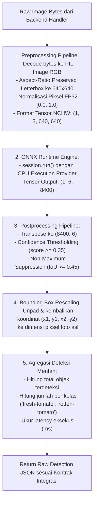
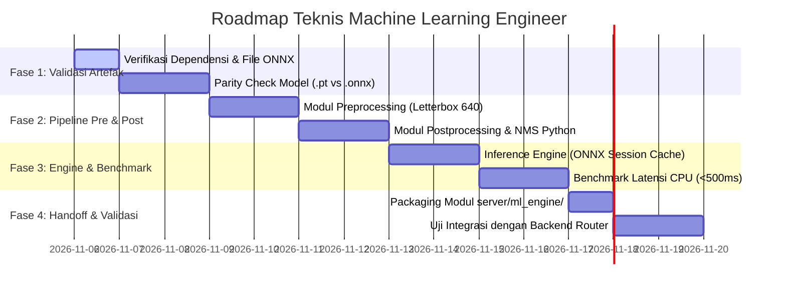

# Rencana Kerja Teknis: Machine Learning (ML) Engineer

> **Proyek:** Agri-Sort AI — Quality Control & Smart Pricing Hortikultura  
> **Dokumen:** Pedoman Implementasi Teknis Machine Learning Engineer  
> **Status:** HASIL AUDIT & REVISI TEKNIS (Ground Truth Baseline)  
> **Penanggung Jawab:** Machine Learning (ML) Engineer  
> **Tanggal Pembaruan:** 5 November 2026  

---

## 1. Informasi Proyek & Konteks Teknis

Agri-Sort AI memanfaatkan teknologi *Computer Vision* berbasis deteksi objek untuk mengotomatiskan identifikasi visual komoditas hortikultura pada keranjang hasil panen petani.

### Ringkasan Kondisi Model Aktual `[VERIFIED]`
Berdasarkan hasil audit langsung terhadap artefak di direktori `model-export/`:
- **Framework & Arsitektur:** Ultralytics YOLO11 Nano (`yolo11n.pt`)
- **Tugas Model (*Task*):** `detect` (*Object Detection* dengan *bounding box*)
- **Dataset Asal:** Roboflow `agri-sort/2`
- **Jumlah Kelas (`nc`):** 2 Kelas
- **Daftar Label Kelas (`names`):**
  1. `0`: `fresh-tomato` (Tomat Segar)
  2. `1`: `rotten-tomato` (Tomat Busuk/Cacat)
- **Ukuran Input Model (`imgsz`):** $640 \times 640$ piksel (3 kanal warna RGB)
- **Total Epoch Pelatihan:** 50 Epoch
- **Berkas Bobot Tersedia:**
  - `model-export/weights/best.onnx` (10,66 MB / 10.663.419 bytes)
  - `model-export/weights/best.pt` (5,51 MB / 5.505.562 bytes)
  - `model-export/weights/last.pt` (5,51 MB / 5.505.562 bytes)

---

## 2. Batas Kemampuan Model yang Wajib Dipatuhi

ML Engineer wajib mematuhi batas-batas teknis berikut dalam implementasi dan dokumentasi:

1. **Model TIDAK Menghasilkan Grade A, Grade B, dan Reject:**
   Model dilatih khusus mendeteksi tomat segar (`fresh-tomato`) dan tomat busuk (`rotten-tomato`). Model **tidak memiliki dasar data** untuk mengklasifikasikan mutu ke dalam tiga tingkatan grade komersial.
2. **Confidence Score BUKAN Indikator Kualitas Produk:**
   Nilai *confidence* ($0.0 - 1.0$) semata-mata mengukur tingkat keyakinan probabilitas model bahwa suatu fitur visual adalah objek tomat. Nilai confidence **TIDAK BOLEH** digunakan untuk membagi kualitas buah (misalnya menganggap confidence $95\%$ sebagai Grade A dan $60\%$ sebagai Grade B). Hal tersebut keliru secara ilmiah dan metodologis.
3. **Ambang Batas (*Confidence Threshold*) untuk Eliminasi False Positive:**
   Confidence threshold murni digunakan sebagai filter kepastian deteksi (apakah suatu prediksi diterima atau dibuang sebagai *background noise*), bukan penentu kelas mutu.
4. **Model BELUM Mendukung Cabai Rawit Hijau dan Terung:**
   Meskipun target aplikasi hortikultura mencakup cabai dan terung, model yang ada saat ini hanya mengenali tomat. Jangan membuat klaim bahwa model mampu mendeteksi komoditas selain tomat.
5. **Model TIDAK Mengukur Berat atau Nilai Finansial:**
   Model computer vision hanya menghasilkan koordinat kotak dan kelas. Logika perhitungan bobot riil dan harga adalah tanggung jawab domain bisnis backend, bukan output model AI.

---

## 3. Hasil Evaluasi Performa Model Aktual `[VERIFIED]`

Berdasarkan analisis berkas log pelatihan `model-export/config/results.csv`:

| Metrik Evaluasi | Nilai Terbaik (*Best*) | Nilai Epoch Terakhir (50) | Keterangan & Penafsiran |
|---|:---:|:---:|---|
| **mAP@50 (Mean Average Precision @ IoU 0.50)** | **0.9712** (Epoch 48) | **0.9643** | Kemampuan lokalisasi dan klasifikasi objek sangat tinggi pada batas tumpang-tindih 50%. |
| **mAP@50-95 (mAP All IoU Thresholds)** | **0.8912** (Epoch 50) | **0.8912** | Akurasi ketat pada berbagai ambang batas IoU (0.50 hingga 0.95). |
| **Precision (B)** | **0.9814** (Epoch 50) | **0.9814** | Tingkat ketepatan deteksi positif: 98.1% objek yang dideteksi memang benar tomat. |
| **Recall (B)** | **0.9351** (Epoch 48) | **0.9254** | Tingkat sensitivitas temuan: 92.5% buah tomat pada data validasi berhasil ditemukan. |
| **Validation Box Loss** | **0.3683** (Epoch 50) | **0.3683** | Kesalahan penempatan kotak deteksi konvergen stabil. |
| **Validation Class Loss** | **0.2860** (Epoch 50) | **0.2860** | Kesalahan penentuan kelas biner konvergen sangat baik. |

---

## 4. Alur Pipeline Inferensi Machine Learning



---

## 5. Kontrak Integrasi Output (Antar-Role)

ML Engineer bertanggung jawab menghasilkan **Raw Detection Result** murni tanpa beban logika bisnis harga atau penetapan grade fiktif.

Format keluaran fungsi inferensi Python:
```python
def predict_harvest_image(
    image_bytes: bytes, 
    confidence_threshold: float = 0.35
) -> dict:
```

### Skema Dictionary Respon:
```json
{
  "contract_version": "1.0.0",
  "model_name": "yolo11n-agrisort",
  "model_version": "2026.11.02",
  "inference_time_ms": 312.4,
  "image_dimensions": {
    "width": 1280,
    "height": 720
  },
  "detections": [
    {
      "id": 1,
      "class_id": 0,
      "class_name": "fresh-tomato",
      "confidence": 0.942,
      "box": {
        "x1": 120.5,
        "y1": 85.0,
        "x2": 240.2,
        "y2": 210.8
      }
    },
    {
      "id": 2,
      "class_id": 1,
      "class_name": "rotten-tomato",
      "confidence": 0.887,
      "box": {
        "x1": 310.0,
        "y1": 140.2,
        "x2": 430.5,
        "y2": 265.0
      }
    }
  ],
  "detection_summary": {
    "total_objects": 2,
    "class_counts": {
      "fresh-tomato": 1,
      "rotten-tomato": 1
    }
  }
}
```

---

## 6. Rencana Kerja ML Engineer Berdasarkan Fase



---

### Fase 1: Validasi Model & Verifikasi Konversi

#### Task ML-01: Verifikasi Lingkungan & Dependensi Runtime
- **Tujuan:** Memastikan pustaka eksekusi inferensi siap digunakan tanpa dependensi berat (tidak memerlukan CUDA di CPU).
- **Langkah:**
  1. Menyiapkan dependensi minimal: `onnxruntime>=1.19.0`, `pillow>=10.4.0`, `numpy>=1.26.0`.
  2. Memverifikasi struktur model ONNX (`best.onnx`) menggunakan skrip inspeksi:
     - Input tensor: `images` berdimensi `[1, 3, 640, 640]`, tipe `float32`.
     - Output tensor: `output0` berdimensi `[1, 6, 8400]`, tipe `float32`.
- **Berkas Terlibat:** `model-export/weights/best.onnx`, `server/requirements.txt`
- **Acceptance Criteria:** Model dapat dimuat oleh `onnxruntime.InferenceSession` tanpa peringatan ketidakcocokan opset.

#### Task ML-02: Parity Check (.pt vs .onnx)
- **Tujuan:** Menjamin hasil deteksi antara checkpoint PyTorch asli dan model ekspor ONNX identik.
- **Langkah:**
  1. Menjalankan inferensi pada 5 gambar uji yang sama menggunakan model PyTorch (`best.pt`) dan model ONNX (`best.onnx`).
  2. Menghitung deviasi maksimum nilai bounding box dan confidence.
- **Berkas Terlibat:** `server/tests/test_model_parity.py`
- **Acceptance Criteria:** Selisih maksimum nilai probabilitas deteksi $< 10^{-3}$ ($0.1\%$).

---

### Fase 2: Preprocessing, Postprocessing, & Non-Maximum Suppression

#### Task ML-03: Implementasi Modul Preprocessing Preservasi Rasio Citra
- **Tujuan:** Mengubah citra masukan dengan berbagai resolusi menjadi tensor input standar tanpa distorsi bentuk buah.
- **Langkah:**
  1. Membaca buffer byte citra menjadi objek `PIL.Image.Image` dalam ruang warna RGB.
  2. Menerapkan *Letterbox Scaling* ke ukuran $640 \times 640$:
     - Menghitung rasio penskalaan minimum: $r = \min(640 / W_{\text{orig}}, 640 / H_{\text{orig}})$.
     - Menghitung ukuran baru: $W_{\text{new}} = \text{round}(W_{\text{orig}} \times r)$, $H_{\text{new}} = \text{round}(H_{\text{orig}} \times r)$.
     - Mengisi ruang kosong (padding) dengan warna abu-abu netral $(114, 114, 114)$ di kedua sisi sehingga objek berada di tengah.
     - Menyimpan parameter transformasi: `scale_ratio`, `pad_x`, `pad_y`.
  3. Mengonversi citra ke array NumPy `float32` dan melakukan normalisasi rentang $[0, 255] \rightarrow [0.0, 1.0]$.
  4. Melakukan transposisi dimensi dari format HWC `(640, 640, 3)` ke format NCHW `(1, 3, 640, 640)`.
- **Berkas Terlibat:** `[NEW] server/ml_engine/preprocessor.py`
- **Acceptance Criteria:** Fungsi mengembalikan tensor berdimensi tepat `(1, 3, 640, 640)` bertipe `float32` dan metadata skala.

#### Task ML-04: Implementasi Postprocessing, Filtering, & Non-Maximum Suppression (NMS)
- **Tujuan:** Mengekstrak kotak pembatas yang valid, membuang deteksi ganda, dan memetakan koordinat kembali ke dimensi asli.
- **Langkah:**
  1. Memproses tensor output berdimensi `(1, 6, 8400)`:
     - Menghapus batch dimension dan transposisi menjadi `(8400, 6)`.
     - Setiap baris: `[x_center, y_center, width, height, prob_fresh, prob_rotten]`.
  2. Menyaring deteksi dengan confidence score di bawah ambang batas ($\text{confidence} < \text{confidence\_threshold}$, default $0.35$).
  3. Mengonversi format koordinat pusat $(x_c, y_c, w, h)$ ke sudut $(x_1, y_1, x_2, y_2)$.
  4. Menerapkan algoritma **Non-Maximum Suppression (NMS)**:
     - Mengurutkan kandidat kotak berdasarkan skor confidence tertinggi.
     - Mengeliminasi kotak-kotak bertumpang-tindih yang memiliki nilai Intersection over Union ($\text{IoU}$) $\ge 0.45$.
  5. Mengembalikan koordinat kotak ke resolusi gambar asli (*coordinate rescaling*):
     $$x_{\text{orig}} = \frac{x_{\text{padded}} - \text{pad}_x}{\text{scale\_ratio}}, \quad y_{\text{orig}} = \frac{y_{\text{padded}} - \text{pad}_y}{\text{scale\_ratio}}$$
     Melakukan *clamping* agar koordinat berada dalam rentang valid $[0, W_{\text{orig}}]$ dan $[0, H_{\text{orig}}]$.
- **Berkas Terlibat:** `[NEW] server/ml_engine/postprocessor.py`
- **Acceptance Criteria:** NMS berhasil menggabungkan prediksi ganda pada satu buah tomat menjadi tepat satu kotak deteksi.

---

### Fase 3: Engine Inferensi & Optimasi Latensi

#### Task ML-05: Implementasi Kelas Singleton YOLOInferenceEngine
- **Tujuan:** Menjamin pemuatan model hanya terjadi satu kali saat server start (*warm start*), menghindari latensi berulang saat pemanggilan API.
- **Langkah:**
  1. Membuat kelas `YOLOInferenceEngine` dengan pola desain *singleton*:
     - Menyimpan instance `InferenceSession` di memori.
     - Menetapkan konfigurasi `session_options.intra_op_num_threads` sesuai jumlah core CPU.
  2. Menyediakan fungsi utama `predict_harvest_image(image_bytes, confidence_threshold)`.
  3. Mengukur durasi waktu eksekusi menggunakan `time.perf_counter()`.
- **Berkas Terlibat:** `[NEW] server/ml_engine/inferencer.py`
- **Acceptance Criteria:** Model di-load sekali, pemanggilan inferensi berikutnya tidak mengulang proses pemuatan berkas ONNX.

#### Task ML-06: Penanganan Kasus Tepi (*Edge Cases*) & Error Handling
- **Tujuan:** Mencegah terjadinya exception atau crash saat menerima input yang tidak biasa.
- **Langkah:**
  1. **Gambar Tanpa Tomat:** Mengembalikan array deteksi kosong `[]`, `total_objects: 0`, dan status sukses (bukan error).
  2. **Citra Gelap / Blur:** Membiarkan model mendeteksi dengan confidence wajar; jika di bawah threshold, ditolak secara wajar oleh filter.
  3. **Berkas Rusak / Corrupt Bytes:** Menangkap exception decoding gambar dan mengembalikan exception internal terdefinisi (`InvalidImageBytesError`).
  4. **Resolusi Ekstrem:** Memastikan letterbox mampu menangani aspek rasio panorama (misal $3000 \times 400$) atau vertikal tanpa division by zero.
- **Berkas Terlibat:** `server/ml_engine/inferencer.py`
- **Acceptance Criteria:** Seluruh pengujian skenario edge-case menghasilkan respon terkendali tanpa crash pada engine.

---

### Fase 4: Handoff & Uji Integrasi

#### Task ML-07: Pengemasan Modul Bersih & Unit Testing
- **Tujuan:** Menyerahkan modul inferensi siap pakai kepada Fullstack Developer.
- **Langkah:**
  1. Mengekspor fungsi utama melalui `server/ml_engine/__init__.py`.
  2. Menulis unit test komprehensif menggunakan `pytest`:
     - Uji inferensi dengan gambar sampel tomat.
     - Uji deteksi citra kosong.
     - Uji kepatuhan format output terhadap skema kontrak integrasi.
- **Berkas Terlibat:** `[NEW] server/ml_engine/__init__.py`, `[NEW] server/tests/test_ml_engine.py`
- **Acceptance Criteria:** `pytest server/tests/test_ml_engine.py` lulus 100%.

---

## 7. Rencana Pengembangan Model Masa Depan (FUTURE SCOPE)

Kemampuan berikut **BELUM TERSEDIA** saat ini dan dicatat sebagai agenda riset lanjutan:
1. **Dataset Multi-Grading Khusus:** Mengumpulkan dan menganotasi dataset tomat dengan label mutu komersial (Grade A, Grade B, Reject) yang divalidasi langsung oleh pakar agronomi/hortikultura.
2. **Perluasan Komoditas Target:** Akuisisi dataset citra keranjang panen Cabai Rawit Hijau, Cabai Merah Keriting, dan Terung untuk memperluas cakupan deteksi.
3. **Model Segmentasi Instan (*Instance Segmentation*):** Mengembangkan model YOLO11-seg untuk menghitung luas area permukaan tomat guna mengestimasi volume dan diameter buah secara matematis.

---

## 8. Definition of Done (DoD) ML Engineer

Pekerjaan ML Engineer dinyatakan selesai jika memenuhi seluruh checklist berikut:
1. Berkas model `best.onnx` berhasil diintegrasikan melalui `onnxruntime` tanpa error.
2. Pipeline preprocessing letterbox $640 \times 640$ mempertahankan rasio aspek dan menghasilkan tensor FP32 ter-normalisasi.
3. Postprocessing NMS berhasil membuang deteksi tumpang-tindih (IoU 0.45) dan mengembalikan koordinat asli.
4. Respon inferensi 100% mematuhi skema kontrak integrasi raw detection.
5. Latensi inferensi rata-rata pada CPU server terukur $< 500\text{ ms}$.
6. Tidak ada klaim fiktif terkait Grade A/B/Reject atau komoditas cabai/terung.
7. Seluruh unit test pada `server/tests/test_ml_engine.py` lulus 100%.
