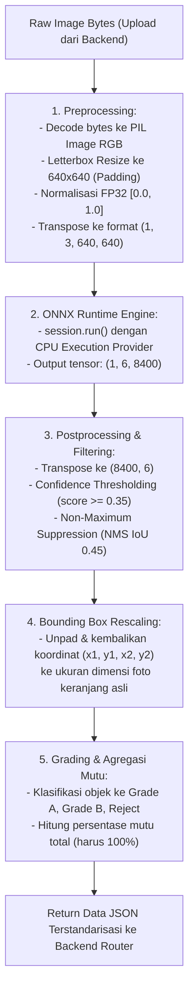

# Rencana Kerja Teknis: Machine Learning (ML) Engineer

> **Proyek:** Agri-Sort AI — STEAMPreneur SMK Tingkat Nasional 2026  
> **Peran:** Machine Learning (ML) Engineer  
> **Fokus Utama:** Persiapan dependensi, pipeline preprocessing, inferensi model YOLO11 ONNX runtime, postprocessing (NMS), kalkulasi pembagian mutu (*grading*), dan pengemasan modul inferensi Python berlatensi rendah ($< 500\text{ ms}$).  
> **Artefak Model Sumber:** `model-export/weights/best.onnx` (10,66 MB, YOLO11 Nano, Opset 18)

---

## 1. Sasaran Teknis & Spesifikasi Model

| Parameter | Spesifikasi Target |
|---|---|
| **Model Arsitektur** | Ultralytics YOLO11 Nano (`yolo11n`) hasil latih Google Colab GPU |
| **Format Bobot** | ONNX Runtime (`model-export/weights/best.onnx`) |
| **Dimensi Input** | $1 \times 3 \times 640 \times 640$ (Tensor Float32, kanal RGB, ter-normalisasi $0.0 - 1.0$) |
| **Dimensi Output** | $1 \times 6 \times 8400$ ($x_{center}, y_{center}, w, h, \text{score}_{\text{fresh}}, \text{score}_{\text{rotten}}$) |
| **Target Latensi** | $< 500\text{ ms}$ per batch foto di CPU server |
| **Target Akurasi** | $mAP@50 \ge 85\%$ pada data uji keranjang panen |
| **Kelas Deteksi** | `fresh-tomato` (Kelas 0), `rotten-tomato` (Kelas 1) $\rightarrow$ dipetakan ke Grade A, Grade B, Reject |

---

## 2. Alur Pipeline Inferensi AI



---

## 3. Rincian Langkah Kerja (Step-by-Step Task)

### Langkah 1: Setup Lingkungan & Pustaka Dependensi
- Memastikan dependensi Python terpasang di sistem:
  ```bash
  pip install onnxruntime pillow numpy
  ```
- Memverifikasi keberadaan dan integritas file bobot:
  - Berkas model: `model-export/weights/best.onnx`
  - Metadata: `model-export/export_metadata.json`
  - Konfigurasi kelas: `model-export/config/data.yaml`

### Langkah 2: Pembuatan Modul Preprocessing Citra (`server/ml_engine/preprocessor.py`)
Membangun fungsi preprocessing yang mempertahankan rasio aspek gambar (*Aspect Ratio Preserved Letterbox*):
1. **Fungsi `letterbox_image(image, target_size=(640, 640))`:**
   - Menghitung rasio skala: $r = \min(640 / W, 640 / H)$.
   - Menghitung ukuran baru: $W_{new} = \text{round}(W \times r)$, $H_{new} = \text{round}(H \times r)$.
   - Menghitung padding: $\text{pad}_w = (640 - W_{new}) / 2$, $\text{pad}_h = (640 - H_{new}) / 2$.
   - Mengisi area tepi dengan warna abu-abu standar YOLO `(114, 114, 114)`.
   - Mengembalikan citra ter-padding beserta metadata skala `(scale_ratio, pad_w, pad_h)` untuk keperluan postprocessing.
2. **Fungsi `image_to_tensor(image)`:**
   - Mengonversi citra PIL ke array NumPy `float32`.
   - Membagi nilai piksel dengan $255.0$ untuk normalisasi rentang $[0.0, 1.0]$.
   - Mengubah urutan sumbu dari HWC `(640, 640, 3)` menjadi CHW `(3, 640, 640)`.
   - Menambahkan dimensi batch: `np.expand_dims(tensor, axis=0)` $\rightarrow$ `(1, 3, 640, 640)`.

### Langkah 3: Pembuatan Engine Inferensi ONNX Runtime (`server/ml_engine/inferencer.py`)
Membangun kelas singleton `YOLOInferenceEngine` agar model hanya dimuat satu kali ke memori (*warm start*):
1. **Inisialisasi `__init__(model_path)`:**
   - Memuat `onnxruntime.InferenceSession` dengan `CPUExecutionProvider`.
   - Mengonfigurasi `session_options.intra_op_num_threads` sesuai jumlah inti CPU untuk eksekusi paralel maksimal.
   - Mengambil nama input tensor (`session.get_inputs()[0].name`) dan output tensor (`session.get_outputs()[0].name`).
2. **Metode `infer(input_tensor)`:**
   - Menjalankan `session.run([output_name], {input_name: input_tensor})`.
   - Mengukur waktu inferensi murni dalam milidetik menggunakan `time.perf_counter()`.

### Langkah 4: Pembuatan Modul Postprocessing & NMS (`server/ml_engine/postprocessor.py`)
Memproses keluaran mentah model YOLO11:
1. **Parsing Tensor Output `(1, 6, 8400)`:**
   - Menghapus dimensi batch dan transpose menjadi bentuk matriks `(8400, 6)`.
   - Tiap baris memuat: `[x_center, y_center, width, height, prob_fresh, prob_rotten]`.
2. **Filtering Berdasarkan Confidence:**
   - Menentukan kelas dengan probabilitas tertinggi untuk tiap baris: $\text{class\_id} = \arg\max(\text{prob\_fresh}, \text{prob\_rotten})$.
   - Mengambil nilai kepercayaan: $\text{confidence} = \max(\text{prob\_fresh}, \text{prob\_rotten})$.
   - Membuang deteksi dengan $\text{confidence} < \text{confidence\_threshold}$ (default: $0.35$).
3. **Penerapan Algoritma Non-Maximum Suppression (NMS):**
   - Mengonversi koordinat pusat ke format $(x_1, y_1, x_2, y_2)$:
     $$x_1 = x_c - w/2, \quad y_1 = y_c - h/2, \quad x_2 = x_c + w/2, \quad y_2 = y_c + h/2$$
   - Mengeliminasi kotak-kotak tumpang tindih (*overlapping*) menggunakan ambang batas Intersection over Union ($\text{IoU} \ge 0.45$).
4. **Rescaling Koordinat ke Resolusi Foto Asli:**
   - Mengurangkan offset padding: $x - \text{pad}_w$, $y - \text{pad}_h$.
   - Membagi dengan faktor skala rasio: $x / \text{scale\_ratio}$, $y / \text{scale\_ratio}$.
   - Membatasi koordinat (*clamping*) agar tetap berada dalam batas lebar dan tinggi gambar asli $[0, W_{\text{orig}}]$ dan $[0, H_{\text{orig}}]$.

### Langkah 5: Pemetaan Mutu (*Grading Logic*) (`server/ml_engine/grading.py`)
Menerapkan aturan bisnis kontrol kualitas hortikultura STEAM:
1. **Aturan Penentuan Grade Tiap Objek:**
   - `class_id == 0` (*fresh-tomato*) dengan $\text{confidence} \ge 0.70$ $\rightarrow$ **Grade A** (Mutu Super / Segar Prima).
   - `class_id == 0` (*fresh-tomato*) dengan $0.35 \le \text{confidence} < 0.70$ $\rightarrow$ **Grade B** (Mutu Standar / Sedikit Cacat).
   - `class_id == 1` (*rotten-tomato*) $\rightarrow$ **Reject** (Busuk / Cacat Berat / Terinfeksi).
2. **Kalkulasi Agregasi Persentase Mutu:**
   - Menghitung total objek terdeteksi: $N = N_A + N_B + N_{Reject}$.
   - Jika $N = 0$, kembalikan status deteksi kosong dengan pesan edukatif.
   - Menghitung persentase:
     $$\%A = \frac{N_A}{N} \times 100\%, \quad \%B = \frac{N_B}{N} \times 100\%, \quad \%Reject = 100\% - (\%A + \%B)$$
     *(Menjamin total persentase selalu tepat $100.0\%$)*.

### Langkah 6: Pembuatan Antarmuka Utama ML Engine (`server/ml_engine/__init__.py`)
Menyediakan satu fungsi pintu masuk utama yang bersih untuk dipanggil oleh Backend FastAPI:
```python
def predict_harvest_batch(image_bytes: bytes, confidence_threshold: float = 0.35) -> dict:
    """
    Fungsi entry-point inferensi gambar panen.
    Menerima raw image bytes dan mengembalikan dictionary hasil deteksi
    lengkap dengan koordinat bounding box, klasifikasi grade, dan ringkasan distribusi mutu.
    """
    pass
```

### Langkah 7: Pengujian Mandiri & Benchmarking (`server/tests/test_ml_engine.py`)
1. Membuat pengujian otomatis untuk memverifikasi:
   - Waktu inferensi pada 10 citra uji berturut-turut stabil di bawah $500\text{ ms}$.
   - Respon deteksi memiliki format JSON sesuai kontrak.
   - Koordinat bounding box tidak bernilai negatif dan tidak melebihi dimensi citra asli.

---

## 4. Struktur Direktori Kerja ML Engineer

```
server/
├── ml_engine/
│   ├── __init__.py           # Ekspor fungsi utama predict_harvest_batch()
│   ├── inferencer.py         # Singleton YOLOInferenceEngine (ONNX Runtime)
│   ├── preprocessor.py       # Aspect ratio letterboxing & normalisasi tensor FP32
│   ├── postprocessor.py      # Transposisi, filtering confidence, NMS, & rescaling koordinat
│   └── grading.py            # Pemetaan kelas deteksi ke Grade A, Grade B, dan Reject
└── tests/
    └── test_ml_engine.py     # Unit test dan pengujian benchmark latensi inferensi
```

---

## 5. Kontrak Format Keluaran (Output Dictionary)

Fungsi `predict_harvest_batch()` harus mengembalikan data dengan skema Python dictionary berikut:

```python
{
    "inference_time_ms": 315,
    "image_width": 1280,
    "image_height": 720,
    "detections": [
        {
            "id": 1,
            "class_id": 0,
            "class_name": "fresh-tomato",
            "grade": "GRADE_A",
            "confidence": 0.94,
            "box": { "x1": 145, "y1": 90, "x2": 280, "y2": 230 }
        },
        {
            "id": 2,
            "class_id": 1,
            "class_name": "rotten-tomato",
            "grade": "REJECT",
            "confidence": 0.87,
            "box": { "x1": 340, "y1": 150, "x2": 460, "y2": 275 }
        }
    ],
    "summary": {
        "total_count": 25,
        "counts": {
            "grade_a": 18,
            "grade_b": 5,
            "reject": 2
        },
        "percentages": {
            "grade_a": 72.0,
            "grade_b": 20.0,
            "reject": 8.0
        }
    }
}
```

---

## 6. Kriteria Selesai (Definition of Done — ML Engineer)

- [ ] Model `model-export/weights/best.onnx` berhasil di-*load* ke memori menggunakan `onnxruntime`.
- [ ] Pipeline *preprocessing letterbox* menghasilkan tensor $(1, 3, 640, 640)$ tanpa distorsi rasio aspek.
- [ ] Postprocessing NMS berhasil membuang kotak deteksi ganda dan mengembalikan koordinat asli.
- [ ] Waktu inferensi rata-rata pada CPU tercatat $< 500\text{ ms}$ per pemanggilan.
- [ ] Skrip uji `server/tests/test_ml_engine.py` lulus $100\%$ tanpa *error*.
