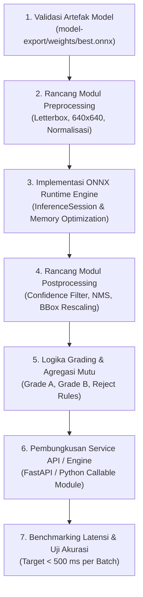
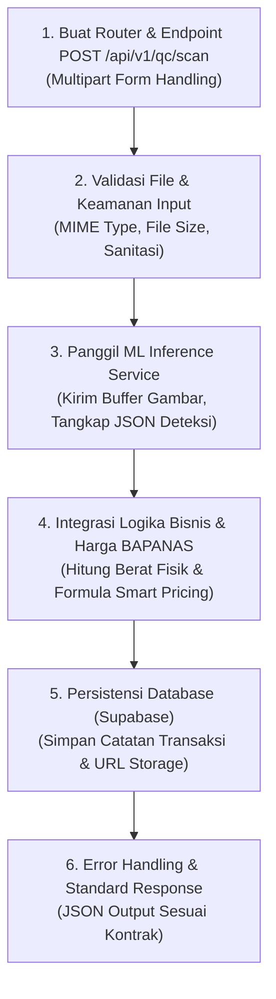
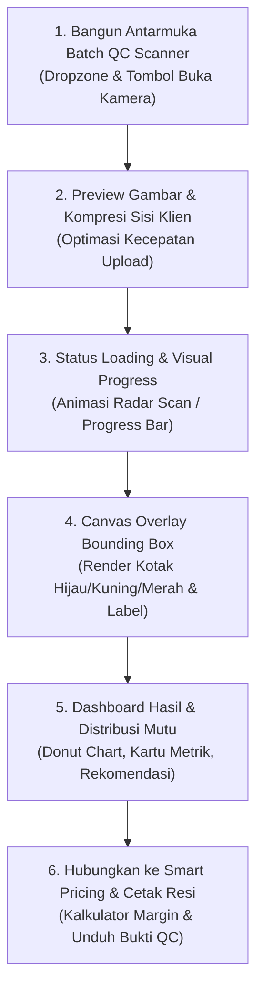
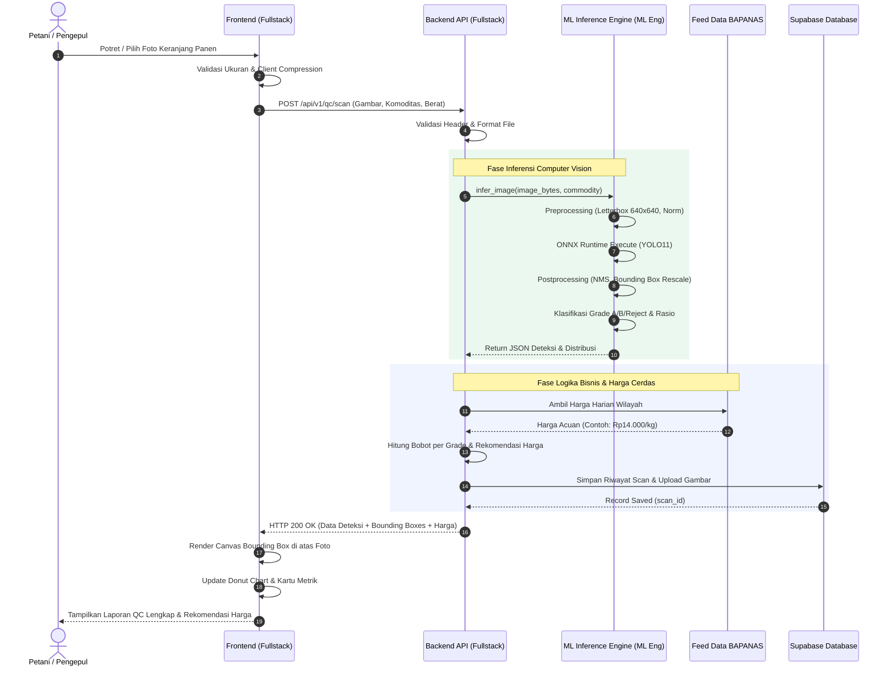

# Alur Kerja Pengembangan Fitur Scanning & Integrasi Model AI

> **Proyek:** Agri-Sort AI (STEAMPreneur SMK Tingkat Nasional 2026)  
> **Tujuan:** Panduan terstruktur perancangan fitur *Batch QC Scanner* dan integrasi model deteksi kualitas *Computer Vision* (YOLO11 ONNX) ke dalam Web Application.  
> **Pembagian Peran:**  
> - **Machine Learning (ML) Engineer:** Integrasi model AI, pipeline inferensi, preprocessing/postprocessing, dan pembungkusan microservice.  
> - **Fullstack Engineer:** Pengembangan antarmuka pengguna (Frontend), API gateway, logika bisnis, dan persistensi database (Backend).

---

## 1. Ikhtisar Arsitektur & Pembagian Tanggung Jawab

Fitur *Scanning* adalah inti operasional Agri-Sort AI yang memungkinkan petani dan pengepul memotret keranjang panen (cabai/tomat), mendeteksi objek secara otomatis, mengklasifikasikan mutu ke dalam **Grade A**, **Grade B**, dan **Reject**, serta mengkalkulasi rekomendasi harga berdasarkan acuan BAPANAS.

Untuk mencapai target latensi **$< 500\text{ ms}$** dan akurasi $\ge 85\%$, pengembangan dipisahkan secara tegas melalui pendekatan *Contract-First*:

```
+-----------------------------------------------------------------------------------+
|                            FULLSTACK ENGINEER (FRONTEND)                          |
|  - Batch QC Scanner UI (Upload Drag-Drop / Kamera Gawai)                          |
|  - Client-Side Pre-validation & Image Optimization                                |
|  - Canvas Bounding Box Overlay (Visualisasi Kotak Deteksi & Label)                 |
|  - QC Summary Cards & Donut Chart Distribusi Mutu                                 |
+-----------------------------------------+-----------------------------------------+
                                          | HTTP POST (multipart/form-data)
                                          v
+-----------------------------------------------------------------------------------+
|                            FULLSTACK ENGINEER (BACKEND)                           |
|  - API Gateway / Router: POST /api/v1/qc/scan                                     |
|  - Payload Validation & Sanitization                                              |
|  - Orchestrator: Panggil ML Inference Engine                                      |
|  - Business Logic: Hitung Estimasi Bobot Fisik (Kg) & Rekomendasi Harga BAPANAS   |
|  - Database Layer: Simpan Log Scan & Metadata ke Supabase                         |
+-----------------------------------------+-----------------------------------------+
                                          | Tensor / Image Bytes
                                          v
+-----------------------------------------------------------------------------------+
|                               ML ENGINEER (AI PIPELINE)                           |
|  - Model Management: Ultralytics YOLO11 ONNX (model-export/weights/best.onnx)     |
|  - Preprocessing: Resize 640x640, Letterbox, Color Space, Normalisasi Float32     |
|  - ONNX Runtime Engine: Session Caching & CPU/GPU Execution Optimization          |
|  - Postprocessing: Transpose, NMS (IoU Thresholding), Rescale Bounding Boxes      |
|  - Grading Rules: Klasifikasi & Agregasi Persentase Mutu (Grade A, B, Reject)     |
+-----------------------------------------------------------------------------------+
```

---

## 2. Kontrak Antarmuka Komunikasi (API Data Contract)

Sebelum pengkodean dimulai, kedua peran menyepakati skema pertukaran data berikut:

### Endpoint: `POST /api/v1/qc/scan`
- **Content-Type:** `multipart/form-data`
- **Request Parameters:**
  - `image`: File binary gambar (Format: `.jpg`, `.jpeg`, `.png`, max: 10 MB)
  - `commodity`: String (`"cabai_merah"`, `"cabai_rawit"`, `"tomat"`)
  - `total_weight_kg`: Float (Estimasi berat keranjang panen, misal: `50.0`)
  - `confidence_threshold`: Float (Opsional, default: `0.35`)

### Response Format (200 OK):
```json
{
  "status": "success",
  "data": {
    "metadata": {
      "scan_id": "scan_20261104_001",
      "commodity": "tomat",
      "timestamp": "2026-11-04T10:45:00Z",
      "total_weight_kg": 50.0,
      "inference_time_ms": 320
    },
    "detections": [
      {
        "id": 1,
        "class_id": 0,
        "class_name": "fresh-tomato",
        "grade": "GRADE_A",
        "confidence": 0.92,
        "box": {
          "x1": 120,
          "y1": 85,
          "x2": 240,
          "y2": 210
        }
      },
      {
        "id": 2,
        "class_id": 1,
        "class_name": "rotten-tomato",
        "grade": "REJECT",
        "confidence": 0.88,
        "box": {
          "x1": 310,
          "y1": 140,
          "x2": 430,
          "y2": 265
        }
      }
    ],
    "summary": {
      "total_count": 25,
      "counts": {
        "grade_a": 18,
        "grade_b": 5,
        "reject": 2
      },
      "percentages": {
        "grade_a": 72.0,
        "grade_b": 20.0,
        "reject": 8.0
      },
      "estimated_weights_kg": {
        "grade_a": 36.0,
        "grade_b": 10.0,
        "reject": 4.0
      }
    },
    "smart_pricing": {
      "reference_price_per_kg": 14000,
      "reference_source": "BAPANAS - Sumatera Barat",
      "recommended_price_per_kg": 13200,
      "projected_revenue": 660000,
      "action_recommendation": "Mutu Prima: Dominan Grade A (72%). Pisahkan 4 kg reject untuk menjaga kesegaran saat pengiriman."
    }
  }
}
```

---

## 3. Alur Kerja Rinci: Machine Learning (ML) Engineer

ML Engineer bertanggung jawab mengubah model latih menjadi mesin inferensi yang handal, cepat, dan siap dikonsumsi backend.



### Rincian Tugas ML Engineer:

1. **Validasi & Inventarisasi Model AI:**
   - Memastikan berkas biner `model-export/weights/best.onnx` (10,66 MB) dan konfigurasinya (`model-export/config/args.yaml`, `data.yaml`) utuh dan dapat dibaca.
   - Mengonfirmasi dimensi input model ($640 \times 640$ piksel, float32) dan pemetaan kelas awal (`fresh-tomato`, `rotten-tomato`).

2. **Pengembangan Pipeline Preprocessing:**
   - Membuat fungsi transformasi citra tanpa merusak rasio aspek (*Aspect Ratio Preserved Letterbox*):
     - Membaca buffer citra dari memori (*in-memory bytes*).
     - Resize dengan padding abu-abu (*letterboxing*) ke ukuran $640 \times 640$.
     - Konversi kanal warna dari BGR ke RGB.
     - Transpose dimensi dari `(H, W, C)` ke format tensor ONNX `(1, 3, 640, 640)`.
     - Normalisasi nilai piksel dari rentang $[0, 255]$ ke $[0.0, 1.0]$.

3. **Inisialisasi & Optimasi ONNX Runtime:**
   - Menggunakan `onnxruntime` dengan penyedia eksekusi (*Execution Providers*) teroptimasi (CPU execution provider dengan multi-threading aktif).
   - Menerapkan *singleton pattern* untuk `InferenceSession` agar model di-*load* ke memori satu kali saja saat server menyala (*warm start*), menghindari latensi berulang saat *request* masuk.

4. **Pengembangan Pipeline Postprocessing & NMS:**
   - Memproses tensor output YOLO `[1, 6, 8400]` (format: `x_center`, `y_center`, `width`, `height`, class_prob_1, class_prob_2):
     - Transposisi tensor menjadi `[8400, 6]`.
     - Filter deteksi dengan *confidence score* di bawah batas ambang ($\text{conf} < 0.35$).
     - Menjalankan algoritma **Non-Maximum Suppression (NMS)** dengan ambang IoU $0.45$ untuk menghilangkan kotak deteksi tumpang tindih (*overlapping boxes*).
     - Menghitung balik (*unpad & rescale*) koordinat kotak $(x_1, y_1, x_2, y_2)$ ke dimensi resolusi asli foto keranjang.

5. **Logika Bisnis Mutu (Grading Rules Engine):**
   - Memetakan hasil deteksi ke 3 kelas standar proposal:
     - Deteksi `fresh` dengan confidence tinggi $\rightarrow$ **Grade A**.
     - Deteksi dengan sedikit defek / batas ambang moderat $\rightarrow$ **Grade B**.
     - Deteksi `rotten` / tanda infeksi patek $\rightarrow$ **Reject (Tolak)**.
   - Menghitung agregat persentase:
     $$\% \text{Grade}_k = \frac{\text{Jumlah Objek Grade}_k}{\text{Total Objek Terdeteksi}} \times 100\%$$

6. **Pengemasan Service & Dokumentasi Inferensi:**
   - Menyediakan modul Python bersih (misal: `ml_engine/inferencer.py`) atau *microservice endpoint* mandiri (`POST /predict`) yang mengembalikan format JSON terstruktur.
   - Menyediakan unit test mandiri untuk menguji gambar sampel uji (`test_inference.py`).

---

## 4. Alur Kerja Rinci: Fullstack Engineer (Backend)

Fullstack Engineer bertanggung jawab mengelola alur data, validasi, integrasi harga BAPANAS, dan persistensi database.



### Rincian Tugas Backend:

1. **Pembuatan Endpoint & Gateway API:**
   - Membuat *route handler* `POST /api/v1/qc/scan` menggunakan FastAPI / Express / Next.js API Routes.
   - Mengelola *multipart/form-data parsing* untuk menerima stream file foto secara asinkron tanpa *blocking event loop*.

2. **Validasi & Proteksi Payload:**
   - Validasi tipe berkas (hanya memperbolehkan `image/jpeg`, `image/png`, `image/webp`).
   - Batasan ukuran berkas (maksimal 10 MB per foto).
   - Validasi data numerik: `total_weight_kg` harus bernilai positif ($> 0$).

3. **Integrasi ke ML Engine:**
   - Menghubungkan fungsi *handler* ke modul inferensi ML Engineer.
   - Mengirimkan raw image buffer ke *inferencer* dan menerima hasil deteksi serta ringkasan kelas secara real-time.

4. **Integrasi Data BAPANAS & Formula Finansial (STEAM Math):**
   - Mengambil data harga acuan wilayah terkini dari feed/database BAPANAS (misal: Cabai Merah Rp45.000/kg, Tomat Rp14.000/kg).
   - Menjalankan rumus pembobotan harga wajar:
     $$\text{Harga Rekomendasi} = \left( \%A \times \text{Harga Acuan} \right) + \left( \%B \times (\text{Harga Acuan} \times 0.75) \right) + \left( \%Reject \times 0 \right)$$
   - Menghitung proyeksi pendapatan:
     $$\text{Total Pendapatan} = \text{Total Berat Panen (kg)} \times \text{Harga Rekomendasi}$$

5. **Persistensi Data ke Supabase Cloud BaaS:**
   - Mengunggah foto hasil pemindaian ke Supabase Storage Bucket (`harvest-scans/`).
   - Menyimpan *record* ke tabel PostgreSQL `qc_scans`:
     - `id`, `user_id`, `commodity`, `total_weight_kg`, `counts_json`, `percentages_json`, `recommended_price`, `bapanas_price`, `image_url`, `created_at`.

6. **Error Handling & Resiliensi:**
   - Penanganan kondisi tak terduga (misal gambar blur/kosong di mana nol objek terdeteksi) dengan memberikan pesan edukatif: `"Objek tidak terdeteksi. Pastikan pencahayaan terang dan foto diambil tegak lurus dari atas keranjang"`.

---

## 5. Alur Kerja Rinci: Fullstack Engineer (Frontend)

Fullstack Engineer bertanggung jawab atas kemudahan penggunaan di lapangan (*Human-Centered Design*) sesuai prinsip pilar *Arts*.



### Rincian Tugas Frontend:

1. **Komponen Pengambilan Gambar (*Batch QC Scanner*):**
   - Merancang antarmuka bersih dengan tema warna *earthy natural green* (`#036E45`).
   - Menyediakan 2 metode input:
     - **Mode Unggah:** Drag-and-drop file gambar untuk komputer/laptop.
     - **Mode Kamera:** Akses langsung ke kamera perangkat gawai (*HTML5 MediaDevices / Camera Capture*) dengan panduan bingkai bidik (*viewfinder overlay*) agar keranjang panen berada di tengah.

2. **Optimasi Sisi Klien (Client-Side Compression):**
   - Melakukan *client-side image downscaling* jika resolusi kamera terlalu tinggi ($> 1920\text{px}$) sebelum dikirim ke API, menghemat bandwidth petani di daerah dengan sinyal seluler terbatas.

3. **Indikator Proses & Animasi Scanning:**
   - Memberikan animasi pemindaian interaktif (*laser scanner animation*) saat menunggu respon API backend ($< 500\text{ ms}$) agar pengguna mendapatkan umpan balik visual yang responsif.

4. **Komponen Visualisasi Bounding Box (HTML5 Canvas Overlay):**
   - Merender kotak deteksi presisi di atas gambar foto keranjang panen:
     - 🟢 **Hijau (#047857):** Grade A (Segar / Kualitas Terbaik)
     - 🟡 **Kuning/Oranye (#B45309):** Grade B (Cacat Ringan / Layak)
     - 🔴 **Merah (#B91C1C):** Reject (Busuk / Cacat Berat)
   - Menampilkan label teks: Nama Kelas & Nilai Keyakinan (*Confidence Score*, misal `92%`).
   - Fitur *Toggle*: Pengguna dapat menyalakan/mematikan tampilan kotak deteksi untuk melihat foto asli.

5. **Tampilan Laporan QC Digital (*Digital QC Report*):**
   - Menampilkan diagram lingkaran (*Donut Chart*) persentase Grade A, Grade B, Reject.
   - Kartu metrik:
     - Total butir terdeteksi.
     - Estimasi konversi kilogram per kelas.
     - Status rekomendasi tindakan pasca panen.

6. **Integrasi ke Dashboard Harga Cerdas & Aksi Lanjutan:**
   - Menampilkan perbandingan harga pasar BAPANAS vs harga rekomendasi Agri-Sort AI.
   - Slider interaktif kalkulator margin keuntungan petani/pengepul.
   - Tombol **"Cetak / Unduh Resi QC"** (PDF/gambar) dan tombol **"Simpan Riwayat"**.

---

## 6. Diagram Sekuens Integrasi Antar-Peran

Diagram berikut mengilustrasikan urutan pesan dan interaksi antar-komponen dalam satu siklus pemindaian lengkap:



---

## 7. Timeline & Rencana Kolaborasi Mingguan (Sprint Plan)

Pengembangan fitur ini dirancang selesai dalam siklus **2 minggu (14 hari kerja)**:

| Hari | Target ML Engineer | Target Fullstack Engineer | Titik Temu Integrasi |
|:---:|---|---|---|
| **1 - 2** | Pengujian validasi `best.onnx`, benchmarking offline, penyusunan fungsi preprocessing letterbox. | Setup rute backend `/api/v1/qc/scan`, pembuatan mock response JSON sesuai kontrak. | Finalisasi skema JSON & kontrak parameter. |
| **3 - 5** | Implementasi NMS, rescaling koordinat bounding box, dan logika penentuan Grade A/B/Reject. | Pembuatan komponen UI *Batch QC Scanner* (Dropzone & integrasi kamera web/mobile). | Tes pengiriman file gambar dari UI ke Backend Mock. |
| **6 - 8** | Pembungkusan inference function ke dalam modul callable / microservice terisolasi. | Pembuatan komponen Canvas Bounding Box overlay dan Donut Chart hasil di Frontend. | Integrasi pertama: Hubungkan Backend ke ML Engine nyata. |
| **9 - 10** | Optimasi performa memori, caching session, evaluasi latensi (<500ms). | Integrasi rumus Smart Pricing BAPANAS dan penyimpanan riwayat ke Supabase. | Verifikasi end-to-end: Gambar diunggah $\rightarrow$ kotak terlukis di canvas. |
| **11 - 12** | Validasi akurasi deteksi terhadap 50 foto uji lapangan acak. | Penyempurnaan responsivitas mobile, error handling gambar gelap/rusak, ekspor PDF. | Uji skenario edge-case bersama (foto miring, blur, objek kosong). |
| **13 - 14** | Dokumentasi teknis inferensi & panduan deployment CPU droplet. | Pengujian fungsionalitas menyeluruh (*Black-box testing*), *styling polish*. | **Demo Fitur Scanning Siap Lomba**. |

---

## 8. Kriteria Selesai & Kendali Kualitas (Definition of Done)

Fitur scanning dan integrasi model dinyatakan tuntas dan siap dipresentasikan jika memenuhi seluruh checklist berikut:

- [ ] **Kinerja AI:** Waktu inferensi model pada CPU server rata-rata $\le 450\text{ ms}$ per foto.
- [ ] **Ketepatan Deteksi:** Nilai presisi dan recall deteksi tomat/cabai terverifikasi $\ge 85\%$ pada data uji.
- [ ] **Canvas Rendering:** Kotak pembatas (*bounding box*) terpasang presisi tepat pada posisi buah di foto tanpa pergeseran (*offset*) skala.
- [ ] **Konsistensi Matematika:** Persentase Grade A + Grade B + Reject selalu tepat berjumlah $100.0\%$, dan total konversi berat sama dengan berat input awal.
- [ ] **Resiliensi Jaringan:** Frontend menampilkan pesan kesalahan yang ramah (*graceful notification*) jika koneksi terputus atau format file tidak didukung.
- [ ] **Mobile-Friendly:** Fitur kamera dan visualisasi hasil dapat dioperasikan secara lancar melalui layar smartphone.
- [ ] **Penyimpanan Terdata:** Setiap pemindaian yang sukses tercatat di tabel Supabase dan gambar tersimpan di storage cloud.
