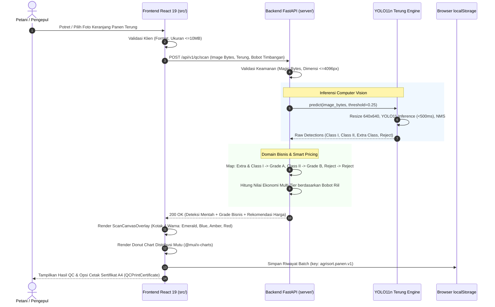

# Alur Kerja Pengembangan Fitur Scanning & Integrasi Model AI

> **Proyek:** Agri-Sort AI — STEAMPreneur SMK Tingkat Nasional 2026  
> **Tujuan:** Panduan alur kerja (*end-to-end workflow*) untuk fitur *Batch QC Scanner*, integrasi model YOLO11 Terung 4-kelas, visualisasi kanvas interaktif, dan pelaporan mutu digital.  
> **Model Aktif:** YOLO11n Terung (`models-20261107T170211Z-1-001/models/terung/`) dengan 4 kelas mutu komersial: `Class I`, `Class II`, `Extra Class`, `Reject`.  
> **Tanggal Pembaruan:** 8 November 2026  

---

## 1. Ikhtisar Arsitektur & Aliran Tanggung Jawab

Fitur *Scanning* adalah inti operasional Agri-Sort AI yang memungkinkan petani dan pengepul memotret keranjang panen komoditas (fokus utama: Terung), mendeteksi objek buah secara visual, mengekstrak sebaran kelas mutu asli, memetakan ke grade komersial (Grade A, Grade B, Reject), serta menghitung estimasi nilai ekonomi berdasarkan acuan harga pasar lokal.

```
+-----------------------------------------------------------------------------------+
|                            FULLSTACK DEVELOPER (FRONTEND)                         |
|  - Batch QC Scanner UI (Kamera HP Langsung / Upload Berkas di HarvestForm)        |
|  - Client-Side Pre-validation & Image Optimization (JPEG/PNG/WebP, max 10MB)      |
|  - ScanCanvasOverlay (Kanvas Kotak Deteksi 4-Warna: Emerald, Sky Blue, Amber, Red)|
|  - QCResults Dashboard & Donut Chart Distribusi Mutu (@mui/x-charts)              |
|  - QCPrintCertificate (Pratinjau & Cetak Sertifikat Digital Mutu Format A4)       |
+-----------------------------------------+-----------------------------------------+
                                          | HTTP POST /api/v1/qc/scan
                                          | Reverse Proxy via Vite /api (15s timeout)
                                          v
+-----------------------------------------------------------------------------------+
|                            FULLSTACK DEVELOPER (BACKEND)                          |
|  - API Gateway / Router: POST /api/v1/qc/scan (server/routers/qc.py)              |
|  - Validasi Magic Bytes Citra, Ukuran (<=10MB), Dimensi (<=4096px)                |
|  - Commodity Dispatcher (Terung 4-Kelas, Tomat 2-Kelas, Cabai Non-AI Manual)      |
|  - Grading Rule Engine:                                                           |
|      Extra Class & Class I -> Grade A | Class II -> Grade B | Reject -> Reject    |
|  - Smart Pricing Multi-Tier: Hitung Nilai Ekonomi dari Bobot Riil Input Timbangan|
+-----------------------------------------+-----------------------------------------+
                                          | Raw Image Bytes
                                          v
+-----------------------------------------------------------------------------------+
|                            MACHINE LEARNING (ML) ENGINEER                         |
|  - Model Management: Ultralytics YOLO11n Terung (best.pt [5.49MB], best.onnx)     |
|  - Preprocessing: Resize 640x640, Normalisasi Tensor FP32 [0.0, 1.0]              |
|  - Inference Execution: In-process Python Ultralytics / ONNX Runtime (<500ms CPU) |
|  - Postprocessing: NMS IoU 0.45, Bounding Box Coordinate Rescaling                |
|  - Raw Detection Contract: Kelas Asli ('Class I', 'Class II', 'Extra Class',      |
|    'Reject') tanpa beban logika harga/grade fiktif                                |
+-----------------------------------------------------------------------------------+
```

---

## 2. Kontrak Data Komunikasi (API Contract)

### Endpoint: `POST /api/v1/qc/scan`
- **Request Parameters (multipart/form-data):**
  - `image`: File binary gambar
  - `commodity`: String (`"Terung"`, `"Tomat"`, `"Cabai Rawit Hijau"`)
  - `weight_kg`: Float (Estimasi bobot fisik riil dari timbangan)
  - `confidence_threshold`: Float (Default: `0.25` untuk Terung, `0.35` untuk Tomat)
  - `mode`: String (`"production"` atau `"mock"`)

### Response Format Terung 4-Kelas (200 OK):
```json
{
  "status": "success",
  "data": {
    "scan_id": "scan_20261108_8f1a2c",
    "timestamp": "2026-11-08T00:15:00Z",
    "is_simulated": false,
    "commodity": "Terung",
    "ai_supported": true,
    "actual_weight_kg": 45.0,
    "grading_system": "4-class (Extra Class, Class I, Class II, Reject)",
    "inference_result": {
      "model_version": "1.0.0",
      "inference_time_ms": 284.5,
      "image_dimensions": { "width": 1280, "height": 720 },
      "detections": [
        {
          "id": 1,
          "class_id": 2,
          "class_name": "Extra Class",
          "confidence": 0.912,
          "box": { "x1": 110.0, "y1": 95.0, "x2": 260.5, "y2": 420.0 }
        },
        {
          "id": 2,
          "class_id": 0,
          "class_name": "Class I",
          "confidence": 0.885,
          "box": { "x1": 310.0, "y1": 105.0, "x2": 480.0, "y2": 435.5 }
        },
        {
          "id": 3,
          "class_id": 1,
          "class_name": "Class II",
          "confidence": 0.742,
          "box": { "x1": 530.0, "y1": 130.0, "x2": 690.0, "y2": 450.0 }
        },
        {
          "id": 4,
          "class_id": 3,
          "class_name": "Reject",
          "confidence": 0.814,
          "box": { "x1": 740.0, "y1": 150.0, "x2": 910.0, "y2": 470.0 }
        }
      ],
      "object_counts": {
        "total": 12,
        "extra_class": 5,
        "class_1": 4,
        "class_2": 2,
        "reject": 1
      },
      "condition_ratios": {
        "extra_class_percent": 41.67,
        "class_1_percent": 33.33,
        "class_2_percent": 16.67,
        "reject_percent": 8.33
      }
    },
    "business_grading": {
      "grade_breakdown": {
        "grade_a_percent": 75.0,
        "grade_b_percent": 16.67,
        "reject_percent": 8.33
      },
      "estimated_weights_kg": {
        "grade_a_kg": 33.75,
        "grade_b_kg": 7.5,
        "reject_kg": 3.75
      }
    },
    "smart_pricing": {
      "commodity": "Terung",
      "reference_price_per_kg": 10000,
      "recommended_price_per_kg": 9500,
      "estimated_economic_value": 427500,
      "action_recommendation": "Mutu Unggul: 75% Grade A (Extra Class + Class I). Pisahkan 1 butir reject sebelum pengiriman."
    }
  }
}
```

---

## 3. Alur Kerja Sekuensial Antar-Komponen



---

## 4. Strategi Routing Multi-Komoditas

```
Permintaan Klien: POST /api/v1/qc/scan
             │
             ▼
     [ Commodity Check ]
             │
     ┌───────┼────────────────────────┐
     ▼       ▼                        ▼
 [ Terung ]  [ Tomat ]          [ Cabai Rawit Hijau ]
     │       │                        │
     ▼       ▼                        ▼
YOLO11n     YOLO11n              Non-AI Manual Fallback
(4-Kelas)   (2-Kelas Legacy)     (Input Parameter Petani)
     │       │                        │
     ▼       ▼                        ▼
Grading     Grading              Grading
Commercial  Fresh/Rotten         Berdasarkan Manual Form
Rule        Rule
```

---

## 5. Rencana Pengujian Menyeluruh (Testing & Verification)

- **Frontend Tests (87 tests passing):**  
  `npm test` mencakup `tes/canvasOverlayHelper.test.js`, `tes/qcCertificateHelper.test.js`, `tes/scanService.test.js`, dan validasi panen.
- **Backend Tests (41 tests passing):**  
  `python3 -m unittest discover -s server/tests` mencakup `test_mock_engine.py`, `test_pricing.py`, `test_security.py`, dan `test_storage.py`.
- **Integrasi E2E:**  
  Pengujian pemindaian foto terung keranjang panen nyata melalui reverse proxy Vite dengan waktu respon $< 500\text{ ms}$.
